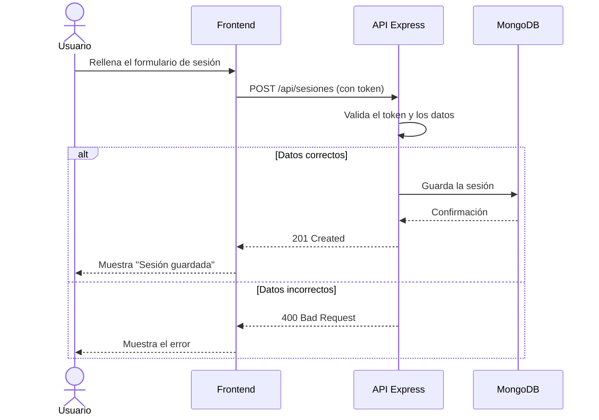

# GymLog


**GymLog** es una aplicación web para llevar el registro de tus entrenamientos de gimnasio sin depender de libretas ni de hojas de cálculo. Está pensada para gente que entrena de forma regular y quiere ver, *de un vistazo*, cómo evoluciona.

**Objetivo principal:** que registrar una sesión lleve menos de un minuto.

**Problema que resuelve:** mucha gente deja de apuntar sus series y pesos porque las apps actuales son lentas o están llenas de funciones que no usa. GymLog se centra solo en lo básico: ejercicios, series, repeticiones y progreso.

---

## Índice de contenidos

1. [Presentación](#gymlog)
2. [Características principales](#características-principales)
3. [Instalación y configuración](#instalación-y-configuración)
4. [Tecnologías utilizadas](#tecnologías-utilizadas)
5. [Arquitectura y funcionamiento](#arquitectura-y-funcionamiento)
6. [Ejemplos de uso](#ejemplos-de-uso)
7. [Información adicional](#información-adicional)
8. [Contacto](#contacto)

---

## Características principales

- Registro de entrenamientos
  - Ejercicio, series, repeticiones y peso
  - Notas opcionales por sesión
- Historial de sesiones con filtros por fecha
- Gráficas de progreso por ejercicio
- Rutinas predefinidas y personalizadas
  1. Rutina de fuerza
  2. Rutina de cardio
  3. Rutina propia
- Exportación de datos a CSV

Estado actual del desarrollo:

- [x] Registro de entrenamientos
- [x] Historial de sesiones
- [x] Autenticación de usuarios
- [ ] Gráficas de progreso
- [ ] Exportación a CSV
- [ ] Modo oscuro

---

## Instalación y configuración

1. Clona el repositorio:
   ```bash
   git clone https://github.com/usuario/gymlog.git
   cd gymlog
   ```
2. Instala las dependencias con `npm install`.
3. Copia el archivo de variables de entorno y edítalo:
   ```bash
   cp .env.example .env
   ```
4. Define al menos `PORT` y `MONGO_URI` en el archivo `.env`.
5. Arranca el servidor en modo desarrollo:
   ```bash
   npm run dev
   ```
6. Abre `http://localhost:3000` en el navegador.

---

## Tecnologías utilizadas

| Tecnología | Versión | Descripción | Uso en el proyecto |
|:-----------|:-------:|:------------|-------------------:|
| **Node.js** | `20.x` | Entorno de ejecución de JavaScript | Servidor del backend |
| **Express** | `4.18` | *Framework* web minimalista | Rutas de la API REST |
| **MongoDB** | `7.0` | Base de datos NoSQL | Guarda usuarios y sesiones |
| **Chart.js** | `4.4` | Librería de gráficos | Gráficas de progreso |
| **Mermaid** | `10.x` | Diagramas en Markdown | Documentación |

---

## Arquitectura y funcionamiento

El navegador envía las peticiones a una API REST hecha con Express, que valida al usuario y guarda los datos en MongoDB. El siguiente diagrama muestra qué pasa cuando alguien registra un entrenamiento:



---

## Ejemplos de uso

### Ejemplo 1: registrar una sesión

```javascript
const respuesta = await fetch("http://localhost:3000/api/sesiones", {
  method: "POST",
  headers: {
    "Content-Type": "application/json",
    Authorization: `Bearer ${token}`,
  },
  body: JSON.stringify({
    ejercicio: "Press banca",
    series: 4,
    repeticiones: 8,
    peso: 60,
  }),
});

console.log(await respuesta.json());
```

### Ejemplo 2: consultar el historial desde la terminal

```bash
curl -H "Authorization: Bearer $TOKEN" \
  "http://localhost:3000/api/sesiones?desde=2026-01-01"
```

Más información en la [documentación de Express](https://expressjs.com/es/) y en la [referencia de `fetch` en MDN](https://developer.mozilla.org/es/docs/Web/API/Fetch_API).

---

## Información adicional

> **Nota importante:** GymLog es un proyecto ficticio creado con fines educativos. No sustituye el consejo de un entrenador profesional.

<details>
<summary>Ver hoja de ruta (roadmap)</summary>

- **Versión 1.1:** gráficas de progreso y exportación a CSV.
- **Versión 1.2:** modo oscuro.
- **Versión 2.0:** aplicación móvil.

</details>

<!-- TODO: añadir capturas de pantalla reales cuando esté el frontend terminado -->

Caracteres especiales escapados en Markdown: \*no es cursiva\*, \# no es un encabezado, \[no es un enlace\] y 1\. no es una lista.

---

## Contacto

Proyecto desarrollado por **Nombre Apellido** :muscle:

- Correo: [nombre.apellido@ejemplo.com](mailto:rodrigo.gutierrez@alumnos.uneatlantico.es)
- GitHub: [github.com/usuario](https://github.com/rodrigorgo1909-web/26-27-igps)
- LinkedIn: [linkedin.com/in/usuario](https://linkedin.com/in/usuario)
