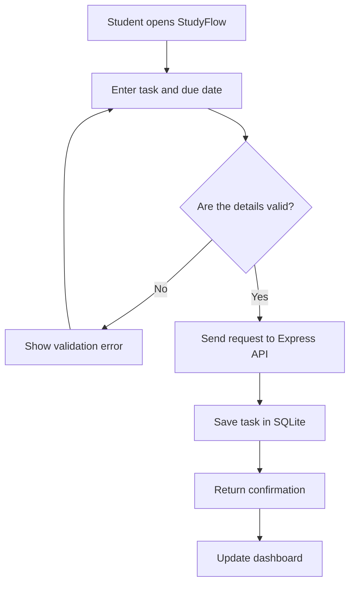

# 📚 StudyFlow — Student Study Planner


*Illustration: Microsoft Fluent Emoji (MIT-licensed).* 

**StudyFlow** is a *fictional web application concept* that helps students organize courses, assignments, exams, and study sessions in one place. Its goal is to reduce missed deadlines and make academic planning easier.

> **Project scope:** This repository contains documentation for a proposed application, not working software. The setup and API examples below illustrate the intended implementation.

## Table of Contents

- [Main Features](#main-features)
- [Installation and Configuration](#installation-and-configuration)
- [Technologies Used](#technologies-used)
- [How It Works](#how-it-works)
- [Usage Examples](#usage-examples)
- [Additional Information](#additional-information)
- [Contact](#contact)

---

## Main Features

StudyFlow has six proposed features:

1. **Course management** — Organize courses by semester.
2. **Assignment tracking** — Create tasks with deadlines and priorities.
   - Priority: *low*, *medium*, or *high*.
   - Status: `pending`, `in_progress`, or `completed`.
3. **Study calendar** — Display exams and deadlines.
4. **Focus timer** — Schedule Pomodoro-style study sessions.
5. **Progress dashboard** — Track completed tasks and study hours.
6. **Deadline reminders** — Receive upcoming deadline alerts.

### Development Checklist

This checklist tracks project **planning**, not implemented functionality:

- [x] Define the idea and target users
- [x] Draft feature requirements
- [x] Design the task creation workflow
- [ ] Build the frontend
- [ ] Implement the API and database
- [ ] Test notifications

## Installation and Configuration

These are **proposed installation steps** for a future implementation. They do not currently run because the app and repository do not exist yet.

### Prerequisites

- Node.js `24.x`
- npm
- Git

### Proposed Setup

1. Clone the future application repository:

   ```bash
   git clone https://github.com/example/studyflow-app.git
   cd studyflow-app
   ```

2. Install dependencies:

   ```bash
   npm install
   ```

3. Create a `.env` file:

   ```dotenv
   PORT=3000
   DATABASE_PATH=./data/studyflow.db
   REMINDERS_ENABLED=true
   ```

4. Start the future development server:

   ```bash
   npm run dev
   ```

5. Open `http://localhost:3000` in a browser.

The `PORT` variable defines the server port; `DATABASE_PATH` would specify where tasks are stored.

## Technologies Used

The following stack is **planned**:

| Technology | Version | Description | Project Usage |
| :--- | :---: | :--- | ---: |
| **HTML** | `HTML5` | Markup language | Page structure |
| **CSS** | `CSS3` | Stylesheet language | Responsive layout |
| **JavaScript** | `ES2025` | Programming language | Interactions |
| **Node.js** | `24.x` | JavaScript runtime | Backend execution |
| **Express** | `5.x` | *Web framework* | REST API |
| **SQLite** | `3.x` | Relational database | Store assignments |

## How It Works

Students create tasks through the interface. The proposed Express API validates each task and saves it to SQLite before returning a confirmation to the dashboard.

### Task Creation Flowchart



## Usage Examples

These examples show the **intended** API behavior; the endpoints have not been implemented.

### Example 1: Create an Assignment

```bash
curl -X POST http://localhost:3000/api/tasks \
  -H "Content-Type: application/json" \
  -d '{"title":"Math assignment","course":"Mathematics","dueDate":"2026-11-20","priority":"high"}'
```

Example JSON response:

```json
{
  "id": 1,
  "title": "Math assignment",
  "course": "Mathematics",
  "dueDate": "2026-11-20",
  "priority": "high",
  "status": "pending"
}
```

### Example 2: View Pending Tasks

```bash
curl "http://localhost:3000/api/tasks?status=pending"
```

Example JSON response:

```json
[
  {
    "id": 1,
    "title": "Math assignment",
    "status": "pending"
  }
]
```

### External Resources

- [GitHub Flavored Markdown](https://github.github.com/gfm/)
- [Mermaid Documentation](https://mermaid.js.org/intro/)
- [Node.js Documentation](https://nodejs.org/en/learn)
- [Express Documentation](https://expressjs.com/)

## Additional Information

> ⚠️ **Important:** Never publish real student records, passwords, API keys, or a real `.env` file in a public repository.

<details>
<summary><strong>Future improvements (click to expand)</strong></summary>

- Calendar synchronization
- Collaborative study groups
- Multilingual interface
- Export tasks as CSV

</details>

<!-- This HTML comment is intentionally hidden in the rendered Markdown view. -->

### Escaping Special Markdown Characters

The source `\*important\*` displays literal asterisks: \*important\*.

The source `\#` displays a literal heading symbol: \# Not a heading.

---

## Contact

For this fictional concept, email [hello@studyflow.example](mailto:hello@studyflow.example) or visit [GitHub](https://github.com/).

*Made for a Markdown documentation assignment.*
