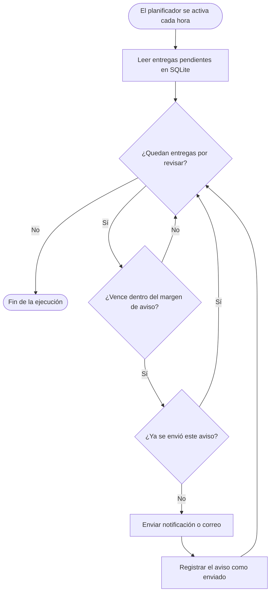

<!-- Proyecto ficticio creado para la Actividad de Evaluación Continua de Markdown (AEC-MD). Este comentario no se muestra al visualizar el documento. -->

# Plazo


**Plazo** es una herramienta de línea de comandos y una API REST para que estudiantes universitarios tengan *todas sus fechas de entrega en un solo sitio*. :calendar:

> **Nota:** Plazo es un proyecto **ficticio**. Los comandos, la API y las versiones de este documento ilustran cómo sería su documentación técnica.

---

## Presentación del proyecto

Plazo guarda en una base de datos local las entregas de cada asignatura, calcula cuánto falta para cada una y avisa con antelación. Se usa desde la terminal con el comando `plazo`, y la misma información está disponible en una API para conectarla con otras aplicaciones.

### Objetivo principal

Conseguir que un estudiante pueda responder en **menos de cinco segundos** a una sola pregunta: *¿qué tengo que entregar primero?*

### Problema que resuelve

Las fechas de entrega suelen estar repartidas entre varias plataformas: el campus virtual, los repositorios de cada asignatura, el correo y los apuntes de clase. Plazo las reúne en una única lista ordenada por urgencia, de modo que ninguna entrega dependa de ~~recordarla de memoria~~ haberla visto a tiempo.

---

## Índice de contenidos

- [Presentación del proyecto](#presentación-del-proyecto)
  - [Objetivo principal](#objetivo-principal)
  - [Problema que resuelve](#problema-que-resuelve)
- [Características principales](#características-principales)
  - [Funcionalidades](#funcionalidades)
  - [Estado de desarrollo](#estado-de-desarrollo)
- [Instalación y configuración](#instalación-y-configuración)
- [Tecnologías utilizadas](#tecnologías-utilizadas)
- [Arquitectura y funcionamiento](#arquitectura-y-funcionamiento)
- [Ejemplos de uso](#ejemplos-de-uso)
  - [Registrar una entrega y consultar lo pendiente](#registrar-una-entrega-y-consultar-lo-pendiente)
  - [Consultar las entregas desde la API](#consultar-las-entregas-desde-la-api)
  - [Recursos relacionados](#recursos-relacionados)
- [Información adicional](#información-adicional)
  - [Sintaxis de los títulos](#sintaxis-de-los-títulos)
  - [Contacto](#contacto)

---

## Características principales

### Funcionalidades

1. **Registro de entregas**
   - Título, asignatura y fecha límite.
   - Enlace opcional al enunciado.
2. **Lista ordenada por urgencia**
   - Muestra primero lo que vence antes.
   - Marca en rojo lo que vence en menos de 48 horas.
3. **Avisos programados**
   - Antelación configurable por asignatura.
   - Envío por notificación de escritorio o por correo.
4. **Importación de calendarios**
   - Lee archivos `.ics` exportados desde el campus virtual.
   - Detecta duplicados antes de guardar.
5. **API REST**
   - Devuelve las entregas en formato JSON.
   - Protegida con un token personal.
6. **Estadísticas por asignatura**
   - Entregas realizadas a tiempo y fuera de plazo.

### Estado de desarrollo

- [x] Registro de entregas
- [x] Lista ordenada por urgencia
- [x] Avisos programados
- [ ] Importación de calendarios
- [ ] API REST con paginación
- [ ] Estadísticas por asignatura

---

## Instalación y configuración

Antes de empezar se necesita tener instalado **Node.js 22** o superior. Se puede comprobar con `node --version`.

1. Clonar el repositorio y entrar en la carpeta del proyecto.
2. Instalar las dependencias con `npm install`.
3. Copiar `.env.example` a `.env`.
4. Definir en `.env` las variables `PLAZO_DB_PATH` y `PLAZO_API_TOKEN`.
5. Crear las tablas de la base de datos con `npm run migrate`.
6. Enlazar el comando `plazo` con `npm link`.

Los mismos pasos, listos para ejecutar:

```bash
git clone https://example.com/plazo.git
cd plazo
npm install
cp .env.example .env
npm run migrate
npm link
```

Ejemplo de archivo `.env`:

```ini
PLAZO_DB_PATH=./datos/plazo.db
PLAZO_API_TOKEN=cambia-este-valor
PLAZO_AVISO_HORAS=48
```

---

## Tecnologías utilizadas

| Tecnología | Versión | Descripción | Uso en el proyecto |
|:-----------|:-------:|:------------|-------------------:|
| **Node.js** | `22 LTS` | Entorno de ejecución de JavaScript | Ejecuta la CLI y la API |
| **TypeScript** | `5.6` | JavaScript con tipos estáticos | *Todo* el código fuente |
| **SQLite** | `3.46` | Base de datos en un único archivo | Guarda entregas y avisos |
| **Fastify** | `5.0` | Framework web para Node.js | Expone la API REST |
| **Commander.js** | `12.1` | Librería para crear comandos de terminal | Define `plazo add` y `plazo list` |

---

## Arquitectura y funcionamiento

Plazo tiene tres piezas que comparten la misma base de datos: la **CLI**, con la que el estudiante gestiona sus entregas; la **API**, para consultarlas desde otras aplicaciones; y un **planificador**, que se ejecuta cada hora y decide qué avisos enviar.

El siguiente diagrama muestra el proceso que sigue el planificador en cada ejecución:



---

## Ejemplos de uso

### Registrar una entrega y consultar lo pendiente

```bash
plazo add "AEC Markdown" --asignatura IGPS --fecha 2026-11-20
plazo list --pendientes
```

Salida esperada:

```text
VENCE EN   ASIGNATURA   ENTREGA
3 días     PRG1         Práctica de bucles
12 días    IGPS         AEC Markdown
```

### Consultar las entregas desde la API

```javascript
const respuesta = await fetch("http://localhost:3000/api/entregas?estado=pendiente", {
  headers: { Authorization: `Bearer ${process.env.PLAZO_API_TOKEN}` },
});

const entregas = await respuesta.json();
console.log(`Tienes ${entregas.length} entregas pendientes`);
```

### Recursos relacionados

- [Documentación de Node.js](https://nodejs.org/docs/latest-v22.x/api/)
- [Documentación de Fastify](https://fastify.dev/docs/latest/)
- [Documentación de SQLite](https://www.sqlite.org/docs.html)
- [Formato iCalendar, RFC 5545](https://datatracker.ietf.org/doc/html/rfc5545)

---

## Información adicional

> :warning: **Advertencia:** el archivo `.env` contiene el token de la API. No debe subirse nunca al repositorio; por eso está incluido en `.gitignore`.

<details>
<summary>Preguntas frecuentes</summary>

**¿Mis datos salen de mi ordenador?**
No. La base de datos es un archivo local y solo se conecta a internet para enviar avisos por correo, si se activan.

**¿Puedo usar Plazo sin la API?**
Sí. La CLI funciona por sí sola y la API solo se inicia con `plazo serve`.

</details>

### Sintaxis de los títulos

Los títulos de las entregas admiten Markdown, así que los caracteres especiales se deben escapar con una barra invertida para que aparezcan tal cual. Por ejemplo, si se escribe `\*\*Práctica 1\*\*` se ve como \*\*Práctica 1\*\*, sin negrita. Del mismo modo, \# no crea un encabezado y \[texto\]\(url\) no crea un enlace.

### Contacto

- **Autor:** Abraham González ([perfil de GitHub](https://github.com/Clizco))
- **Soporte (dirección de ejemplo):** [soporte@example.com](mailto:soporte@example.com)
