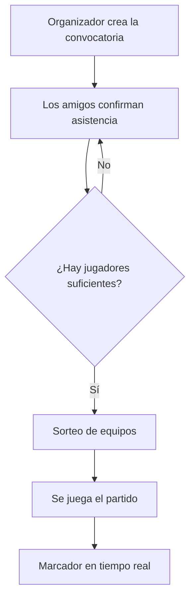

# Fútbol en Marcha ⚽


---

## Presentación del proyecto

**Fútbol en Marcha** es una *app móvil* para organizar partidos de **fútbol 7** o **fútbol sala** entre amigos. Permite crear convocatorias, confirmar asistencia, sortear equipos de forma equilibrada y llevar el marcador en tiempo real.

**Objetivo:** que organizar un partido deje de ser un lío de mensajes en el grupo de WhatsApp, donde nadie sabe quién viene y los equipos salen descompensados.

---

## Índice de contenidos

- [Presentación del proyecto](#presentación-del-proyecto)
- [Índice de contenidos](#índice-de-contenidos)
- [Características principales](#características-principales)
- [Instalación y configuración](#instalación-y-configuración)
- [Tecnologías utilizadas](#tecnologías-utilizadas)
- [Arquitectura y funcionamiento](#arquitectura-y-funcionamiento)
- [Ejemplos de uso](#ejemplos-de-uso)
- [Información adicional](#información-adicional)
- [Contacto](#contacto)

---

## Características principales

1. **Convocatorias**
   - Fecha, hora y lugar del partido.
   - Modalidad: fútbol 7 o fútbol sala.
2. **Confirmación de asistencia**
   - Cada jugador responde `Voy` o `No voy`.
3. **Sorteo de equipos equilibrado**
   - Se reparte a los jugadores según su nivel.
4. **Marcador en tiempo real**
   - Todos ven los goles al momento.
5. **Historial de partidos**
   - Resultados de partidos anteriores.

**Estado de desarrollo:**

- [x] Convocatorias
- [x] Confirmación de asistencia
- [x] Sorteo de equipos
- [ ] Marcador en tiempo real
- [ ] Historial de partidos

---

## Instalación y configuración

1. Clona el repositorio.
2. Instala las dependencias con `npm install`.
3. Arranca la app con `npx expo start`.
4. Escanea el código QR con la app **Expo Go** en tu móvil.

```bash
git clone https://github.com/usuario/futbol-en-marcha.git
cd futbol-en-marcha
npm install
npx expo start
```

---

## Tecnologías utilizadas

| Tecnología | Versión | Descripción | Uso en el proyecto |
| :--- | :---: | :--- | :--- |
| **React Native** | `0.7x` | Framework para apps móviles | Pantallas de la app |
| **TypeScript** | `5.x` | *JavaScript* con tipos | Código de la app |
| **Firebase** | `11.x` | Base de datos en tiempo real | Guardar partidos y **marcador** |
| **Git** | `2.x` | Control de versiones | Guardar el historial del código |

---

## Arquitectura y funcionamiento

La app guarda los datos en Firebase, que los envía a todos los móviles del partido. Así, cuando alguien anota un gol, el resto lo ve al instante.



---

## Ejemplos de uso

### Ejemplo 1: crear una convocatoria

```typescript
const partido = crearConvocatoria({
  modalidad: "futbol7",
  fecha: "2026-11-13 19:30",
  lugar: "Polideportivo",
});
```

### Ejemplo 2: sortear equipos

```typescript
const [equipoA, equipoB] = sortearEquipos(jugadores);
console.log(equipoA, equipoB);
```

Más información en la [documentación de React Native](https://reactnative.dev/docs/getting-started) y en la [documentación de Expo](https://docs.expo.dev/).

---

## Información adicional

> **Recomendación:** confirma tu asistencia al menos 24 horas antes del partido.

<!-- Este comentario no se ve en la vista previa -->

<details>
<summary>¿Cómo funciona el nivel de los jugadores?</summary>

Cada jugador tiene un nivel del 1 al 10. El sorteo usa ese número para que la suma de los dos equipos sea parecida.

</details>

**Caracteres especiales escapados:** \*esto no va en cursiva\* y \# esto no es un título.

---

## Contacto

- 📧 [contacto@futbolenmarcha.example.com](mailto:contacto@futbolenmarcha.example.com)
- 🐙 [GitHub](https://github.com/aimargutierrez)