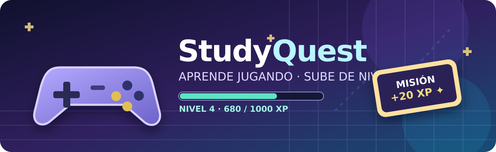
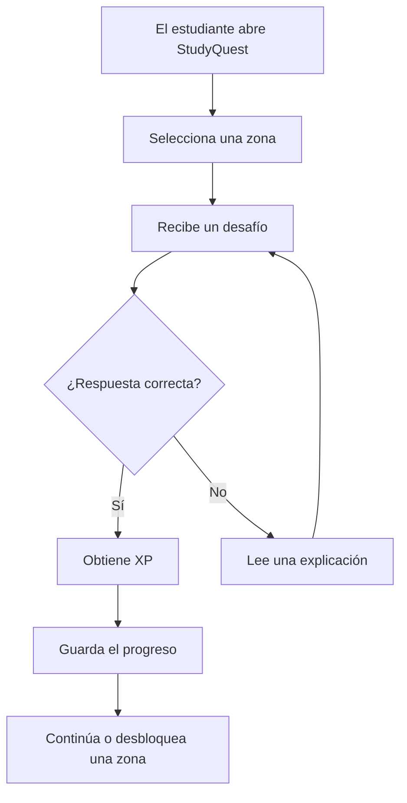

# 🎮 StudyQuest — Aprende jugando




**StudyQuest**, un proyecto de **Alejandro Serna Ruiz**, es una aplicación web educativa ficticia que convierte el estudio en una aventura de estilo *RPG*. El estudiante explora un mapa, supera desafíos y consigue experiencia para desbloquear nuevas zonas.

**Objetivo principal:** ayudar a estudiantes de informática a mantener la motivación y practicar conceptos de programación, bases de datos y redes mediante sesiones cortas e interactivas.

**Problema que resuelve:** estudiar únicamente con apuntes puede resultar repetitivo y dificultar el seguimiento del progreso. StudyQuest propone objetivos visibles, explicaciones inmediatas y recompensas por constancia.

---

## 📚 Índice de contenidos

1. [Presentación del proyecto](#presentación-del-proyecto)
2. [Características principales](#características-principales)
3. [Instalación y configuración](#instalación-y-configuración)
4. [Tecnologías utilizadas](#tecnologías-utilizadas)
5. [Arquitectura y funcionamiento](#arquitectura-y-funcionamiento)
6. [Ejemplos de uso](#ejemplos-de-uso)
7. [Información adicional](#información-adicional)
8. [Contacto y recursos](#contacto-y-recursos)

## Presentación del proyecto

La experiencia de StudyQuest se divide en **zonas temáticas**. Cada zona representa una asignatura y contiene retos adaptados al contenido: preguntas de opción múltiple, pequeños ejercicios de código y problemas de razonamiento.

El progreso se expresa mediante **puntos de experiencia (XP)**, niveles y medallas. La idea no es sustituir a las clases, sino añadir una forma de *repasar practicando*.

**Público objetivo:** estudiantes que están comenzando Ingeniería Informática y quieren organizar sus repasos sin perder de vista sus avances.

## Características principales

- **Mapa interactivo por asignaturas.**
  - Bosque de Programación: variables, funciones y estructuras de control.
  - Ciudad de Bases de Datos: modelos entidad-relación y consultas SQL.
  - Fortaleza de Redes: protocolos, direccionamiento IP y subredes.
- **Desafíos de distintos tipos**, con corrección y explicación de respuestas.
- **Sistema de XP y niveles** que recompensa los intentos y los aciertos.
- **Personajes no jugables (NPC)** que proponen misiones de repaso.
- **Panel de progreso** con porcentaje de retos completados por asignatura.
- **Guardado local** del progreso, pensado para continuar en el mismo navegador.

### Estado de desarrollo previsto

Las casillas marcadas indican funcionalidades diseñadas y las pendientes representan tareas de desarrollo.

- [x] Definir asignaturas y zonas iniciales.
- [x] Diseñar la lógica de preguntas y recompensas.
- [x] Documentar el flujo de una partida.
- [ ] Implementar el mapa interactivo en React.
- [ ] Crear un banco de 100 preguntas revisadas.
- [ ] Añadir estadísticas y pruebas con estudiantes.

## Instalación y configuración

Para preparar el entorno de desarrollo de StudyQuest se propone utilizar React, TypeScript y Vite.

### Requisitos previos

- **Node.js 22** y `npm` instalados.
- Navegador moderno (Chrome, Firefox o Edge).
- Editor de código, por ejemplo Visual Studio Code.

### Pasos

1. Abrir una terminal en la carpeta donde se quiera crear el proyecto.
2. Generar la aplicación base con la plantilla de React y TypeScript de Vite.
3. Entrar en el directorio creado e instalar las dependencias.
4. Iniciar el servidor de desarrollo.
5. Abrir la dirección local indicada en la terminal, normalmente `http://localhost:5173`.

```bash
npm create vite@7.1.0 studyquest -- --template react-ts

cd studyquest
npm install
npm run dev
```

### Configuración prevista

En una implementación posterior, los parámetros de juego se podrían centralizar en un archivo `src/config.ts`:

```typescript
export const CONFIG = {
  xpPorAcierto: 20,
  xpPorIntento: 5,
  retosParaSubirNivel: 10,
  guardadoLocal: true,
} as const;
```

Los valores `xpPorAcierto` y `retosParaSubirNivel` son **ajustables** durante las pruebas de equilibrio del juego.

## Tecnologías utilizadas

| Tecnología | Versión propuesta | Descripción | Uso en el proyecto |
| :--- | :---: | ---: | :--- |
| **React** | `19.2.0` | Biblioteca de interfaces | Componentes del mapa y panel de progreso |
| **TypeScript** | `5.9.3` | JavaScript con tipado estático | Modelos de preguntas y cálculo de XP |
| **Vite** | `7.1.0` | Herramienta de desarrollo web | Servidor local y compilación |
| **Node.js** | `22.x` | Entorno de ejecución de JavaScript | Ejecución de `npm` y herramientas |
| **CSS** | *CSS3* | Hojas de estilo | Diseño *responsive* y aspecto RPG |

## Arquitectura y funcionamiento

La aplicación se plantea como una interfaz web que muestra retos, comprueba respuestas y guarda el avance en el propio navegador mediante `localStorage`.



### Componentes principales

1. **Interfaz:** muestra el mapa, los NPC y los desafíos.
2. **Motor de retos:** selecciona preguntas y valida respuestas.
3. **Gestor de progresión:** calcula XP, niveles y logros.
4. **Almacenamiento local:** conserva el estado de la partida en el navegador.

## Ejemplos de uso

### Ejemplo 1: superar una pregunta de Bases de Datos

El usuario entra en la *Ciudad de Bases de Datos* y recibe una pregunta de opción múltiple. Los retos podrían almacenarse con una estructura JSON como esta:

```json
{
  "id": "bd-001",
  "tema": "SQL",
  "pregunta": "¿Qué sentencia permite consultar filas de una tabla?",
  "opciones": ["SELECT", "DELETE", "DROP", "ALTER"],
  "respuestaCorrecta": "SELECT",
  "xp": 20
}
```

**Resultado esperado:** si marca `SELECT`, gana `20 XP` y recibe una explicación sobre la consulta de datos. Si falla, puede revisar el concepto y volver a intentarlo.

### Ejemplo 2: completar un reto de Programación

En el *Bosque de Programación*, un NPC solicita una función que devuelva `true` cuando un número sea par. Una solución válida en JavaScript sería:

```javascript
function esPar(numero) {
  return numero % 2 === 0;
}

console.log(esPar(8));
console.log(esPar(7));
```

**Resultado esperado:** el sistema compara los resultados con casos de prueba, muestra si se ha superado el reto y actualiza el progreso.

Para estudiar estos conceptos se pueden consultar los recursos oficiales de [JavaScript en MDN](https://developer.mozilla.org/es/docs/Web/JavaScript) y [SQL en PostgreSQL](https://www.postgresql.org/docs/current/tutorial-sql.html).

## Información adicional

> ⚠️ **Recomendación:** las recompensas del juego sirven para reforzar la práctica, pero los contenidos y las soluciones deben ser revisados antes de utilizarlos para preparar exámenes reales.

<details>
<summary>Ver posibles ampliaciones futuras</summary>

Entre las mejoras contempladas se encuentran un calendario de estudio, un modo de repaso contrarreloj y una clasificación privada de resultados. Antes de incorporar cuentas de usuario sería necesario diseñar un sistema seguro para gestionar los datos personales.

</details>

<!-- Documentación técnica de StudyQuest. -->

**Ejemplo de caracteres escapados en Markdown:** \*Este texto no aparece en cursiva\* y \# Esto no se convierte en un encabezado.

---

## Contacto y recursos

- **Autor:** Alejandro Serna Ruiz.
- **Correo ficticio de contacto:** [hola@studyquest.example](mailto:hola@studyquest.example).
- **Documentación técnica:** [React](https://react.dev/learn), [Vite](https://vite.dev/guide/) y [TypeScript](https://www.typescriptlang.org/docs/).
- **Markdown y diagramas:** [GitHub Flavored Markdown](https://github.github.com/gfm/) y [Mermaid](https://mermaid.js.org/intro/).

*StudyQuest: cada pregunta es un paso más hacia el siguiente nivel.* 🚀
