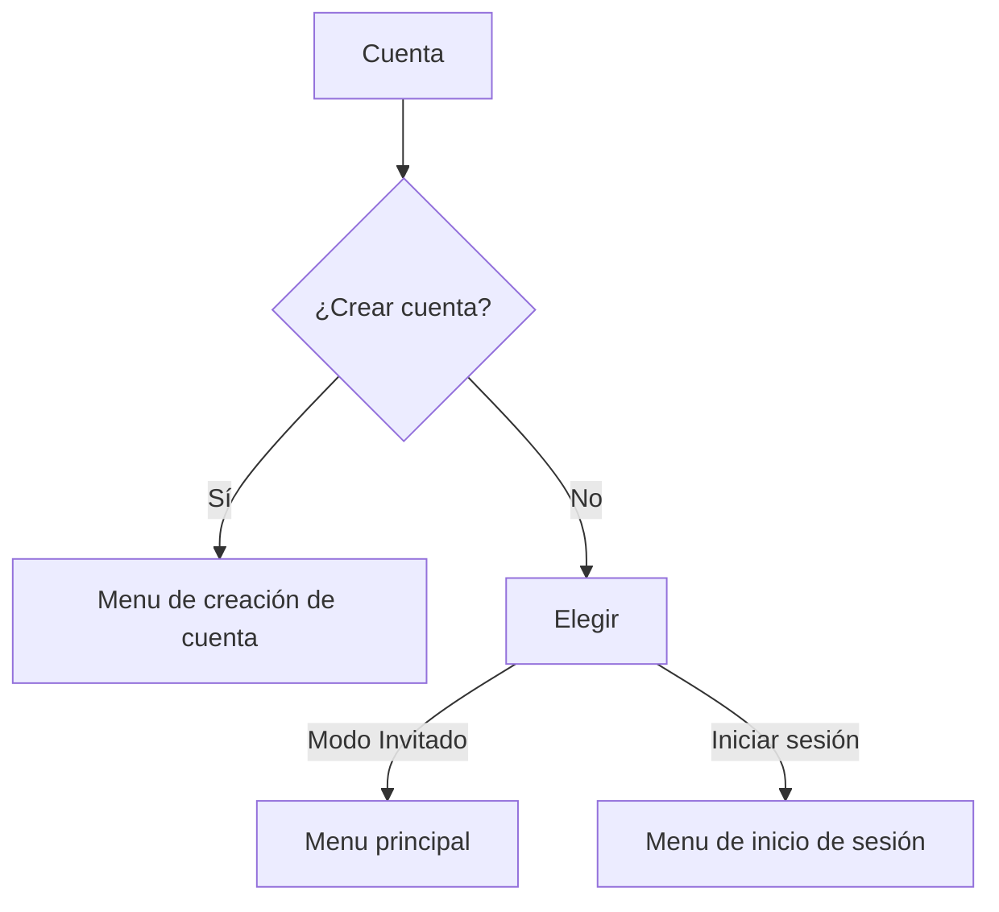

# Pixel World 


##### Pixel World es una plataforma con multiples videojuegos.

###### _El objetivo principal del proyecto es crear una pltataforma repleta de videojuegos en que puedan jugarse desde el navegador para que cualquiera que tenga un ordenador pueda jugarlos sin tener el ordenador mas potente del mundo._ 

### Indice
- Titulo y logotipo
- Características principales
- Tecnologías utilizadas
- Funcionamiento
- Contacto


### Características principales 🚧 

1. Juego web
2. Menus
   - [x] Menu Selececión de videojuegos
   - [ ] Menu de creación de cuenta
3. Guardado de partida automatico y en la nube
4. Multijugador
5. Variedad de generos de videojuegos

```
import java.util.Scanner;

class  {
    public static void main(String[] args) {
        Scanner entrada = new Scanner(System.in);

      
    }
}
```


### Tecnologías utilizadas

|        **Tecnología**       | **Versión** |                                  **Descripción**                                 |              **Uso en el proyecto**              |
|:---------------------------:|:-----------:|:--------------------------------------------------------------------------------:|:------------------------------------------------:|
|        Menu de amigos       |    _1.1_    | Un menu que guarda tus amistades y te permite invitarlas a los diferentes juegos | Permitir agregar, eliminar e invitar a amistades |
| Seleción de juego aleatorio |    _1.0_    |                Un botón en la UI que te mete en un juego aleatorio               |        Si no sabes que jugar elige por ti        |
|        Modo invitado        |    _1.0_    |                    Modo en el que no necesitas iniciar sesión                    |             Permite jugar sin cuenta             |
|           Ajustes           |    _1.2_    |            Para cambiar la configuración del usuario a una más comoda            |       Cambiar la configuración de la cuenta      |

### Funcionamiento

Pagina web con menus de cuenta y selección de videojuegos



### Contacto

- GitHub: https://github.com/alfonsofernandez77
