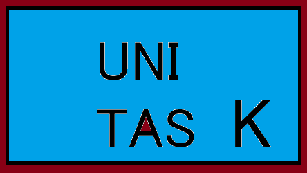
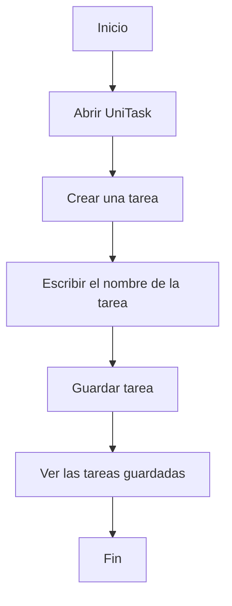

# UniTask - Gestor de tareas universitarias



## 1. Presentación del proyecto

**UniTask** es una aplicación diseñada para ayudar a
los estudiantes universitarios a organizar sus
actividades académicas.

El objetivo principal del proyecto es facilitar
la planificación de tareas, trabajos y exámenes.

### ¿Qué problema resuelve?

Muchos estudiantes tienen dificultades para
recordar las fechas de entrega y organizar
sus responsabilidades académicas.

*UniTask busca solucionar este problema mediante
una plataforma sencilla y accesible.*

## 2. Índice de contenidos

- [Presentación del proyecto](#1-presentación-del-proyecto)
- [Características principales](#3-características-principales)
- [Instalación y configuración](#4-instalación-y-configuración)
- [Tecnologías utilizadas](#5-tecnologías-utilizadas)
- [Arquitectura](#6-arquitectura)
- [Ejemplos de uso](#7-ejemplos-de-uso)
- [Información adicional](#8-información-adicional)
- [Elementos visuales](#9-elementos-visuales)

## 3. Características principales

UniTask contará con las siguientes funcionalidades:

### Funcionalidades

1. **Crear tareas:** permite registrar trabajos y actividades pendientes.
2. **Organizar asignaturas:** clasifica las tareas según la materia.
3. **Fechas de entrega:** permite establecer plazos para cada actividad.
4. **Marcar tareas completadas:** ayuda a controlar el progreso académico.
5. **Calendario académico:** muestra las próximas entregas y exámenes.

### Funcionalidades adicionales

- Notificaciones de tareas próximas a vencer.
- Clasificación de actividades por prioridad.
  - Prioridad alta.
  - Prioridad media.
  - Prioridad baja.

### Estado de desarrollo

- [x] Definición de la idea del proyecto.
- [x] Diseño de las funcionalidades principales.
- [ ] Desarrollo de la aplicación.
- [ ] Implementación de notificaciones.
- [ ] Pruebas de funcionamiento.

## 4. Instalación y configuración

UniTask es un proyecto ficticio cuya implementación
está planificada como una aplicación web.

### Requisitos previos

Para desarrollar UniTask se necesitarían:

1. Un ordenador con Windows, Linux o macOS.
2. Visual Studio Code como editor de código.
3. Un navegador web actualizado.
4. Conocimientos básicos de HTML, CSS y JavaScript.

### Preparación del entorno

Para crear la carpeta inicial del proyecto,
se pueden ejecutar los siguientes comandos:

```bash
mkdir unitask
cd unitask
code .
```

Estos comandos crean una carpeta llamada
`unitask`, acceden a ella y la abren
en Visual Studio Code.

### Configuración inicial

La estructura prevista del proyecto es:

- `index.html`: estructura de la aplicación.
- `styles.css`: diseño visual.
- `script.js`: funcionalidades interactivas.

Una vez desarrollado el prototipo, se podrá
abrir el archivo `index.html` en un navegador.

**Nota:** Estas instrucciones describen
el entorno previsto. La aplicación todavía
no está implementada.

## 5. Tecnologías utilizadas

Para el desarrollo de UniTask se propone
utilizar las siguientes tecnologías:

| Tecnología | Versión | Descripción | Uso en el proyecto |
|:-----------|:-------:|:------------|:-------------------|
| **HTML** | 5 | Lenguaje de marcado web. | Crear la estructura de la aplicación. |
| **CSS** | CSS3 | Lenguaje de estilos. | Diseñar la interfaz visual. |
| **JavaScript** | ES2024 | Lenguaje de programación. | Implementar las funciones interactivas. |
| **Git** | `2.56.0` | Sistema de control de versiones. | Gestionar el historial del proyecto. |

### Herramientas de desarrollo

Se utilizará **Visual Studio Code** como editor
principal y *GitHub* para almacenar el
repositorio del proyecto.

**Nota:** Las tecnologías indicadas forman parte
de la planificación de UniTask, ya que la
aplicación todavía no está desarrollada.

## 6. Arquitectura

UniTask será una aplicación web para organizar
las tareas de los estudiantes.

Su funcionamiento será sencillo. El usuario
podrá entrar en la aplicación, crear una tarea
y guardarla para verla después.

### Diagrama de funcionamiento

Este diagrama muestra los pasos para crear
una tarea en UniTask.



### Partes de la aplicación

La aplicación tendrá tres partes principales:

1. **HTML:** para crear la estructura de la página.
2. **CSS:** para cambiar los colores y el diseño.
3. **JavaScript:** para hacer que los botones y las tareas funcionen.


## 7. Ejemplos de uso

En esta sección se muestran algunos ejemplos
sencillos de cómo podría funcionar UniTask.

### Ejemplo 1: Escribir una tarea

El usuario podría escribir el nombre de una
tarea en un campo de texto.

```html
<input type="text" placeholder="Nombre de la tarea">
<button>Guardar tarea</button>
```

Este código HTML crea un espacio para escribir
el nombre de la tarea y un botón para guardarla.

### Ejemplo 2: Mostrar un mensaje

Con JavaScript se podría mostrar un mensaje
cuando una tarea se haya guardado.

```javascript
function mostrarMensaje() {
    alert("Tarea guardada correctamente");
}
```

La función muestra un mensaje en la pantalla
cuando es ejecutada.

### Enlaces de ayuda

Para aprender más sobre HTML y JavaScript
se pueden consultar estas páginas:

- [HTML en MDN](https://developer.mozilla.org/es/docs/Web/HTML)
- [JavaScript en MDN](https://developer.mozilla.org/es/docs/Web/JavaScript)

**Nota:** Estos ejemplos son básicos y forman
parte de la idea del proyecto. UniTask todavía
no está desarrollada.


## 8. Información adicional

### Consejos para utilizar UniTask

> Es recomendable organizar las tareas con tiempo
> para evitar olvidarse de las entregas.

### Preguntas frecuentes

<details>
<summary>¿Para qué sirve UniTask?</summary>

UniTask sirve para organizar las tareas
universitarias y recordar sus fechas de entrega.

</details>

### Contacto

Si quieres saber más sobre el proyecto, puedes
visitar la página de [GitHub](https://github.com).

Correo de ejemplo: unitask@gmail.com

<!-- Esta sección contiene información adicional
sobre el proyecto UniTask. -->


## 9. Elementos visuales

### Estado del proyecto

UniTask es un proyecto que todavía está en
fase de planificación.


### Información adicional

 UniTask está pensado para ayudar a los
estudiantes a organizar mejor sus tareas.

---

### Caracteres especiales

En Markdown algunos símbolos tienen
funciones especiales.

Por ejemplo:

- Para mostrar un asterisco: \*
- Para mostrar una almohadilla: \#
- Para mostrar un guion bajo: \_

Estos caracteres se pueden mostrar
escribiendo una barra invertida antes
del símbolo.

### Final del documento

Esta documentación explica la idea principal
de UniTask y algunas de sus posibles funciones.

El proyecto todavía no está programado,
pero esta actividad me ha servido para
practicar el uso de Markdown.
