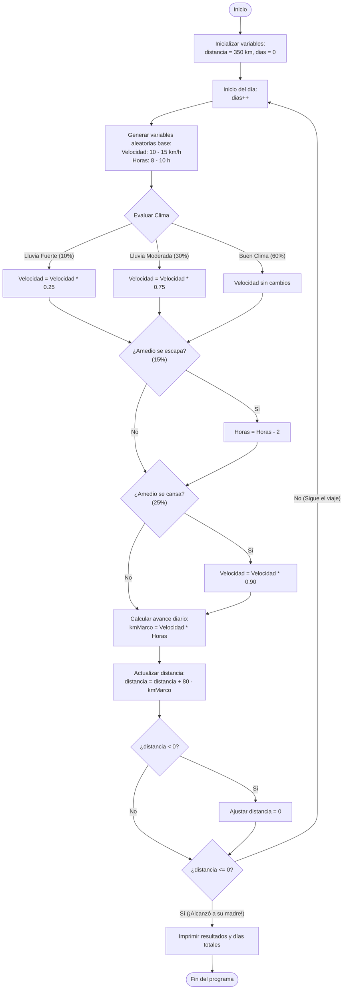

# EL GRANDIOSO VIAJE DE MARCO
 <a id="begin"></a>

El grandioso viaje de Marco es una divertida aplicacion en la cual puedes observar las diferentes travesias que tiene Marco junto a su mono Amedio al tratar de llegar donde su madre.

## Objetivos:
  <a id="objetivos"></a>
* *Ver cuanto tardaria Marco en llegar donde su madre 💞*
* ~~Identificar las diferentes probabilidades que algo salga mal o que Marco se retrase 😭~~
* **Señalar lo mal portado que es Amedio 😡**
* Enseñar un final feliz al encontrarse con su madre 😆


###### Enlaces dentro del MD
| Inicio | [Ir al inicio](#begin) |
|:----------:|:--------:|
| Objetivos    | [Ir a objetivos](#objetivos)   |
| Funcionalidades | [Ir a funcionalidades](#Funciona) |
| Instalacion | [Ir a Instalacion](#Instalacion) |
| Tecnologias Usadas | [Ir a Tech Usada](#TechUsada) |
| Florchart | [Ir a flowchart usado](#flowchart) |


### Funcionalidades
<a id="Funciona"></a>
+ Señalar como se implementan las probabilidades en JAVA
+ Aclarar una bonita historia de amor
+ Enseñar las probabilidades no excluyentes
    + Como Amedio se puede escapar y cansar el mismo dia!
+ Incluir un contador de dias de cuanto tarda Marco
+ Separar cada dia con una bonita conjuncion de lineas y asteriscos 😮

[x] Hacer Pasos 1,2,3,4  
[ ] Terminar la tarea  
[ ] Hacer pasos 5 , 6, 7

## Instalacion
 <a id="Instalacion"></a>
1. Descargar Java y actualizarlo a ultima version
2. Descargar Visual Studio Code e implementar las extensiones necesarias de Java
3. Clonar la repo [Mi repo haha😆](https://github.com/antoniorodriguez007/26-27-prg1.git)  
    3.1 En la rama practica-03-11 encontrar la carpeta entregas  
    3.2 Abrir la carpeta entregas y entrar a *rodriguezAntonio*  
4. Al estar dentro de esa carpeta, ingresar a **src** y tendras que ver un archivo llamado `ViajedeMarco.java` con codigo similar a este:
 ```javascript
if (chance_amedio <= PROB_AMEDIO_ESCAPA) {
                horas_de_viaje = horas_de_viaje - REDUCCION_HORAS_AMEDIO_ESCAPA;
                System.out.println("EL AMEDIO INTENTO ESCAPAR");
            }
            if (chance_amedio <= PROB_AMEDIO_CANSA) {
                velocidad_promedio = velocidad_promedio * REDUCCION_VELOCIDAD_AMEDIO_CANSA;
                System.out.println("EL AMEDIO SE CANSO");
            }
```
5. Ejecutar y ver como viaja Marco!!!😎😎

## Tecnologias usadas
 <a id="TechUsada"></a>
| Tecnologia | JAVA | Visual Studio | Manos Humanas | Github
|:----------:|:--------:| :--------:| :--------:| :--------:|
| Version   |  **JDK 27**  |  **18.5** | **2026** | **3.22.2** |
| Descripcion |  lenguaje de programación y una plataforma | IDE creado por Microsoft, utilizado  para diseñar, depurar, probar  software orientado a objetos | Parte del cuerpo humano que viene con la mayoria de personas, terminan en 5 dedos | Plataforma basada en la nube que permite a los desarrolladores almacenar, gestionar y colaborar en proyectos de código 
| Uso en el proyecto |  El lenguaje de programacion base usado para este proyecto|  IDE principal que se empleo en la creacion del proyecto | Con estas fue que se tocaron las teclas del teclado que se usaron al crear la aplicacion | Uso de este para verificar versiones y discutir mejoras entre los desarrolladores |


## Florwchart tipo mermaid
 <a id="florchart"></a>




