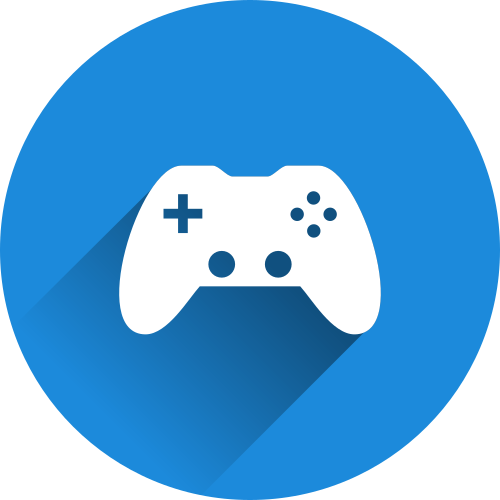
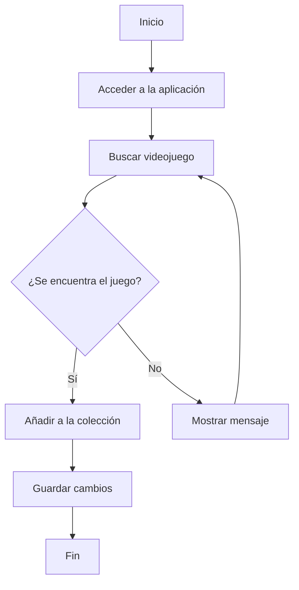

# Nintendo Game Library 🎮



**Nintendo Game Library** es una aplicación ficticia diseñada para organizar y gestionar colecciones de videojuegos de Nintendo.

Su objetivo principal es ofrecer a los jugadores un espacio donde puedan consultar sus videojuegos, registrar sus progresos y mantener organizada su colección.

El proyecto pretende resolver el problema de tener la información de nuestros videojuegos repartida entre diferentes plataformas o anotaciones.

*¡Toda tu colección de Nintendo en un solo lugar!*


## 📑 Índice de contenidos

1. [Presentación del proyecto](#nintendo-game-library)
2. [Características principales](#características-principales)
3. [Instalación y configuración](#instalación-y-configuración)
4. [Tecnologías utilizadas](#tecnologías-utilizadas)
5. [Arquitectura y funcionamiento](#arquitectura-y-funcionamiento)
6. [Ejemplos de uso](#ejemplos-de-uso)
7. [Información adicional](#información-adicional)
8. [Contacto](#contacto)


---

## ⭐ Características principales

Nintendo Game Library contará con las siguientes funcionalidades:

1. **Gestión de videojuegos**
   - Añadir nuevos juegos a la colección.
   - Eliminar videojuegos.
   - Consultar información de cada título.

2. **Seguimiento del progreso**
   - Marcar videojuegos como completados.
   - Registrar las horas de juego.

3. **Lista de deseos**
   - Guardar videojuegos que queremos comprar.
   - Consultar nuestra lista de próximos objetivos.

4. **Sistema de búsqueda**
   - Buscar juegos por nombre.
   - Filtrar por consola o género.

5. **Organización de la colección**
   - Clasificar videojuegos por plataforma.
   - Ordenar los títulos alfabéticamente.

### Estado del desarrollo

- [x] Diseño inicial del proyecto.
- [x] Definición de las funcionalidades.
- [ ] Desarrollo del sistema de búsqueda.
- [ ] Implementación de la gestión de videojuegos.
- [ ] Creación de la interfaz gráfica.
- [ ] Pruebas finales.
 
---

## ⚙️ Instalación y configuración

Para instalar Nintendo Game Library, sigue estos pasos:

1. Clonar el repositorio desde GitHub:

   ```bash
   git clone https://github.com/usuario/nintendo-game-library.git
   ```

2. Acceder a la carpeta del proyecto:

   ```bash
   cd nintendo-game-library
   ```

3. Instalar las dependencias necesarias:

   ```bash
   npm install
   ```

4. Iniciar la aplicación:

   ```bash
   npm start
   ```

Una vez completados estos pasos, la aplicación estará disponible para su utilización.

### Requisitos previos

- Tener instalado **Node.js**.
- Disponer de conexión a Internet.
- Tener instalado **Git**.
- Contar con un navegador web actualizado.


---

## 💻 Tecnologías utilizadas

Las siguientes tecnologías se utilizarán para desarrollar el proyecto:

| Tecnología | Versión | Descripción | Uso en el proyecto |
|:---|:---:|:---|:---|
| **HTML** | 5 | Lenguaje de marcado web. | Estructura de la aplicación. |
| **CSS** | 3 | Lenguaje de estilos. | Diseño visual e interfaz. |
| **JavaScript** | ES2024 | Lenguaje de programación. | Funcionalidades e interactividad. |
| **Node.js** | 22 | Entorno de ejecución. | Ejecución del servidor. |
| **Git** | 2.47 | Sistema de control de versiones. | Gestión del código fuente. |


---

## 🏗️ Arquitectura y funcionamiento

Nintendo Game Library funciona mediante una interfaz que permite al usuario interactuar con su colección de videojuegos.

El funcionamiento general sigue este proceso:

1. El usuario accede a la aplicación.
2. Selecciona la opción de buscar videojuegos.
3. Introduce el nombre del título que desea encontrar.
4. La aplicación consulta la información disponible.
5. El usuario puede añadir el videojuego a su colección.
6. El sistema guarda los cambios realizados.

### Diagrama de flujo



---

## 🚀 Ejemplos de uso

### Ejemplo 1: Añadir un videojuego

El usuario puede añadir un videojuego a su colección indicando su nombre y plataforma.

```javascript
const videojuego = {
    nombre: "Super Mario Galaxy",
    plataforma: "Nintendo Switch",
    completado: false
};

console.log("Videojuego añadido:", videojuego.nombre);
```

### Ejemplo 2: Marcar un videojuego como completado

El usuario puede actualizar el estado de un videojuego cuando termina de jugarlo.

```javascript
let videojuego = {
    nombre: "The Legend of Zelda: Breath of the Wild",
    completado: false
};

videojuego.completado = true;

console.log("Estado actualizado:", videojuego.completado);
```

### Documentación relacionada

- [Documentación de JavaScript](https://developer.mozilla.org/es/docs/Web/JavaScript)
- [Documentación de GitHub Markdown](https://docs.github.com/es/get-started/writing-on-github)
- [Documentación de Node.js](https://nodejs.org/docs/latest/api/)


---

## 📌 Información adicional

### Nota importante

> **Recomendación:** Mantener actualizada la colección para evitar perder información sobre los videojuegos registrados.

### Información complementaria

<details>
<summary>Más información sobre el proyecto</summary>

Nintendo Game Library es un proyecto ficticio desarrollado con fines educativos.

Su diseño está pensado para facilitar la organización de colecciones de videojuegos y mejorar la experiencia de los jugadores.

En futuras versiones se podrían incorporar nuevas funcionalidades.

</details>

<!-- Este comentario HTML no aparecerá en la visualización del documento. -->

### Contacto

Para consultas o sugerencias sobre el proyecto:

- GitHub: [Repositorio del proyecto](https://github.com/)
- Correo electrónico: contacto@nintendogamelibrary.example


---

## 🎨 Elementos visuales y avanzados

### Badges del proyecto


### Caracteres especiales

En Markdown algunos caracteres tienen funciones especiales. Para mostrarlos como texto normal podemos utilizar la barra invertida (`\`).

Ejemplo:

\*Este texto no aparece en cursiva\*

\# Este texto no aparece como encabezado

\> Este texto no aparece como cita

### Separadores

Los separadores horizontales se pueden crear utilizando tres guiones:

---
