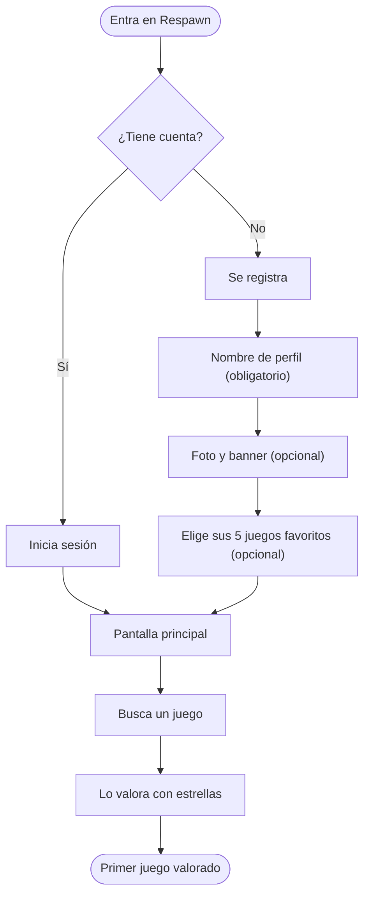

# 🎮 Respawn


 

**Respawn** es una red social donde los jugadores califican y debaten sobre videojuegos: *como una mezcla entre Twitter y Letterboxd, pero solo de videojuegos*.

## Objetivo

Las plataformas que existen para esto, como **GG**, funcionan mal, van lentas y no tienen personalidad ni funciones realmente útiles.
Respawn quiere ser la alternativa: una comunidad con una estética **moderna,
minimalista y acogedora**, donde opinar sobre juegos sea fácil y agradable.

## Índice

- [Características principales](#características-principales)
- [Instalación y configuración](#instalación-y-configuración)
- [Tecnologías utilizadas](#tecnologías-utilizadas)
- [Arquitectura y funcionamiento](#arquitectura-y-funcionamiento)
- [Ejemplos de uso](#ejemplos-de-uso)
- [Información adicional](#información-adicional)

## Características principales

1. **Valoración con estrellas**: puntúa cada juego de media en media estrella, de 0,5 a 5.
2. **Perfil personal**
   - Foto de perfil, banner y descripción.
   - Enlaces a tus otras redes sociales.
   - Tus *5 juegos favoritos* destacados en primer plano.
3. **Fichas de juegos**
   - Descripción oficial escrita por sus creadores.
   - Tráileres oficiales.
   - Catálogo con prácticamente todos los videojuegos existentes.
4. **Hilos de debate**: abre todos los hilos que quieras sobre cada juego.
5. **Seguidores y seguidos**: sigue a otros jugadores y que te sigan a ti.
6. **Zona de creadores**: si has hecho un juego, puedes promocionarlo.
7. **Carpetas de juegos**: guarda juegos en carpetas organizadas a tu manera (por ejemplo, por géneros).
8. **Recomendaciones con IA**: una IA te sugiere juegos según lo que te apetezca jugar.

### Estado del desarrollo

- [x] Valoración con estrellas
- [x] Perfil personal
- [x] Seguidores y seguidos
- [ ] Hilos de debate
- [ ] Tráileres oficiales
- [ ] Zona de creadores
- [ ] Carpetas de juegos
- [ ] Recomendaciones con IA

## Instalación y configuración

Para ejecutar Respawn en tu ordenador:

1. Instala `Java 21`, `Node.js` y `PostgreSQL`.
2. Clona el repositorio.
3. Arranca el servidor.
4. Arranca la versión web.

```bash
git clone https://github.com/usuario/respawn.git
cd respawn/servidor
./mvnw spring-boot:run
cd ../web
npm install
npm start
```

Después abre `http://localhost:3000` en el navegador.

## Tecnologías utilizadas

| Tecnología | Versión | Descripción | Uso en el proyecto |
|:-----------|:-------:|:------------|-------------------:|
| **Java** | `21` | Lenguaje de programación | Lógica del servidor |
| **Spring Boot** | `3` | Framework para servidores en Java | API de Respawn |
| **React** | `19` | Librería para interfaces web | Versión *web* |
| **React Native** | `0.76` | React para apps móviles | Versión *móvil* |
| **PostgreSQL** | `17` | Base de datos | Usuarios, juegos y valoraciones |

## Arquitectura y funcionamiento

Así es el proceso desde que un usuario nuevo entra en Respawn hasta que valora su primer juego:



## Ejemplos de uso

### Ejemplo 1: pedirle a la IA un juego

El usuario escribe lo que le apetece y la IA le recomienda juegos. Así viaja la petición por la app:

```json
{
  "peticion": "Un juego de mundo abierto de fantasía donde pueda hacer lo que quiera",
  "recomendaciones": ["The Elder Scrolls V: Skyrim", "The Witcher 3", "Elden Ring", "World of Warcraft"]
}
```

### Ejemplo 2: organizar carpetas

El usuario crea sus carpetas por géneros y guarda juegos en ellas:

```json
{
  "carpetas": {
    "Terror": ["Resident Evil 4", "Silent Hill 2", "Outlast"],
    "Historia": ["The Last of Us", "Red Dead Redemption 2", "Assassin's Creed Mirage" ],
    "Shooter online": ["Valorant", "Call of Duty: Warzone"]
  }
}
```

Más información sobre las tecnologías: [Spring Boot](https://spring.io/projects/spring-boot) · [React](https://react.dev) · [PostgreSQL](https://www.postgresql.org/docs/)

---

## Información adicional

> **Nota:** Respawn está en desarrollo. Algunas funciones todavía no están disponibles.

<details>
<summary>¿Respawn es gratis?</summary>

Sí. Respawn es gratuito y no tiene anuncios de ningún tipo.

</details>

<!-- Comentario oculto: falta añadir capturas de la app -->

### Contacto

- Correo: [contacto@respawn.com](mailto:contacto@respawn.com)
- GitHub: [github.com/cesaargomezz](https://github.com/cesaargomezz)

\*Respawn no es una red social oficial de ninguna compañía de videojuegos\*. :video_game:
