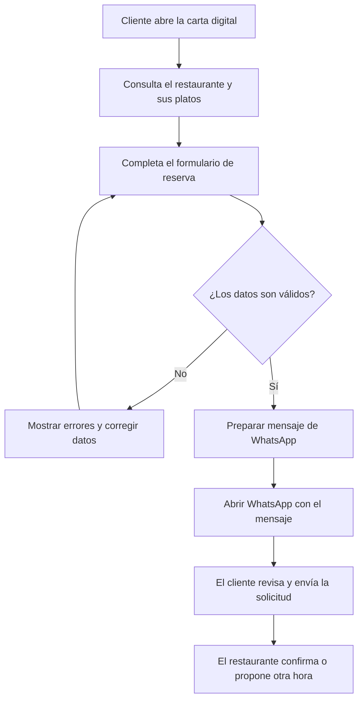

# MesaFácil — Carta digital y reservas para restaurantes

  


**MesaFácil** es un proyecto ficticio de aplicación web para que restaurantes y cafeterías puedan mostrar su carta de forma clara, actualizada y accesible desde cualquier dispositivo. El cliente puede consultar platos, filtrar por categorías, revisar información sobre alérgenos y preparar una solicitud de reserva mediante WhatsApp.

El proyecto se plantea como un **prototipo frontend**: no procesa pagos ni confirma reservas automáticamente. Su propósito es mejorar el acceso a la información del restaurante y simplificar el primer contacto entre el establecimiento y sus clientes.

> 🍽️ **Idea principal:** una carta digital sencilla, rápida y cómoda, sin obligar al cliente a descargar una aplicación.

---

## Índice de contenidos

- [1. Presentación del proyecto](#1-presentación-del-proyecto)
  - [Objetivo principal](#objetivo-principal)
  - [Problema que resuelve](#problema-que-resuelve)
- [2. Características principales](#2-características-principales)
- [3. Instalación y configuración](#3-instalación-y-configuración)
  - [Requisitos previos](#requisitos-previos)
  - [Pasos de instalación](#pasos-de-instalación)
  - [Configuración del restaurante](#configuración-del-restaurante)
- [4. Tecnologías utilizadas](#4-tecnologías-utilizadas)
- [5. Arquitectura y funcionamiento](#5-arquitectura-y-funcionamiento)
- [6. Ejemplos de uso](#6-ejemplos-de-uso)
- [7. Información adicional](#7-información-adicional)
  - [Nota importante](#nota-importante)
  - [Información ampliada](#información-ampliada)
  - [Contacto](#contacto)
- [8. Recursos y referencias](#8-recursos-y-referencias)

---

## 1. Presentación del proyecto

### Objetivo principal

El objetivo de **MesaFácil** es ofrecer a pequeños restaurantes una página web que reúna en un único lugar su carta, precios, horarios, datos de contacto y ubicación. La interfaz debe ser fácil de utilizar tanto para personas habituadas a la tecnología como para quienes solo desean consultar rápidamente qué ofrece el establecimiento.

### Problema que resuelve

Algunos establecimientos publican su carta únicamente como una imagen o un archivo PDF en redes sociales. Esto puede dificultar la lectura desde el móvil, la actualización de los precios y la consulta de información concreta.

MesaFácil propone una alternativa: presentar los platos como contenido web organizado, adaptable a pantallas pequeñas y sencillo de mantener. La información de ejemplo incluida en este proyecto es ficticia y debe sustituirse por datos autorizados del restaurante antes de cualquier publicación real.

## 2. Características principales

Las funcionalidades previstas para el prototipo son:

1. **Carta digital por categorías**
   - Organización de los platos en entrantes, principales, postres y bebidas.
   - Nombre, descripción y precio de cada producto.
2. **Búsqueda de platos** por nombre o por palabras de su descripción.
3. **Información alimentaria**
   - Indicadores informativos de alérgenos cuando el restaurante los haya confirmado.
   - Etiquetas opcionales como vegetariano o vegano.
4. **Solicitud de reserva mediante WhatsApp**, con un mensaje preparado para que el cliente lo revise y lo envíe.
5. **Información del establecimiento**, con dirección, horario, teléfono y enlace a mapas.
6. **Diseño adaptable (responsive)** para móviles, tabletas y ordenadores.

### Estado de desarrollo

- [x] Estructura inicial de la página y navegación por secciones.
- [x] Diseño adaptable para pantallas pequeñas y grandes.
- [x] Modelo de datos de ejemplo para representar la carta.
- [x] Diseño del flujo de solicitud de reserva por WhatsApp.
- [ ] Conectar la carta a una base de datos o panel de administración.
- [ ] Incorporar disponibilidad de mesas en tiempo real.
- [ ] Añadir pruebas automatizadas y revisión de accesibilidad.

Las casillas marcadas indican elementos definidos para el prototipo; las pendientes representan mejoras futuras, no funcionalidades que ya estén disponibles.

## 3. Instalación y configuración

### Requisitos previos

Antes de comenzar, es necesario disponer de:

- **Node.js 20.x** o una versión compatible posterior.
- **npm**, incluido con Node.js.
- **Git** para descargar el repositorio.
- Un editor de código, por ejemplo [Visual Studio Code](https://code.visualstudio.com/).

### Pasos de instalación

1. Clonar el repositorio en el equipo. Sustituye `USUARIO` por el nombre de usuario o la organización donde se encuentre el repositorio:

   ```bash
   git clone https://github.com/USUARIO/mesa-facil.git
   ```

2. Entrar en la carpeta del proyecto:

   ```bash
   cd mesa-facil
   ```

3. Instalar las dependencias declaradas en `package.json`:

   ```bash
   npm install
   ```

4. Iniciar el servidor de desarrollo:

   ```bash
   npm run dev
   ```

5. Abrir en el navegador la dirección local que muestre la terminal. Con la configuración predeterminada de Vite suele ser `http://localhost:5173/`.

6. Para generar una versión de producción, ejecutar:

   ```bash
   npm run build
   ```

   Los archivos preparados para publicación se guardarán en la carpeta `dist/`.

### Configuración del restaurante

Los datos de demostración deben sustituirse por los datos reales facilitados y aprobados por el establecimiento. Como ejemplo, el proyecto puede mantener la información en un archivo `src/config.js`:

```javascript
export const restaurant = {
  name: "Restaurante Ejemplo",
  phone: "34600000000", // Código de país + número, sin espacios ni signos.
  address: "Calle Mayor, 10, Madrid",
  openingHours: "De martes a domingo, de 13:00 a 23:00"
};
```

El número de teléfono se utiliza para construir el enlace de WhatsApp. **No incluyas contraseñas, claves privadas ni credenciales en archivos JavaScript públicos.**

## 4. Tecnologías utilizadas

| Tecnología | Versión | Descripción | Uso en el proyecto |
| :--- | :---: | :--- | :--- |
| **HTML** | 5 | Lenguaje de marcado semántico. | Estructura de las páginas, formularios y secciones de la carta. |
| **CSS** | 3 | Hojas de estilo para presentación y diseño adaptable. | Colores, tipografía, distribución con *Flexbox* y *Grid*, y adaptación móvil. |
| **JavaScript** | ES2022 | Lenguaje de programación ejecutado en el navegador. | Búsqueda, filtros de platos, validación del formulario y enlace de reserva. |
| **Node.js** | 20.x | Entorno de ejecución de JavaScript. | Ejecutar las herramientas de desarrollo y los comandos de `npm`. |
| **Vite** | 5.4.x | Herramienta de desarrollo y empaquetado frontend. | Servidor local y generación de la versión de producción. |
| **Git / GitHub** | Git 2.x | Control de versiones y alojamiento del repositorio. | Registrar cambios, colaborar y revisar entregas mediante *pull requests*. |

Las versiones indicadas son la configuración de referencia de este proyecto ficticio; deben comprobarse y mantenerse coherentes con el archivo `package.json` del repositorio real.

## 5. Arquitectura y funcionamiento

MesaFácil sigue una arquitectura frontend sencilla. El navegador carga la interfaz y los datos de la carta. JavaScript permite buscar y filtrar los platos sin recargar la página. Cuando el cliente completa los datos de una solicitud de reserva, la aplicación valida los campos obligatorios y prepara un enlace de WhatsApp con el mensaje correspondiente.

El prototipo **no confirma la reserva**: WhatsApp se abre para que el cliente envíe la solicitud y el restaurante responda por sus propios medios.

### Diagrama de flujo de una solicitud de reserva



### Estructura orientativa de carpetas

```text
mesa-facil/
├── public/
│   └── assets/
├── src/
│   ├── data/
│   │   └── menu.js
│   ├── styles/
│   │   └── main.css
│   ├── config.js
│   └── main.js
├── index.html
├── package.json
└── README.md
```

## 6. Ejemplos de uso

### Ejemplo 1: filtrar la carta por categoría

El siguiente fragmento muestra cómo obtener los platos de una categoría concreta a partir de una lista de datos:

```javascript
const menu = [
  { name: "Patatas bravas", category: "Entrantes", price: 7.50 },
  { name: "Ensalada de temporada", category: "Entrantes", price: 9.00 },
  { name: "Arroz de verduras", category: "Principales", price: 14.00 }
];

function getDishesByCategory(dishes, category) {
  return dishes.filter((dish) => dish.category === category);
}

const starters = getDishesByCategory(menu, "Entrantes");
console.table(starters);
```

**Resultado esperado:** la consola muestra los dos platos cuya categoría es `Entrantes`.

### Ejemplo 2: preparar una solicitud de reserva

Este ejemplo construye un enlace de WhatsApp. El número es ficticio y debe sustituirse por el número oficial del restaurante antes de utilizarlo:

```javascript
const phone = "34600000000";
const reservation = {
  date: "2026-12-12",
  time: "21:00",
  people: 2,
  name: "Alex"
};

const message = [
  "Hola, quisiera solicitar una reserva:",
  `Nombre: ${reservation.name}`,
  `Fecha: ${reservation.date}`,
  `Hora: ${reservation.time}`,
  `Personas: ${reservation.people}`
].join("\n");

const whatsappUrl =
  `https://wa.me/${phone}?text=${encodeURIComponent(message)}`;

console.log(whatsappUrl);
```

**Resultado esperado:** se obtiene una dirección `https://wa.me/…` que abre WhatsApp con el texto preparado. El envío y la confirmación dependen del usuario y del restaurante.

### Documentación y recursos relacionados

- [Guía de HTML en MDN](https://developer.mozilla.org/es/docs/Web/HTML)
- [Guía de CSS en MDN](https://developer.mozilla.org/es/docs/Web/CSS)
- [Guía de JavaScript en MDN](https://developer.mozilla.org/es/docs/Web/JavaScript)
- [Documentación oficial de Vite](https://vite.dev/guide/)
- [Sintaxis de diagramas Mermaid](https://mermaid.js.org/intro/)
- [Ayuda de GitHub sobre Markdown](https://docs.github.com/es/get-started/writing-on-github)

## 7. Información adicional

### Nota importante

> ⚠️ **Aviso sobre reservas y alérgenos:** una solicitud enviada por WhatsApp no equivale a una reserva confirmada. Del mismo modo, la información sobre alérgenos debe ser verificada y aprobada por el restaurante. El prototipo no sustituye la comunicación directa con el establecimiento.

### Información ampliada

<details>
<summary>Ver ejemplo de datos de un plato y futuras mejoras</summary>

Cada plato puede representarse mediante un objeto JavaScript. Este ejemplo utiliza información inventada:

```javascript
const dish = {
  id: 1,
  name: "Tosta de verduras asadas",
  category: "Entrantes",
  price: 8.50,
  tags: ["vegetariano"],
  allergens: ["gluten"]
};
```

**Mejoras futuras:** panel privado para editar la carta, gestión de disponibilidad, varios idiomas y conexión con un servicio de reservas.

</details>

<!-- Nota interna para el equipo: sustituir todos los datos ficticios y revisar los enlaces antes de publicar una versión para un restaurante real. -->

### Contacto

Este proyecto es académico y ficticio. Para consultas sobre la demostración se pueden utilizar estos datos de ejemplo:

- **Responsable:** Equipo MesaFácil (contacto ficticio).
- **Correo:** [hola@mesafacil.example](mailto:hola@mesafacil.example)
- **Repositorio:** [github.com/USUARIO/mesa-facil](https://github.com/USUARIO/mesa-facil)
- **Documentación:** [Markdown Guide](https://www.markdownguide.org/)

El dominio `.example` está reservado para ejemplos y no representa una dirección de correo real.

### Caracteres especiales en Markdown

Para mostrar caracteres que Markdown utiliza como formato, se puede escribir una barra invertida antes del carácter. Ejemplo: `\*texto entre asteriscos\*` se visualizará como \*texto entre asteriscos\* y no como texto en cursiva.

## 8. Recursos y referencias

- [Markdown Guide — referencia de sintaxis](https://www.markdownguide.org/basic-syntax/)
- [GitHub — escritura y formato en Markdown](https://docs.github.com/es/get-started/writing-on-github)
- [Shields.io — creación de badges](https://shields.io/)
- [Mermaid — documentación oficial](https://mermaid.js.org/)

---

**Fin de la documentación de MesaFácil.** Para adaptar este README a un proyecto real, revisa los datos, versiones, enlaces, funcionalidades implementadas y permisos de uso de todos los recursos.
