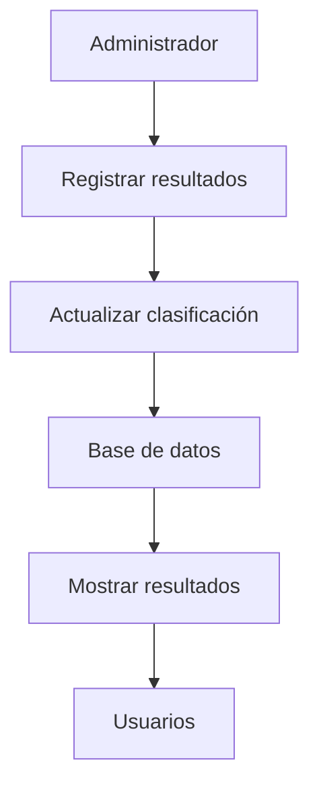

# F1 Race Manager 🏎️


F1 Race Manager es una aplicación web diseñada para gestionar campeonatos de Fórmula 1 de manera eficiente y visual.

**El objetivo principal** del proyecto es permitir a aficionados, equipos y organizadores consultar información sobre pilotos, escuderías, calendarios de carreras y clasificaciones en tiempo real.

La aplicación pretende resolver el problema de la dispersión de información, centralizando todos los datos relevantes de un campeonato en una única plataforma.

*Proyecto ficticio desarrollado con fines educativos para la actividad de Markdown.*

---

# Índice

- [Características principales](#características-principales)
- [Instalación y configuración](#instalación-y-configuración)
- [Tecnologías utilizadas](#tecnologías-utilizadas)
- [Arquitectura o funcionamiento](#arquitectura-o-funcionamiento)
- [Ejemplos de uso](#ejemplos-de-uso)
- [Información adicional](#información-adicional)

---

# Características principales

F1 Race Manager ofrece las siguientes funcionalidades:

- Gestión de pilotos.
- Gestión de escuderías.
- Calendario completo de Grandes Premios.
- Clasificación del campeonato de pilotos.
- Clasificación del campeonato de constructores.

### Funcionalidades en desarrollo

- [x] Registro de pilotos
- [x] Registro de escuderías
- [x] Calendario de carreras
  - Clasificación
  - Carrera Sprint
  - Carrera Principal
- [ ] Simulación de carreras
- [ ] Predicción de resultados mediante IA

---

# Instalación y configuración

Para instalar F1 Race Manager sigue los siguientes pasos:

1. Clona el repositorio.
2. Accede al directorio del proyecto.
3. Instala las dependencias.
4. Ejecuta la aplicación.

```bash
git clone https://github.com/usuario/f1-race-manager.git
cd f1-race-manager
npm install
npm start
```

Para instalar las dependencias utiliza el comando `npm install`.

La aplicación estará disponible en `http://localhost:3000`.

---

# Tecnologías utilizadas

| Tecnología | Versión | Descripción | Uso en el proyecto |
|:----------|:-------:|:-----------|:------------------|
| **HTML5** | 5 | Lenguaje de marcado | Interfaz principal |
| **CSS3** | 3 | Diseño visual | Estilos de la aplicación |
| `JavaScript` | ES2024 | Lógica del sistema | Gestión de datos |
| *Node.js* | 20 | Entorno de ejecución | Backend y API |

---

# Arquitectura o funcionamiento

F1 Race Manager permite registrar resultados de carreras, consultar clasificaciones y gestionar toda la información relacionada con un campeonato de Fórmula 1.



---

# Ejemplos de uso

## Registrar un nuevo piloto

```javascript
registrarPiloto("Fernando Alonso", "Aston Martin");
```

Este comando añade un piloto al sistema.

## Consultar la clasificación del campeonato

```javascript
obtenerClasificacionPilotos();
```

Este comando devuelve la clasificación actual de los pilotos.

### Recursos recomendados

- https://www.formula1.com/
- https://developer.mozilla.org/es/
- https://nodejs.org/

---

# Información adicional

> ⚠️ Importante: Los resultados y clasificaciones deben actualizarse después de cada Gran Premio para garantizar la precisión de los datos.

<details>
<summary>Información avanzada</summary>

El sistema permite almacenar estadísticas históricas de pilotos, escuderías y circuitos para realizar comparaciones entre temporadas.

También es posible generar informes automáticos de clasificación y rendimiento.

</details>

<!-- Comentario oculto para el profesor -->

## Contacto

- Correo electrónico: f1racemanager@example.com
- GitHub: https://github*Este texto no aparecerá en cursiva\*

\#Este texto no será interpretado como un encabezado
