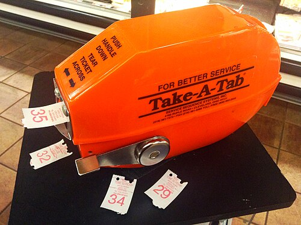
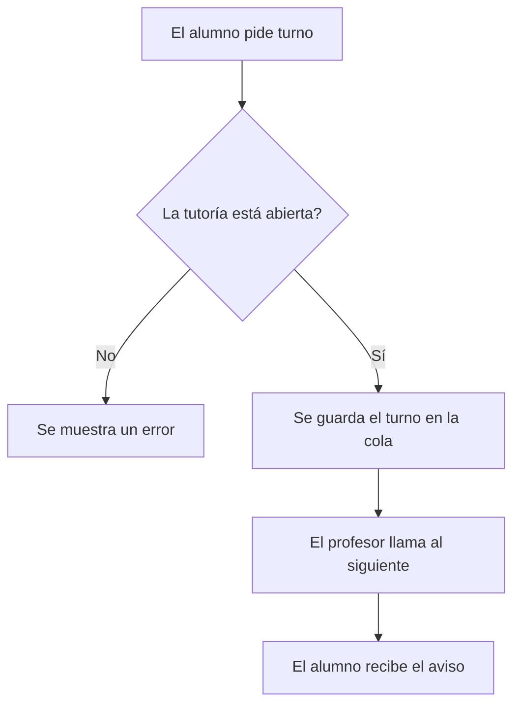

# TurnoYa




Imagen de [Mike Mozart](https://commons.wikimedia.org/wiki/File:Take_a_Number%2C_%2814495402297%29.jpg), licencia [CC BY 2.0](https://creativecommons.org/licenses/by/2.0/deed.es).

**TurnoYa** es una aplicación web para pedir turno en las tutorías de la universidad. :calendar:

El objetivo es que los alumnos no tengan que *esperar en el pasillo*. Ahora mismo, cuando hay mucha gente, no se sabe quién va primero ni cuánto falta. Con TurnoYa cada alumno ve su posición en la cola desde el móvil.

## Índice

- [Características](#características)
- [Instalación](#instalación)
- [Tecnologías](#tecnologías)
- [Funcionamiento](#funcionamiento)
- [Ejemplos de uso](#ejemplos-de-uso)
  - [Pedir un turno](#pedir-un-turno)
  - [Ver la cola](#ver-la-cola)
- [Información adicional](#información-adicional)
- [Contacto](#contacto)

---

## Características

- Pedir turno en una tutoría
  - El alumno escribe el motivo
- Ver la posición en la cola
- Recibir un aviso cuando llega el turno
- Panel para que el profesor llame al siguiente
- Cancelar el turno

Estado del desarrollo:

- [x] Pedir turno
- [x] Ver la posición en la cola
- [x] Panel del profesor
- [ ] Recibir avisos
- [ ] Cancelar el turno

## Instalación

1. Clonar el repositorio.
2. Instalar las dependencias con `npm install`.
3. Crear un archivo `.env` con la variable `PORT`.
4. Arrancar el proyecto con `npm start`.

```bash
git clone https://github.com/ejemplo/turnoya.git
cd turnoya
npm install
npm start
```

## Tecnologías

| Tecnología | Versión | Descripción | Uso en el proyecto |
|:---|:---:|:---|:---|
| **Node.js** | 22 | Entorno de JavaScript | Ejecutar el servidor |
| **Express** | 5 | Framework web | Crear la API |
| **PostgreSQL** | 16 | Base de datos | Guardar los turnos |
| **React** | 19 | Librería de interfaces | Crear las pantallas |

## Funcionamiento

El alumno pide turno desde la web. Si la tutoría está abierta, el turno se guarda en la cola y el profesor va llamando a los alumnos en orden.



## Ejemplos de uso

### Pedir un turno

```bash
curl -X POST http://localhost:3000/tutorias/1/turnos -d "motivo=Duda del tema 3"
```

### Ver la cola

```javascript
const respuesta = await fetch("http://localhost:3000/tutorias/1/cola");
const cola = await respuesta.json();
console.log(cola);
```

Más información en la [documentación de Express](https://expressjs.com/es/) y en la [documentación de fetch](https://developer.mozilla.org/es/docs/Web/API/Fetch_API).

---

## Información adicional

> Nota: este proyecto es ficticio y se ha hecho para la actividad de Markdown.

<details>
<summary>Errores frecuentes</summary>

Si sale el error `409`, el alumno ya tiene un turno en esa tutoría.

</details>

## Contacto

- Correo: [soporte@turnoya.example](mailto:soporte@turnoya.example)
- GitHub: [Darglas12](https://github.com/Darglas12)
