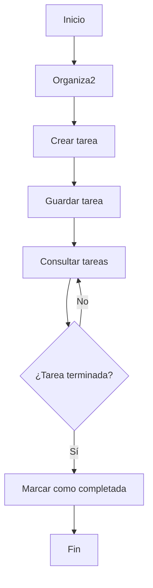

# Organiza2
## Presentación
**_Organiza2_** es una app que te ayudará a organizarte en el ámbito académico:

La principal función de la app es ayudar a organizarse mejor a todos sus usuarios para que no se te olviden tus fechas de entrega de trabajos, examenes, clases importantes etc...

## Índice
[Presentación](#presentación)
[Características](#características)
[Instalación](#instalación)
[Tecnologías utilizadas](#tecnologías-utilizadas)
[Arquitectura](#arquitectura)
[Ejemplos de uso](#ejemplos-de-uso)
[Información adicional](#información-adicional)
[Contacto](#contacto)
### Características
- [x] Crear tareas.
- [x] Organizar asignaturas.
- [x] Marcar tareas como completadas.
- [ ] Añadir recordatorios.
### Instalación
1. Primer paso: añadir la app desde la terminal (git clone "enlace")
2. Segundo paso: entrar en la carpeta (cd "nombre")
3. Instalar dependencias (npm install)
4. Iniciar la aplicación (npm start)
### Tecnologías utilizadas
| Tecnología| Versión | Descripción | Uso en el proyecto |
|:------------|:---------:|:-------------:|--------------------:|
|HTML        |    5    |Lenguaje de marcado|Estructura|
|CSS|3|Estilos visaules|Diseño|
|Java Script|ES6|Lenguaje de programación|Funcionalidades|
|MySQL|8.0|Base de datos|Guardar tareas|
### Arquitectura

### Ejemplos de uso
#### Ejemplo 1: _Crear una tarea desde JavaScript_
const tarea = {
    nombre: "Trabajo de matemáticas",
    asignatura: "Matemáticas",
    fecha: "2026-11-10",
    completada: false
};
#### Ejemplo 2: _Marcar tareas que el mismo haya creado como completadas_
tarea.completada = true;
console.log("¡Tarea completada!");

