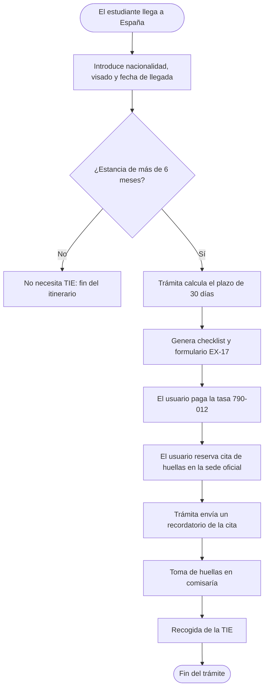

# *Trámita* 📖 📌


*Tu asistente para los trámites de extranjería.*

## Índice

- [Presentación del proyecto](#presentación-del-proyecto)
  - [El problema](#el-problema)
  - [La solución](#la-solución)
  - [Objetivo principal](#objetivo-principal)
- [Características principales](#características-principales)
- [Instalación y configuración](#instalación-y-configuración)
- [Tecnologías utilizadas](#tecnologías-utilizadas)
- [Arquitectura y funcionamiento](#arquitectura-y-funcionamiento)
- [Ejemplos de uso](#ejemplos-de-uso)
- [Información adicional](#información-adicional)
- [Contacto](#contacto)

## Características principales

- [x] **Itinerario personalizado** según el perfil del usuario
  - [x] Nacionalidad y tipo de visado
  - [x] Provincia de residencia
- [x] **Checklist de documentos** para cada trámite
- [ ] **Avisos de plazos** antes de que venzan
  - [ ] Notificaciones por correo
  - [ ] Notificaciones en el móvil
- [ ] **Formularios prerrellenados** (por ejemplo, `EX-17`)
- [ ] **Seguimiento del estado** de cada trámite
- [ ] **Paquete para EE. UU.** (planificado a futuro)

## Presentación del proyecto

**Trámita** es una aplicación web y móvil que guía a los *estudiantes extranjeros* paso a paso por los trámites administrativos necesarios para estudiar en España. Convierte un proceso confuso en una **lista de tareas clara, con plazos y avisos**.

### El problema

Un estudiante que llega a España con visado de estudios tiene que obtener su **TIE** (Tarjeta de Identidad de Extranjero) en un plazo de `30 días` desde su llegada. Para ello debe pedir cita, rellenar formularios, pagar una tasa y reunir documentos, y la información está **dispersa en webs distintas** y cambia según la provincia. Un error o un retraso puede dejarle en situación irregular.

### La solución

Trámita pregunta al usuario por su situación (nacionalidad, visado, fecha de llegada) y le genera un **itinerario personalizado** con:

- Los documentos que necesita, en forma de checklist.
- Los plazos calculados, con avisos antes de que venzan.
- El formulario preparado para revisar y presentar.

### Objetivo principal

Reducir el tiempo y la incertidumbre de la burocracia migratoria para que el estudiante se centre en lo importante: **estudiar y adaptarse a su nueva vida**.

## Instalación y configuración

Requisitos previos: tener instalados `Node.js` y `Git`.

1. Clona el repositorio:
2. Entra en la carpeta del proyecto e instala las dependencias.
3. Copia el archivo de variables de entorno y rellena tu `API_KEY`.
4. Arranca la aplicación en modo desarrollo.

```bash
git clone https://github.com/ejemplo/tramita.git
cd tramita
npm install
cp .env.example .env
npm run dev
```

---

## Tecnologías utilizadas

| Tecnología | Versión | Descripción | Uso en el proyecto |
|:---|:---:|:---|:---|
| **Node.js** | `22.x` | Entorno de ejecución de *JavaScript* | Servidor y lógica de plazos |
| **React Native** | `0.76` | Framework para apps móviles | *Aplicación* para iOS y Android |
| **PostgreSQL** | `16` | Base de datos relacional | Guarda perfiles y trámites |
| **Mermaid** | `11.x` | Diagramas a partir de texto | Documentación del flujo |

---

## Arquitectura y funcionamiento

Trámita recibe el perfil del estudiante, comprueba si le corresponde la **TIE** y, en ese caso, genera su itinerario con plazos y documentos. La app **no presenta nada por el usuario**: prepara, avisa y hace seguimiento.



---

## Ejemplos de uso

### Ejemplo 1: generar el itinerario

```bash
curl -X POST https://api.tramita.example/itinerario \
  -H "Content-Type: application/json" \
  -d '{"pais": "Colombia", "visado": "estudios", "llegada": "2026-09-01"}'
```

Respuesta:

```json
{
  "tramite": "TIE",
  "plazo_limite": "2026-10-01",
  "documentos": ["pasaporte", "EX-17", "tasa 790-012", "foto"]
}
```

### Ejemplo 2: consultar el estado

```javascript
const respuesta = await fetch("https://api.tramita.example/estado/42");
const estado = await respuesta.json();
console.log(estado.paso_actual); // "cita de huellas"
```

Más información: [Sede electrónica de la Policía Nacional](https://sede.policia.gob.es) y [Documentación de Mermaid](https://mermaid.js.org).

---

## Información adicional

> :warning: **Aviso importante:** Trámita es un proyecto ficticio y **no ofrece asesoramiento legal**. Los requisitos y plazos cambian según la provincia: verifícalos siempre en la [sede electrónica oficial](https://sede.administracionespublicas.gob.es).


<details>
<summary>Ver la lista completa de documentos</summary>

- Pasaporte y visado de estudios
- Formulario `EX-17`
- Justificante de la tasa `790-012`
- Fotografía reciente
- Carta de admisión de la universidad

</details>


## Contacto

- :email: Correo: [contacto@tramita.example](mailto:contacto@tramita.example)
- :octocat: GitHub: [diego-nav05](https://github.com/diego-nav05)
