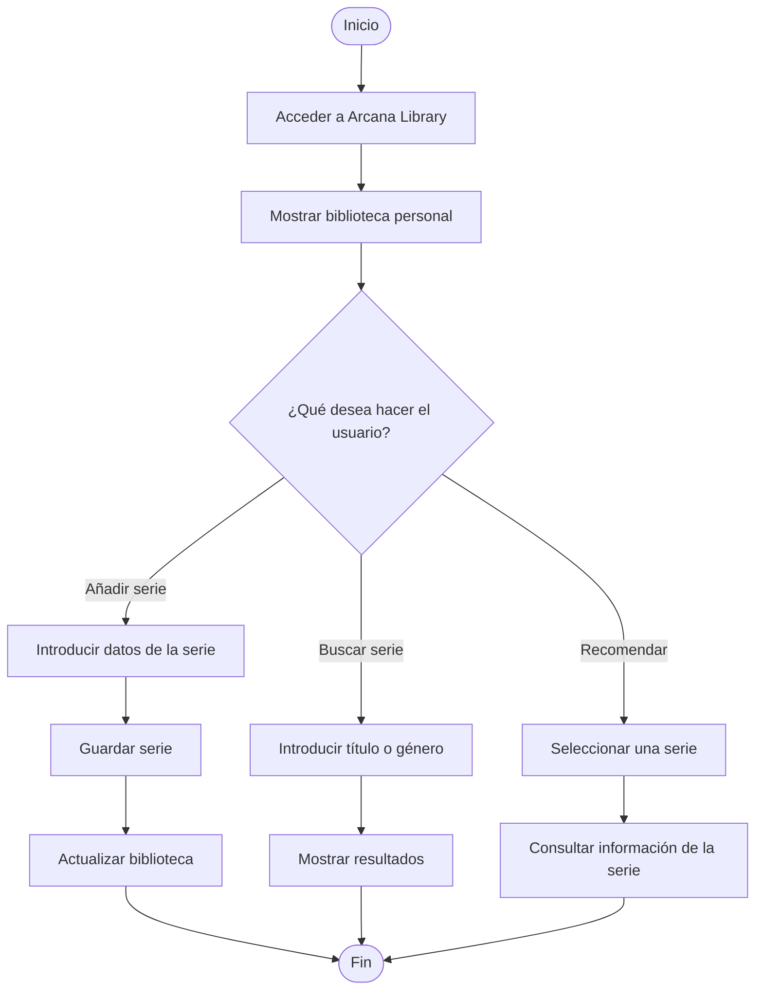

📚 Arcana Library


# 📚 Arcana Library


---

## 1. Presentación del proyecto

**Arcana Library** es una aplicación diseñada para que los usuarios puedan registrar y organizar las series que han visto, creando una biblioteca personal donde consultar su historial de series.

El objetivo principal de Arcana Library es **facilitar la organización, consulta y recomendación de series**, tanto para el propio usuario como para compartir sugerencias con otras personas.

Actualmente, cuando una persona quiere recordar una serie que ha visto o recomendar alguna a un amigo, puede tener dificultades para encontrarla entre tantas opciones. Arcana Library pretende solucionar este problema mediante una biblioteca digital sencilla, visual y organizada.

### Imagen representativa


*Una biblioteca personal para guardar, descubrir y recomendar series.*

## 2. Índice de contenidos

- [Presentación del proyecto](#1-presentación-del-proyecto)
- [Índice de contenidos](#2-índice-de-contenidos)
- [Características principales](#3-características-principales)
- [Instalación y configuración](#4-instalación-y-configuración)
- [Tecnologías utilizadas](#5-tecnologías-utilizadas)
- [Arquitectura y funcionamiento](#6-arquitectura-y-funcionamiento)
- [Ejemplos de uso](#7-ejemplos-de-uso)
- [Información adicional](#8-información-adicional)
- [Elementos visuales y avanzados](#9-elementos-visuales-y-avanzados)
- [Contacto](#contacto)

## 3. Características principales

Arcana Library contará con las siguientes funcionalidades:

1. **Registro de series**
   - Añadir nuevas series a la biblioteca personal.
   - Guardar información como el título, género y año de estreno.

2. **Historial de series**
   - Consultar todas las series registradas.
   - Visualizar las series vistas anteriormente.

3. **Sistema de valoración**
   - Puntuar las series según la opinión personal.
   - Añadir comentarios o pequeñas reseñas.

4. **Organización por categorías**
   - Clasificar series por género.
   - Separar las series vistas de las pendientes.

5. **Sistema de recomendaciones**
   - Consultar series guardadas para recomendar a otras personas.
   - Encontrar fácilmente títulos según los gustos del usuario.

6. **Búsqueda de series**
   - Buscar series por nombre.
   - Filtrar resultados por género o estado.

### Estado de desarrollo

- [x] Diseño inicial del proyecto.
- [x] Definición de las funcionalidades principales.
- [ ] Diseño de la interfaz gráfica.
- [ ] Desarrollo del sistema de registro de series.
- [ ] Implementación del historial personal.
- [ ] Implementación de valoraciones.
- [ ] Desarrollo del sistema de recomendaciones.
- [ ] Pruebas y publicación de la aplicación.

## 4. Instalación y configuración

Para instalar y ejecutar Arcana Library en un entorno local, será necesario disponer de **Node.js**, npm y Git.

### Requisitos previos

- Node.js (versión 20 o superior).
- npm.
- Git.
- Un editor de código, como Visual Studio Code.

### Pasos de instalación

1. Clonar el repositorio:

   ```bash
   git clone https://github.com/usuario/arcana-library.git
   ```

2. Acceder a la carpeta del proyecto:

   ```bash
   cd arcana-library
   ```

3. Instalar las dependencias:

   ```bash
   npm install
   ```

4. Iniciar el servidor de desarrollo:

   ```bash
   npm run dev
   ```

5. Abrir en el navegador la dirección local que indique la terminal, normalmente `http://localhost:5173`.

> **Nota:** Los comandos anteriores representan el procedimiento previsto para una implementación con Vite y Node.js. Será necesario configurar el proyecto antes de poder ejecutarlos.

## 5. Tecnologías utilizadas

Las tecnologías previstas para desarrollar Arcana Library son:

| Tecnología | Versión | Descripción | Uso en el proyecto |
|:---|:---:|:---|:---|
| **HTML5** | 5 | Lenguaje de marcado web. | Estructura de la aplicación. |
| **CSS3** | 3 | Lenguaje de estilos. | Diseño y apariencia visual. |
| **JavaScript** | ES6+ | Lenguaje de programación. | Funcionalidades e interactividad. |
| **React** | 18+ | Biblioteca de interfaces. | Construcción de componentes. |
| **Node.js** | 20+ | Entorno de ejecución. | Ejecución del entorno de desarrollo. |
| **Git** | 2+ | Sistema de control de versiones. | Gestión del código fuente. |

## 6. Arquitectura y funcionamiento

Arcana Library seguirá una arquitectura basada en componentes.

El funcionamiento general será el siguiente:

1. El usuario accede a la aplicación.
2. La aplicación muestra su biblioteca personal.
3. El usuario puede registrar una nueva serie.
4. Los datos se procesan y se guardan.
5. La biblioteca se actualiza.
6. El usuario puede consultar, buscar o recomendar sus series.

### Diagrama de flujo



## 7. Ejemplos de uso

### Ejemplo 1: Añadir una serie a la biblioteca

Un usuario quiere registrar una serie que acaba de terminar para poder consultarla en el futuro.

Ejemplo de los datos que se almacenarían:

```javascript
const serie = {
    titulo: "Stranger Things",
    genero: "Ciencia ficción",
    estreno: 2016,
    estado: "Vista",
    valoracion: 9
};

console.log("Serie añadida:", serie.titulo);
```

Resultado esperado:

```text
Serie añadida: Stranger Things
```

### Ejemplo 2: Buscar una serie por género

Un usuario quiere consultar todas las series de ciencia ficción que tiene registradas.

```javascript
const biblioteca = [
    { titulo: "Stranger Things", genero: "Ciencia ficción" },
    { titulo: "Breaking Bad", genero: "Drama" },
    { titulo: "Dark", genero: "Ciencia ficción" }
];

const resultados = biblioteca.filter(
    serie => serie.genero === "Ciencia ficción"
);

console.log(resultados);
```

Resultado esperado:

```text
Stranger Things
Dark
```

### Recursos relacionados

- [Documentación oficial de Markdown](https://www.markdownguide.org/)
- [Documentación de React](https://react.dev/)
- [Documentación de JavaScript](https://developer.mozilla.org/es/docs/Web/JavaScript)
- [Documentación de Mermaid](https://mermaid.js.org/)

## 8. Información adicional

### Recomendación importante

> 💡 Se recomienda mantener actualizada la biblioteca personal para que las recomendaciones sean más precisas y el historial de series esté siempre organizado.

### Información complementaria

<details>
<summary>Más información sobre Arcana Library</summary>

Arcana Library es un proyecto ficticio creado con fines educativos.

Su nombre combina la idea de una biblioteca personal con el concepto de lo arcano, transmitiendo una estética relacionada con el misterio, la fantasía y el descubrimiento.

En futuras versiones se podrían incorporar nuevas funcionalidades:

- Perfiles de usuario.
- Listas personalizadas.
- Compartir recomendaciones.
- Integración con APIs externas de información audiovisual.
- Sincronización entre dispositivos.

</details>

<!-- Este comentario HTML no será visible en la visualización normal del README. -->

### Contacto

Si tienes alguna sugerencia o quieres colaborar en el proyecto, puedes contactar mediante los siguientes enlaces:

- **Correo electrónico:** arcanalibrary@example.com
- **GitHub:** [Repositorio de Arcana Library](https://github.com/usuario/arcana-library)
- **Documentación:** [Guía de Markdown](https://www.markdownguide.org/)

## 9. Elementos visuales y avanzados

### Badges del proyecto


### Caracteres especiales en Markdown

En Markdown algunos caracteres tienen una función especial. Para mostrarlos como texto normal es necesario utilizar la barra invertida (`\`).

Ejemplo:

```markdown
\*Este texto no aparecerá en cursiva\*
\# Este texto no será un encabezado
\- Este texto no será un elemento de lista
```

Resultado:

\*Este texto no aparecerá en cursiva\*

\# Este texto no será un encabezado

\- Este texto no será un elemento de lista

---

### ✨ ¡Bienvenido a Arcana Library!

**Organiza tus series, conserva tus recuerdos y descubre nuevas recomendaciones.**

*Tu biblioteca personal de historias comienza aquí.*
