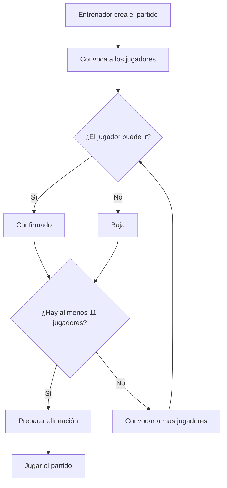
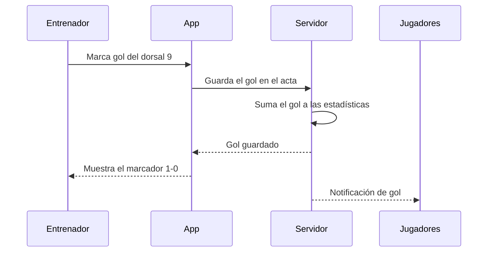
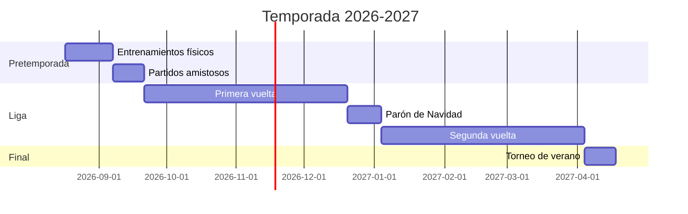

# Pitufut FC
<a id="inicio"></a>

<div align="center" height="40">


</div>


## Presentación del proyecto
<a id="presentacion"></a>

**Pitufut FC** es una aplicación para *gestionar equipos de fútbol amateur*. Sirve para que el entrenador haga las convocatorias, prepare las alineaciones y apunte los goles y las tarjetas de cada partido, y para que los jugadores lo vean todo desde el móvil.

### **Objetivo**
<a id="objetivo"></a>

El objetivo de **Pitufut FC** es que el entrenador deje de organizar el equipo con ~~papeles y grupos de WhatsApp~~ una sola aplicación.

**Problema que resuelve**
- Los jugadores no se enteran de la hora ni del campo del partido
- El entrenador no sabe quién puede venir hasta el último momento
- Las estadísticas de la temporada (goles, asistencias, tarjetas) se ***pierden*** o no se apuntan

> Con la app, cada jugador confirma si va al partido y al final de la temporada se puede ver quién es el **máximo goleador** del equipo.


## Índice de contenidos

1. [Presentación del proyecto](#presentacion)
   1. [Objetivo](#objetivo)
2. [Características principales](#caracteristicas)
   1. [Estado de desarrollo](#estado)
3. [Instalación y configuración](#instalacion)
4. [Tecnologías utilizadas](#tecnologias)
5. [Funcionamiento](#funcionamiento)
6. [Ejemplos de uso](#ejemplos)
7. [Información adicional](#informacion)
   1. [Contacto](#contacto)


## Características principales
<a id="caracteristicas"></a>

:soccer: **Convocatorias**: el entrenador convoca a los jugadores para cada partido

:clipboard: **Alineaciones**: se elige el sistema de juego y los titulares

:trophy: **Estadísticas**: goles, asistencias, tarjetas y minutos jugados

**Lista de funcionalidades**
- Convocatorias
  - El jugador confirma si va o no va
  - Aviso automático 24 horas antes del partido
- Alineaciones
  - Sistemas de juego:
    - 4-4-2
    - 4-3-3
    - 3-5-2
  - Titulares y suplentes
- Acta del partido
  - Goles y asistencias
  - Tarjetas amarillas y rojas
  - Cambios
- Estadísticas de la temporada
  - Máximo goleador
  - Jugador con más minutos
- Calendario
  - Partidos de liga y amistosos
  - Dirección del campo con mapa

### **Estado de desarrollo**
<a id="estado"></a>

- [x] Registro de jugadores
- [x] Convocatorias
- [x] Alineaciones
- [x] Acta del partido
- [ ] Estadísticas de la temporada
- [ ] Calendario con mapa
- [ ] Chat del equipo


## Instalación y configuración
<a id="instalacion"></a>

**Requisitos**
- `Node.js 20` o superior
- `npm` (se instala junto con Node.js)
- Un móvil **Android** o **iOS** con la app *Expo Go*

**Pasos de instalación**

1. Clonar el repositorio
2. Entrar en la carpeta del proyecto
3. Instalar las dependencias con `npm install`
4. Copiar el archivo `.env.example` a `.env`
5. Arrancar la app con `npx expo start`
6. Escanear el código QR con el móvil

```sh

git clone https://github.com/ejemplo/Pitufut-fc.git
cd Pitufut-fc

npm install

cp .env.example .env

npx expo start
```

**Configuración**

En el archivo `.env` hay que cambiar estas variables:
- `NOMBRE_EQUIPO` = nombre del equipo (por ejemplo `CD Barrio Norte`)
- `CATEGORIA` = categoría del equipo (por ejemplo `Juvenil`)
- `MAX_CONVOCADOS` = número máximo de jugadores convocados (por defecto `18`)

---

## Tecnologías utilizadas
<a id="tecnologias"></a>

| Tecnología | Versión | Descripción | Uso en el proyecto |
|:-----------|:-----------:|:-----------|-----------:|
| **React Native** | `0.74` | Framework para crear apps móviles | Pantallas de la app |
| **Expo** | `51` | Herramienta para probar la app en el móvil | Desarrollo y pruebas |
| **Node.js** | `20` | Entorno para ejecutar JavaScript | Servidor de la app |
| **Firebase** | `10` | Base de datos en la nube | Guardar jugadores y partidos |
| **Google Maps** | *API* | Mapas de Google | Mostrar dónde está el campo |

---

## Funcionamiento
<a id="funcionamiento"></a>

El entrenador crea un partido y convoca a los jugadores. Cada jugador recibe un aviso en el móvil y confirma si va. El día del partido el entrenador prepara la alineación con los que han confirmado y, durante el partido, apunta los goles y las tarjetas en el acta.

### Diagrama de flujo: convocatoria de un partido


### Diagrama de secuencia: apuntar un gol


### Diagrama de Gantt: temporada


---

## Ejemplos de uso
<a id="ejemplos"></a>

### Ejemplo 1: Crear una convocatoria

```javascript
const convocatoria = {
    partido: "CD Barrio Norte vs UD Ribera",
    fecha: "2026-11-15",
    hora: "11:00",
    campo: "Campo Municipal",
    jugadores: [1, 4, 5, 6, 8, 9, 10, 11, 14, 17, 20]
};

crearConvocatoria(convocatoria);
```

### Ejemplo 2: Ver el acta de un partido

```sh
curl http://localhost:3000/api/partidos/12/acta
```

Respuesta:
```json
{
  "partido": "CD Barrio Norte vs UD Ribera",
  "resultado": "2-1",
  "goles": [
    { "dorsal": 9, "minuto": 23 },
    { "dorsal": 10, "minuto": 67 }
  ],
  "amarillas": [4],
  "rojas": []
}
```

### Ejemplo 3: Calcular el máximo goleador

```javascript
const maximoGoleador = (jugadores) => {
    let mejor = jugadores[0];
    jugadores.forEach((jugador) => {
        if (jugador.goles > mejor.goles) {
            mejor = jugador;
        }
    });
    console.log(`El máximo goleador es ${mejor.nombre} con ${mejor.goles} goles`);
};
```

**Recursos**
- [Reglas de Juego de la IFAB](https://www.theifab.com/laws-of-the-game/ "Reglas oficiales del fútbol")
- [Documentación de React Native][ref1]
- [Documentación de Expo][ref2]
- [Mermaid](https://mermaid.js.org/intro/ "Enlace a Mermaid")

[ref1]: https://reactnative.dev/ "React Native"
[ref2]: https://docs.expo.dev/ "Expo"


## Información adicional
<a id="informacion"></a>

> **Importante:** un jugador con **5 tarjetas amarillas** acumuladas queda sancionado y no podrá ser convocado para el siguiente partido.

> [!NOTA]
> La app avisa al entrenador si intenta convocar a un jugador sancionado.

<details>
<summary>🔍 Preguntas frecuentes</summary>

### ¿Sirve para fútbol sala?

Sí. Al crear el equipo se puede elegir entre **fútbol 11**, **fútbol 7** y **fútbol sala**.

### ¿Cuántos jugadores puede tener un equipo?

| Modalidad | Jugadores en el campo | Máximo en la plantilla |
|:-----------|:-----------:|-----------:|
| Fútbol 11 | 11 | 25 |
| Fútbol 7 | 7 | 16 |
| Fútbol sala | 5 | 12 |

</details>

<details>
<summary>Atajos de la versión web</summary>

- <kbd>G</kbd> para apuntar un gol
- <kbd>T</kbd> para apuntar una tarjeta
- <kbd>Ctrl</kbd> + <kbd>S</kbd> para guardar el acta

</details>


### Caracteres especiales escapados

\# Esto no es un encabezado

\* Esto no es una lista

\[No es enlace\]

\`No es código\`

Resultado del partido: 2 \- 1

Y si queréis poner la barra -> \\

### Contacto
<a id="contacto"></a>

 Correo: [hector.lopez@alumnos.uneatlantico.es](mailto:hector.lopez@ejemplo.com?subject=Consulta%20Pitufut%20FC)

 GitHub: [@Pitufut_fc](https://github.com/Pitufut-fc-ejemplo)

  Web: <https://Pitufut-fc-ejemplo.com>

---

[Ir al Inicio](#inicio)