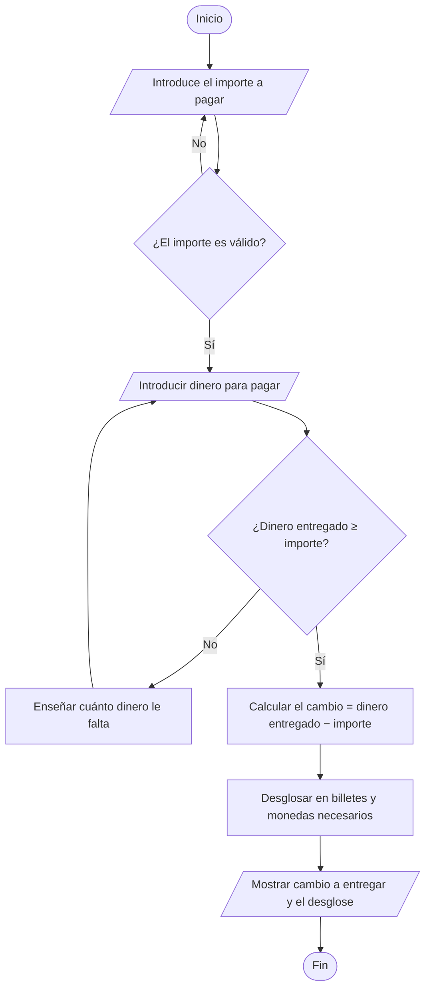

# CAMBIO FÁCIL
<a id="begin"></a>

 
 


**Cambio fácil** es una aplicación que calcula el cambio que se deberá  devolver en una compra.
El usuario **introduce la cantidad a pagar**, y posteriormente **cuanto dinero va a entregar**. La aplicación calcula automáticamente el cambio que debe de ser entregado con los billetes y monedas necesarias. 💵

## Objetivos
<a id="objetivos"></a>

El objetivo de este proyecto es _solucionar los problemas_ que pueden surgir a la hora de calcular el cambio mentalmente, además de _optimizar el tiempo_ en tiendas, centros comerciales...💰

El objetivo de **Cambio Fácil** es:
- **Eliminar errores de cálculo** de forma definitiva al devolver el cambio. 
- **Agilizar** el cobro a los clientes.
- Mostrar **qué billetes y monedas deben entregarse**, no solo la cantidad total.


----

## Indice
<a id="indice"></a>

1. [Presentación de "Cambio Fácil"](#begin)
2. [Objetivos del proyecto](#objetivos)
3. [Índice de contenidos](#indice)
4. [Características principales](#caracteristicas)
5. [Instalación y configuración](#instalacion)
6. [Tecnologías utilizadas](#tecnologias)
7. [Arquitectura y funcionamiento](#arquitectura)
8. [Ejemplos de uso](#ejemplos)
    - [Ejemplo 1: pago de 12,35 con un billete de 20 €](#ejemplo-1)
    - [Ejemplo 2: el dinero entregado no es suficiente](#ejemplo-2)
    - [Recursos relacionados](#recursos)
9. [Información adicional](#informacion)
    - [Contacto](#contacto)
10. [Elementos visuales y avanzados](#visuales)
    - [Caracteres especiales escapados](#escapados)

## Características principales
<a id="caracteristicas"></a>

1. **Entrada de la cantidad de dinero a pagar.**
    - Acepta numeros decimales usando punto o coma.(```12,3``` o ```12.3```).
    - Rechaza valores numéricos negativos, o textos no numéricos.
2. **Entrada para indicar el dinero entregado.**
    - Comprueba que la cantidad ingresada sea suficiente para cubrir el importe a pagar.
    - Avisa de cuanto dinero falta en caso de que no alcance.
3. **Cálculo automático del cambio.**
    - Precisión exacta de céntimos.
    - Sin errores de redondeo.
4. **Desglose del número de billetes y monedas necesarias**
    - Usa el menor numero posible de monedas y billetes.
    - Adaptada al euro (billetes de 5 a 200€ y monedas de 2€ hasta 1 cent).
5. **Modo de realizar varias operaciones seguidas**
    - Permite encadenar varios cobros sin tener que reiniciar el programa.
6. **Historial de operaciones**
    - Guarda un registro de todos los cobros que se han ido haciendo.

**Estado de desarrollo**

- [x] Entrada del importe a pagar.
- [x] Entrada del dinero entregado
- [x] Cálculo del cambio.
- [x] Desglose en billetes y monedas.
- [ ] Modo de varias operaciones seguidas.
- [ ] Historial de operaciones.
- [ ] Exportar el historial a un archivo si es necesario. 
----
## Instalacion y comunicación
<a id="instalacion"></a>

1. Comprueba que tienes instalado **Java 21** con ```java -version```, ```javac -version```.
2. Instala **Visual Studio Code**, y una extensión para poder depurar y ejecutar java. Por ejempplo _"Extension Pack for Java"_ .
3. **Clona el repositorio** usando el comando ```git clone```.

4. Abre la carpeta de Cambio Fácil en VS Code. ```cd (Ruta de carpetas hasta llegar a AEC-MD)```.

5. **Compila el código** desde la terminal con ```javac```.

6. **Ejecuta la aplicación** pulsando sobre el boton ```Run``` que aparece sobre el "main" en VS Code.

Por lo que deberia quedar:
``` bash 
java -version
javac -version

git clone https://github.com/inesmontesiras/26-27-igps.git

cd entregas/ines.montes/AEC-MD

javac -d out src/*.java
```
------
## Tecnologías utilizadas
<a id="tecnologias"></a>

| Tecnología | Versión | Descripción | Uso en el proyecto |
|:-----|:---:|:-------|----------:| 
| **Java** | `21` | _Lenguaje de programación orientado a objetos_ | Creación de todo el código |
| **Visual Studio Code** | `1.x` | _Editor de código_ | Desarrollo, depuración y ejecución |
| **Extension Pack for Java** | `Última` | _Conjunto de extensiones para usar Java en VS Code_ | Aparezca el botón `Run` y para la depuración del `main` |
| **Git / GitHub** | `2.x` | _Controlas versiones_ | Almacenar el historial del código y entregarlo mediante _pull request_ |
| **Mermaid** | `10.x` | _Diagramas definidos con texto_ | Diagrama de flujo de la documentación |
------
## Arquitectura y funcionamiento
<a id="arquitectura"></a>

La aplicación comienza pidiendote el **importe que debes pagar**.
A continuación deberás **introducir la cantidad de dinero necesaria para pagar el artículo**.
Cuando ya tiene los datos, **comprueba que el dinero entregado es suficiente**, y **realiza los cálculos** necesarios para dar el cambio utilizando el **menor número** de monedas y billetes posibles.



## Ejemplos de uso
<a id="ejemplos"></a>

#### Ejemplo 1: Pago 12,35 con un billete de 20€.
<a id="ejemplo-1"></a>

(La terminal mostraría lo siguiente)

``` bash 
Importe a pagar (€): 12,35
Dinero entregado (€): 20

Cambio a devolver: 7,65 €

    1 x billete de 5 €
    1 x moneda de 2 €
    1 x moneda de 50 cent
    1 x moneda de 10 cent
    1 x moneda de 5 cent

```

#### Ejemplo 2: el dinero entregado no es suficiente
<a id="ejemplo-2"></a>

Cuando el cliente entrega menos dinero de lo que debe pagar, la aplicación le avisa de cuánto le falta y vuelve a pedir el dinero:

```bash
Importe a pagar (€): 8,50
Dinero entregado (€): 5

Dinero insuficiente. Faltan 3,50 €.
Dinero entregado (€): 10

Cambio a devolver: 1,50 €
    1 x moneda de 1 €
    1 x moneda de 50 cent
```
#### Recursos relacionados
<a id="recursos"></a>

- [Apuntes Markdow IGPS](https://github.com/miguelancabezon/IGPS/blob/main/temario/4-markdown/clase-7-markdown-introduccion.md).
- [Como usar Java en VS Code (tutorial)](https://www.youtube.com/watch?v=Vbal3r592-g).
- [Apuntes mermaid](https://mermaid.js.org/intro/).
-------

## Información adicional
<a id="informacion"></a>

>🚨 Al usar esta app se debe de tener en cuenta que **no es una caja registradora oficial**, ya que no emite nungún ticket, ni sigue ninguna normativa. 🚨

<details> 
<summary>Ver cómo se calcula el desglose de billetes y monedas</summary>
Para obtener el cambio se va desglosando de mayor a menor (en céntimos, para evitar decimales). En cada uno de ellos se va calculando cuántas piezas caben en el cambio que queda por devolver:

- Billetes: 200 €, 100 €, 50 €, 20 €, 10 € y 5 €.
- Monedas: 2 €, 1 €, 50 cent, 20 cent, 10 cent, 5 cent, 2 cent y 1 cent.

Esta es la mejor forma para que el sistema funcione correctamente sin equivocarse con los euros.

</details>

### Contacto 📢
<a id="contacto"></a>

Si tienes algún problema con la app puedes contactarme en:
-  ✉️ **Gmail**: ines@cambiofacil.com
- 🐱 **GitHub**: <https://github.com/inesmontesiras>

## Elementos visuales avanzados
<a id="visuales"></a>

Para el desarrollo de este proyecto he utilizado.
- **Emojis compatibles con GitHub** de la siguiente web <https://gist.github.com/roachhd/1f029bd4b50b8a524f3c>. 
- **Insignias de Shields.io** al principio del documento (versión de Java, editor y estado).

- **Lineas horizontales** para mejorar la organización.

## Caracteres especiales escapados
<a id="escapados"></a>

En Markdown, hay caracteres que tienen **significados especiales**. Por ejemplo, `*` pone el texto en cursiva, o `**` en negrita y `#` crea un encabezado.

Es por ello que si queremos escribir estos símbolos sin que se activen estas funciones, hay que escribirlo con una barra `/` delante. 
Cuando usamos este simbolo se dice que estamos **"Escapando un caracter"**.

Por ejemplo: Quiero escribir *Hoy*, pero no quiero que este en cursiva, sino que aparezcan los asteriscos. Es por ello que hay que escribir `/*Hoy*/`, para que aparezca `*Hoy*`.


----