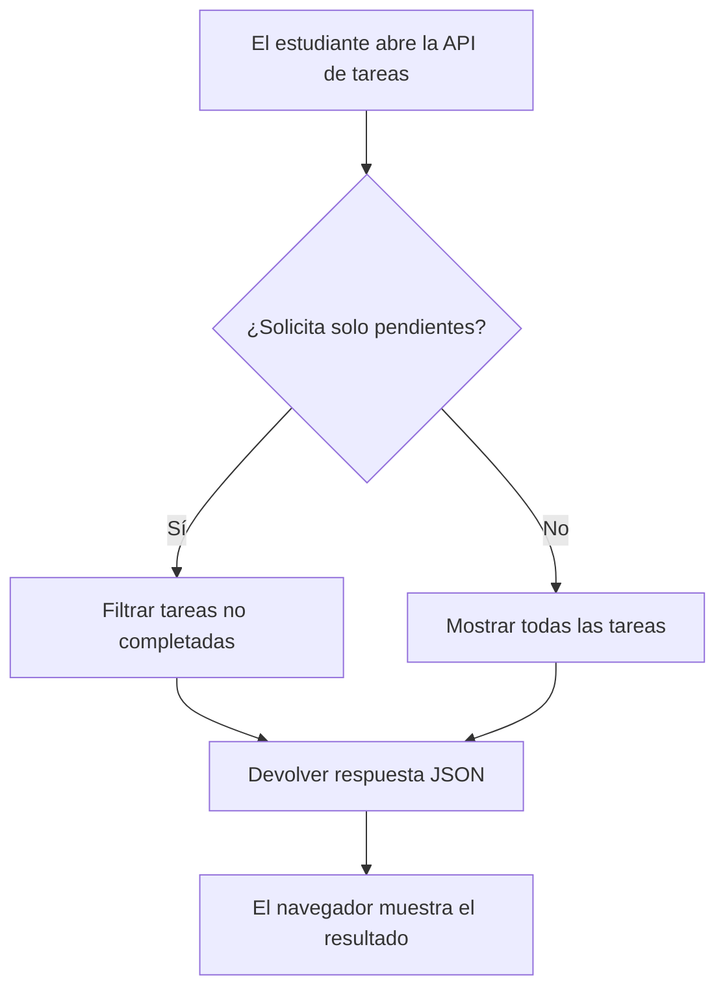

# 📚 StudyHub — Organizador académico


**StudyHub** es un proyecto académico que propone una aplicación para organizar las **asignaturas**, las **tareas** y las **fechas de entrega** de estudiantes universitarios.

Su objetivo es solucionar un problema frecuente: tener las actividades repartidas entre apuntes, calendarios y distintas plataformas. La idea es reunir esa información en un mismo lugar para **planificar mejor el estudio** y *evitar olvidos*.

> **Estado del proyecto:** se incluye una pequeña API de demostración. El resto de funcionalidades descritas forman parte de una propuesta de desarrollo, no de una aplicación terminada.

---

## Índice

- [Características principales](#características-principales)
- [Instalación y configuración](#instalación-y-configuración)
- [Tecnologías utilizadas](#tecnologías-utilizadas)
- [Arquitectura y funcionamiento](#arquitectura-y-funcionamiento)
- [Ejemplos de uso](#ejemplos-de-uso)
- [Información adicional](#información-adicional)
- [Contacto](#contacto)

## Características principales

StudyHub está pensado para que cada estudiante pueda gestionar su actividad académica sin complicaciones.

1. **Gestión de asignaturas.** Registrar las materias y consultar su información.
2. **Organización de tareas.** Crear actividades asociadas a una asignatura.
   - Añadir un título y una descripción.
   - Indicar una prioridad: alta, media o baja.
   - Marcar una tarea como completada.
3. **Calendario académico.** Visualizar exámenes y fechas de entrega.
4. **Recordatorios.** Recibir avisos antes de los plazos importantes.
5. **Panel de progreso.** Consultar tareas pendientes y completadas.
6. **Filtros de búsqueda.** Localizar actividades por asignatura o estado.

### Estado de desarrollo

Las casillas siguientes representan qué partes están disponibles en la **demostración** y cuáles están previstas:

- [x] API para consultar asignaturas de ejemplo.
- [x] API para consultar tareas y filtrarlas por estado.
- [ ] Formulario para crear y editar tareas.
- [ ] Calendario con fechas de entrega.
- [ ] Recordatorios automáticos.
- [ ] Panel gráfico de estadísticas.

## Instalación y configuración

Para probar la API de demostración en tu ordenador necesitas **Python 3.12** y una terminal. No es necesario instalar una base de datos: los datos de ejemplo se guardan temporalmente en memoria.

1. Descarga la carpeta del proyecto y ábrela en **Visual Studio Code**.
2. Abre una terminal en la carpeta donde se encuentra `app.py`.
3. Crea un entorno virtual:

   ```bash
   python -m venv .venv
   ```

4. Activa el entorno virtual. En **Windows (PowerShell)**:

   ```powershell
   .\.venv\Scripts\Activate.ps1
   ```

   En **Linux o macOS**:

   ```bash
   source .venv/bin/activate
   ```

5. Instala las dependencias:

   ```bash
   pip install -r requirements.txt
   ```

6. Inicia el servidor:

   ```bash
   python app.py
   ```

7. Abre `http://127.0.0.1:5000/` en el navegador. Para consultar las asignaturas, visita `http://127.0.0.1:5000/api/asignaturas`.

**Nota:** `debug=True` se utiliza únicamente para la demostración local; no debe emplearse en un servidor público.

## Tecnologías utilizadas

| Tecnología | Versión | Descripción | Uso en el proyecto |
|:-----------|:-------:|:------------|-------------------:|
| **Python** | `3.12` | Lenguaje de programación | Lógica del servidor |
| **Flask** | `3.1.1` | *Framework* web ligero | API de demostración |
| **SQLite** | `3` | Base de datos relacional | Persistencia *prevista* |
| **HTML** | `5` | Lenguaje de marcado | Interfaz *prevista* |
| **CSS** | `3` | Hojas de estilo | Diseño visual *previsto* |

Las versiones de Python y Flask son las utilizadas como referencia para esta demostración. SQLite, HTML y CSS se incluyen como tecnologías previstas para una versión futura.

## Arquitectura y funcionamiento

En una versión completa, el estudiante interactuaría con una interfaz web que enviaría solicitudes a una API. Esta gestionaría las operaciones y almacenaría los datos en SQLite. **La demostración actual solo permite consultar datos de ejemplo en memoria.**

El siguiente diagrama muestra un proceso que **sí funciona** en la API incluida: consultar tareas y filtrar las pendientes.



La ruta `/api/tareas` devuelve todas las tareas, mientras que `/api/tareas?estado=pendientes` devuelve solamente las no completadas.

## Ejemplos de uso

### Ejemplo 1: consultar las asignaturas

Con el servidor en marcha, se puede ejecutar este comando en la terminal:

```bash
curl http://127.0.0.1:5000/api/asignaturas
```

**Respuesta de ejemplo** (formateada para facilitar la lectura):

```json
[
  {"curso": 2, "id": 1, "nombre": "Estructura de Datos"},
  {"curso": 2, "id": 2, "nombre": "Bases de Datos"}
]
```

### Ejemplo 2: consultar tareas pendientes

Para ver únicamente las tareas sin completar:

```bash
curl "http://127.0.0.1:5000/api/tareas?estado=pendientes"
```

**Respuesta de ejemplo:**

```json
[
  {
    "asignatura_id": 1,
    "completada": false,
    "id": 1,
    "titulo": "Repasar listas enlazadas"
  }
]
```

Se puede encontrar información complementaria en la [documentación oficial de Flask](https://flask.palletsprojects.com/) y en la [guía de Markdown de GitHub](https://docs.github.com/es/get-started/writing-on-github).

## Información adicional

> ⚠️ **Importante:** StudyHub es un proyecto educativo. Los datos utilizados en la demostración son ficticios y se reinician al detener el servidor. No introduzcas información personal real.

<details>
<summary>Ver posibles mejoras futuras</summary>

En futuras versiones me gustaría incorporar:

- Inicio de sesión para cada estudiante.
- Guardado de información en una base de datos.
- Sincronización de tareas con un calendario.
- Estadísticas semanales del tiempo de estudio.

</details>

<!-- Comentario HTML: este texto solo es visible al editar el archivo README.md. -->

### Caracteres especiales en Markdown

Para escribir determinados símbolos literalmente se puede utilizar la barra invertida (`\`). Por ejemplo:

- `\*Este texto no está en cursiva\*` produce \*Este texto no está en cursiva\*.
- `\# Esto no es un encabezado` produce \# Esto no es un encabezado.

## Contacto

Para consultas sobre este proyecto ficticio se puede escribir a **[studyhub@example.com](mailto:studyhub@example.com)** (dirección de ejemplo, no operativa).

Repositorio de referencia: [GitHub](https://github.com/). Este documento es una actividad académica y no anuncia un servicio comercial.

---


