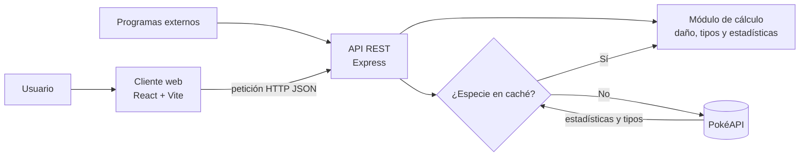
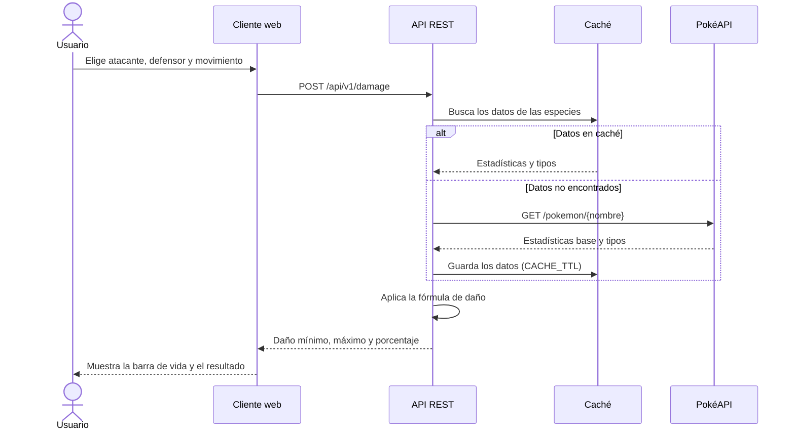

# PokéCalc

<div align="center">


**Calculadora de daño y analizador de equipos para combates Pokémon**

    
</div>

**PokéCalc** es una aplicación web con API REST que calcula *al instante* cuánto daño hace un ataque Pokémon y analiza las debilidades de un equipo completo. Está pensada para jugadores que preparan combates competitivos y no quieren hacer las cuentas a mano.

---

## Índice

- [Presentación del proyecto](#presentación-del-proyecto)
  - [Descripción general](#descripción-general)
  - [Objetivo y problema que resuelve](#objetivo-y-problema-que-resuelve)
- [Características principales](#características-principales)
  - [Funcionalidades](#funcionalidades)
  - [Estado de desarrollo](#estado-de-desarrollo)
- [Instalación y configuración](#instalación-y-configuración)
  - [Requisitos previos](#requisitos-previos)
  - [Pasos de instalación](#pasos-de-instalación)
  - [Variables de entorno](#variables-de-entorno)
- [Tecnologías utilizadas](#tecnologías-utilizadas)
- [Arquitectura y funcionamiento](#arquitectura-y-funcionamiento)
  - [Componentes](#componentes)
  - [Flujo de un cálculo de daño](#flujo-de-un-cálculo-de-daño)
  - [La fórmula de daño](#la-fórmula-de-daño)
- [Ejemplos de uso](#ejemplos-de-uso)
  - [Ejemplo 1: calcular el daño de un ataque](#ejemplo-1-calcular-el-daño-de-un-ataque)
  - [Ejemplo 2: analizar las debilidades de un equipo](#ejemplo-2-analizar-las-debilidades-de-un-equipo)
  - [Recursos relacionados](#recursos-relacionados)
- [Información adicional](#información-adicional)
- [Contacto](#contacto)
- [Licencia](#licencia)

---

## Presentación del proyecto

### Descripción general

En un combate Pokémon, el daño de un ataque depende de muchos factores a la vez: el **nivel**, las **estadísticas** de los dos Pokémon, la **potencia** del movimiento, la **efectividad de tipos**, el bonus por mismo tipo (*STAB*) y un factor aleatorio. Los juegos no enseñan cómo se calcula el daño, así que el jugador nunca sabe con certeza si un ataque va a debilitar al rival.

PokéCalc reúne todo eso en una sola herramienta:

- Una **interfaz web** donde eliges atacante, defensor y movimiento, y ves el resultado en forma de barra de vida.
- Una **API REST** que cualquier otro programa (un bot de Discord, una hoja de cálculo, un simulador…) puede usar para hacer los mismos cálculos.

Los datos de las especies (estadísticas base y tipos) se obtienen de [PokéAPI](https://pokeapi.co), una base de datos pública y gratuita.

### Objetivo y problema que resuelve

**Problema:** preparar un equipo competitivo exige comprobar decenas de enfrentamientos. Hacerlo a mano es lento y es fácil equivocarse, porque la fórmula tiene redondeos en cada paso.

**Objetivo:** que cualquier jugador pueda responder en segundos a preguntas como:

1. ¿Mi ataque debilita al rival de un golpe (*OHKO*) o necesito dos (*2HKO*)?
2. ¿Cuántos puntos de esfuerzo (EVs) necesito para aguantar un ataque concreto?
3. ¿Qué tipos le hacen daño supereficaz a mi equipo y cuáles no tengo cubiertos?

~~Versión 1.0: solo calculaba el daño entre dos Pokémon.~~ Desde la versión 1.2 también analiza equipos completos de seis Pokémon.

---

## Características principales

### Funcionalidades

1. :abacus: **Calculadora de daño**
   - Muestra el daño mínimo y máximo, en puntos y en porcentaje de vida.
   - Indica cuántos golpes hacen falta para debilitar al rival (*OHKO*, *2HKO*…).
2. :fire: **Tabla de tipos interactiva**
   - Los 18 tipos con sus multiplicadores (`x0`, `x0.5`, `x1`, `x2`).
   - Combina automáticamente las debilidades de los Pokémon con dos tipos (hasta `x4`).
3. :shield: **Analizador de equipos**
   - Resume las debilidades y resistencias de los seis miembros del equipo.
   - Avisa cuando tres o más Pokémon comparten la misma debilidad.
4. :bar_chart: **Calculadora de estadísticas**
   - Calcula la estadística final a partir de la base, los IVs, los EVs y la naturaleza.
   - Sugiere el reparto mínimo de EVs para superar en velocidad a un rival.
5. :electric_plug: **API REST pública**
   - Endpoints JSON para el daño, los tipos y el análisis de equipos.
   - Con ejemplos de cada petición en [Ejemplos de uso](#ejemplos-de-uso).
6. :inbox_tray: **Importar y exportar equipos**
   - Compatible con el formato de texto de [Pokémon Showdown](https://pokemonshowdown.com).

### Estado de desarrollo

- [x] Calculadora de daño
- [x] Tabla de tipos interactiva
- [x] API REST con endpoints de daño, tipos y equipos
- [x] Analizador de equipos
- [ ] Calculadora de estadísticas (en desarrollo)
- [ ] Importar y exportar equipos en formato Showdown
- [ ] Modo oscuro en la interfaz web

---

## Instalación y configuración

### Requisitos previos

- **Node.js** `26` o superior (comprueba tu versión con `node --version`).
- **npm** `11` o superior, que se instala junto con Node.js.
- **Git**, para clonar el repositorio.

### Pasos de instalación

1. Clona el repositorio y entra en la carpeta del proyecto:

   ```bash
   git clone https://github.com/jaimefernandez-uneat/pokecalc.git
   cd pokecalc
   ```

2. Instala las dependencias del servidor y del cliente:

   ```bash
   npm install
   ```

3. Copia el archivo de ejemplo `.env.example` a `.env` y ajusta las variables (ver la [siguiente sección](#variables-de-entorno)):

   ```bash
   cp .env.example .env
   ```

4. Arranca el proyecto en modo desarrollo:

   ```bash
   npm run dev
   ```

5. Abre `http://localhost:5173` en el navegador para usar la interfaz web. La API queda disponible en `http://localhost:3000/api/v1`.

### Variables de entorno

El archivo `.env` admite estas variables:

```ini
# Puerto en el que escucha la API
PORT=3000

# URL base de PokéAPI, de donde se descargan los datos de las especies
POKEAPI_URL=https://pokeapi.co/api/v2

# Segundos que se guardan en caché las respuestas de PokéAPI (86400 = 1 día)
CACHE_TTL=86400
```

Si no defines `PORT`, la API usa el puerto `3000` por defecto.

---

## Tecnologías utilizadas

| Tecnología | Versión | Descripción | Uso en el proyecto |
|:-----------|:-------:|:------------|:-------------------|
| **Node.js** | `26 LTS` | Entorno para ejecutar JavaScript en el servidor | Ejecuta la API REST |
| **Express** | `5.3` | Framework web minimalista para Node.js | Define las rutas `/api/v1/*` y valida las peticiones |
| **React** | `19.3` | Librería para construir interfaces de usuario | Interfaz web de la calculadora y del analizador |
| **TypeScript** | `7.0` | Superconjunto de JavaScript con *tipado estático* | Todo el código del cliente y del servidor |
| **Vite** | `8.3` | Herramienta de compilación y servidor de desarrollo | Arranca y empaqueta el cliente React |
| **PokéAPI** | `v2` | API pública con datos de todas las especies | Fuente de las estadísticas base y los tipos |

---

## Arquitectura y funcionamiento

PokéCalc tiene tres partes: un **cliente web** en React, una **API** en Express que hace los cálculos y **PokéAPI** como fuente externa de datos. Para no depender de PokéAPI en cada consulta, la API guarda en una **caché** los datos de las especies que ya ha descargado.

### Componentes



### Flujo de un cálculo de daño

Este diagrama muestra lo que ocurre desde que el usuario pulsa **Calcular** hasta que ve el resultado:



### La fórmula de daño

El módulo de cálculo usa la fórmula oficial de los juegos, simplificada sin golpes críticos ni clima:

Daño base = ((2 \* Nivel / 5 + 2) \* Potencia \* Ataque / Defensa) / 50 + 2

Después se multiplica por el bonus *STAB* (`x1.5`), la efectividad de tipos y un factor aleatorio entre `0.85` y `1`.

---

## Ejemplos de uso

### Ejemplo 1: calcular el daño de un ataque

Un Garchomp de nivel 50 con 182 de Ataque usa *Terremoto* (tipo Tierra, potencia 100) contra un Pokémon de tipo Normal con 175 PS y 100 de Defensa:

```bash
curl -X POST http://localhost:3000/api/v1/damage \
  -H "Content-Type: application/json" \
  -d '{
    "atacante": { "nivel": 50, "ataque": 182, "tipos": ["dragon", "tierra"] },
    "movimiento": { "tipo": "tierra", "potencia": 100, "categoria": "fisico" },
    "defensor": { "ps": 175, "defensa": 100, "tipos": ["normal"] }
  }'
```

La API responde con:

```json
{
  "danio": { "minimo": 104, "maximo": 123 },
  "porcentaje": { "minimo": 59.4, "maximo": 70.3 },
  "stab": true,
  "efectividad": 1,
  "resultado": "2HKO garantizado"
}
```

### Ejemplo 2: analizar las debilidades de un equipo

Este script de JavaScript pide a la API las debilidades de cada miembro de un equipo y avisa de los tipos peligrosos. Guárdalo como `analizar.mjs` y ejecútalo con `node analizar.mjs`:

```javascript
const equipo = ["garchomp", "rotom-wash", "ferrothorn", "gengar", "dragonite", "tyranitar"];

const respuesta = await fetch("http://localhost:3000/api/v1/team/analysis", {
  method: "POST",
  headers: { "Content-Type": "application/json" },
  body: JSON.stringify({ equipo }),
});

const { debilidades } = await respuesta.json();

// Muestra los tipos a los que son débiles 3 o más miembros del equipo
for (const [tipo, miembros] of Object.entries(debilidades)) {
  if (miembros.length >= 3) {
    console.warn(`⚠️ ${miembros.length} Pokémon son débiles a ${tipo}: ${miembros.join(", ")}`);
  }
}
```

### Recursos relacionados

- [Documentación de PokéAPI](https://pokeapi.co/docs/v2): datos de especies, tipos y movimientos.
- [Fórmula de daño en Bulbapedia](https://bulbapedia.bulbagarden.net/wiki/Damage): explicación completa con todos los modificadores.
- [Guía de Express](https://expressjs.com/es/): framework usado en la API.
- [Documentación de React](https://react.dev/learn): librería usada en la interfaz web.
- [Documentación de Node.js](https://nodejs.org/docs/latest-v26.x/api/): entorno en el que se ejecuta la API.

---

## Información adicional

> :warning: **Importante:** PokéCalc usa la fórmula de daño de la **novena generación** (*Escarlata y Púrpura*). Los resultados pueden variar unos pocos puntos en juegos anteriores, porque el orden de los redondeos ha cambiado entre generaciones.

<details>
<summary>Ver la implementación de la fórmula de daño</summary>

Este es el núcleo del módulo de cálculo. Cada `Math.floor` reproduce un redondeo que hace el juego:

```javascript
// Fórmula de daño simplificada (sin críticos ni clima)
const calcularDanio = ({ nivel, potencia, ataque, defensa, stab, efectividad }) => {
  const base = Math.floor(Math.floor((Math.floor(2 * nivel / 5) + 2) * potencia * ataque / defensa) / 50) + 2;
  const mod = (stab ? 1.5 : 1) * efectividad;
  return {
    minimo: Math.floor(base * mod * 0.85),
    maximo: Math.floor(base * mod),
  };
};

console.log(calcularDanio({ nivel: 50, potencia: 100, ataque: 182, defensa: 100, stab: true, efectividad: 1 }));
// { minimo: 104, maximo: 123 }
```

</details>

---

## Contacto

¿Has encontrado un error o tienes una idea para el proyecto? Escríbeme:

- :email: Autor: **Jaime Fernández** · [jaime.fernandez2@alumnos.uneatlantico.es](mailto:jaime.fernandez2@alumnos.uneatlantico.es)
- :bug: Errores y sugerencias: [soporte@pokecalc.ejemplo.es](mailto:soporte@pokecalc.ejemplo.es)

---

## Licencia

Este proyecto se distribuye bajo la licencia **MIT**. Puedes consultar su texto en [opensource.org](https://opensource.org/license/mit).

*Pokémon y todos sus nombres son marcas de Nintendo, Game Freak, Creatures y The Pokémon Company. PokéCalc es un proyecto de fans, educativo y sin ánimo de lucro.*
