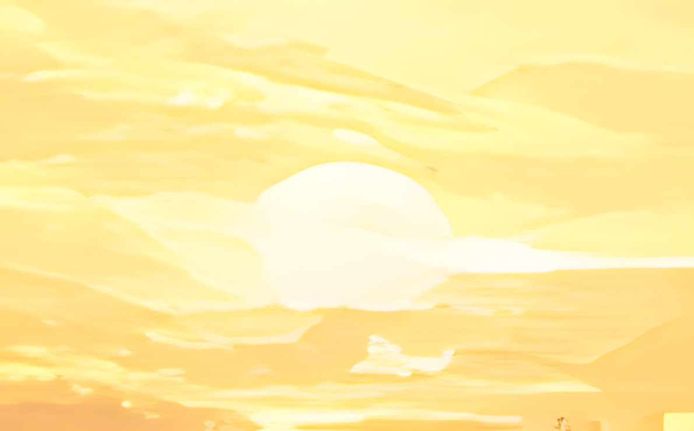
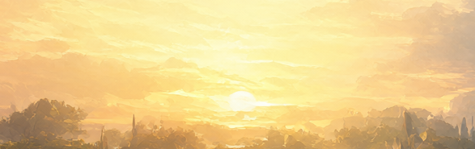
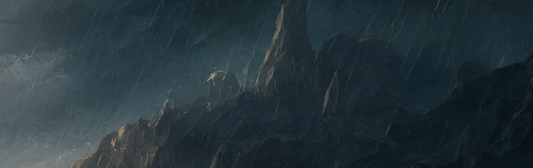
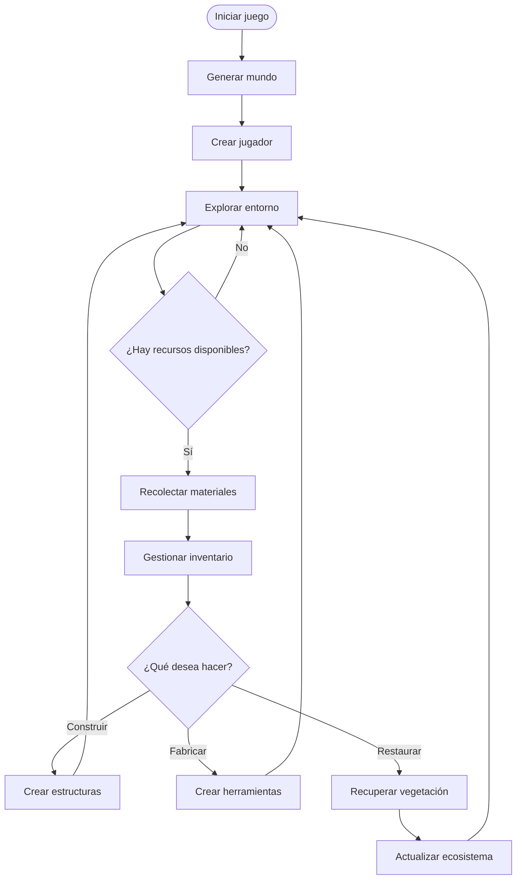

# Mossbound  




 

---
## Índice
1. [Presentación del proyecto](#1-presentación-del-proyecto)
2. [Características principales](#2-características-principales)
3. [Instalación y configuración](#3-instalación-y-configuración)
4. [Tecnologías utilizadas](#4-tecnologías-utilizadas)
5. [Arquitectura y funcionamiento](#5-arquitectura-y-funcionamiento)
6. [Ejemplos de uso](#6-ejemplos-de-uso)
7. [Estado del proyecto](#7-estado-del-proyecto)

---
## 1. Presentación del proyecto
### ¿Qué es Mossbound?

Mossbound es un videojuego de mundo abierto en 3D con estética low-poly y mecánicas de construcción mediante bloques.

El jugador aparece en un valle natural que ha perdido gran parte de su vegetación. A través de la exploración podrá encontrar recursos, fabricar herramientas, construir refugios y recuperar los ecosistemas de la zona.

A diferencia de otros juegos de construcción tradicionales, en Mossbound el objetivo no es únicamente sobrevivir o construir grandes estructuras, sino **restaurar el equilibrio de la naturaleza.**

El mundo está compuesto por diferentes biomas, cada uno con sus propios materiales, vegetación y características.

### Objetivo principal

El objetivo principal es ofrecer una experiencia relajada de exploración y construcción, donde el jugador pueda desarrollar su propio espacio mientras recupera progresivamente el entorno natural.

### Problema que pretende resolver:

Muchos videojuegos de supervivencia se centran principalmente en el combate, la dificultad y la competición. Mossbound propone una alternativa más tranquila, enfocada en la creatividad, la exploración y la satisfacción de ver cómo el mundo cambia gracias a las acciones del jugador.

### Concepto visual

La identidad visual del proyecto se basa en colores naturales, formas simples y escenarios inmersivos.





---
## 2. Características principales

El proyecto contará inicialmente con las siguientes funcionalidades:

### Exploración del mundo

* Mundo dividido en pequeños biomas.
* Generación de terrenos mediante bloques.
* Diferentes recursos según la zona explorada.
* Ciclo básico de día y noche.

### Recolección de recursos

El jugador podrá recoger diferentes materiales para utilizarlos en la construcción y fabricación de objetos.

Algunos recursos disponibles serán:

* Madera: obtenida de los árboles.
* Piedra: encontrada en montañas y cuevas.
* Musgo: utilizado para recuperar zonas naturales.
* Semillas: permiten regenerar la vegetación.

### Sistema de construcción

Permitirá colocar y retirar bloques para modificar el entorno.

* Construcción de refugios.
* Colocación de caminos y elementos decorativos.
* Uso de diferentes materiales.
* Sistema básico de inventario.

### Restauración natural

Esta será la mecánica distintiva del videojuego.

Al utilizar determinados materiales en zonas deterioradas, el entorno comenzará a recuperar su vegetación.

Por ejemplo:

1. El jugador encuentra una zona sin vegetación.
2. Recolecta musgo y semillas.
3. Utiliza los materiales en el terreno.
4. La zona recupera progresivamente su aspecto natural.

### Sistema de fabricación (Crafting)

Permitirá combinar materiales para crear herramientas y objetos.

|Objeto            |Materiales necesarios|
|------------------|---------------------|
|Hacha básica      |3 maderas + 2 piedras|
|Pico básico       |2 maderas + 3 piedras|
|Semillas mejoradas|2 semillas + 1 musgo |
|Bloque de madera  |1 madera             |

### Estado de las funcionalidades

La siguiente lista representa el estado previsto del desarrollo:

- [x] Diseño conceptual del mundo y sus biomas.
- [x] Definición de las mecánicas principales.
- [ ] Generación básica del terreno.
- [ ] Sistema de movimiento del jugador.
- [ ] Recolección de recursos.
- [ ] Inventario y fabricación.
- [ ] Sistema de construcción.
- [ ] Restauración de ecosistemas.
- [ ] Ciclo de día y noche.
- [ ] Guardado y carga de partidas.

---
## 3. Instalación y configuración
> [¡IMPORTANTE!]  
>  Mossbound es un proyecto ficticio. Los pasos, comandos y archivos de esta sección representan una posible aplicacion para una futura versión del videojuego. No existe actualmente una versión descargable.

### Requisitos previos

* Una buena PC

### Pasos de instalación

1. Clonar el repositorio 

``` bash
git clone https://example.com/mossbound.git
```

2. Acceder al directorio del proyecto

``` bash
cd mossbound
```

3. Comprobar la instalación de Java

``` bash
java -version
```

4. Preparar las dependencias

``` bash
./gradlew build
```

5. Iniciar el videojuego

``` bash
./gradlew run
``` 

### Configuración inicial

El proyecto utilizaría un archivo config.properties para almacenar algunos parámetros básicos:

``` properties
# Configuración de Mossbound

game.name=Mossbound
game.version=0.1.0-alpha

world.seed=12345
world.size=small

player.starting_health=100
player.starting_resources=10

graphics.quality=medium
graphics.fullscreen=false
```

### Ejemplo de inicialización en Java

El siguiente código es una representación ficticia de cómo podría organizarse el inicio del videojuego:

``` java
public class Mossbound {

    public static void main(String[] args) {

        System.out.println("Starting Mossbound...");

        GameWorld world = new GameWorld();
        Player player = new Player();

        world.generateTerrain();
        player.spawn(world.getStartingPoint());

        System.out.println("World generated successfully!");
        System.out.println("Welcome to Mossbound!");

    }
}
```

---
## 4. Tecnologías utilizadas

La siguiente tabla muestra las tecnologías que se plantean utilizar para desarrollar el proyecto.

|Tecnología|Versión    |Descripción                                  |Uso en el proyecto                       |
|:----------:|:---------:|---------------------------------------------|-----------------------------------------|
|     |	21     |Lenguaje de programación orientado a objetos.|Lógica principal del videojuego.         |
|    |	1.13.x |Framework para desarrollo de videojuegos.    |Gestión gráfica y ejecución del juego.   |
|    |	8.x    |Herramienta de automatización de compilación.|Dependencias y construcción del proyecto.|
|      |	2.x    |Sistema de control de versiones.             |Seguimiento de cambios.                  |
|   |	4.x    |Software de modelado 3D.                     |Creación de modelos y elementos visuales.|

Las versiones son orientativas y podrían cambiar durante el desarrollo.

---
## 5. Arquitectura y funcionamiento

Organización general

Mossbound se organizaría mediante diferentes módulos para separar las responsabilidades del videojuego.

La estructura inicial del proyecto podría ser la siguiente:

``` text
mossbound/
│
├── assets/
│   ├── textures/
│   ├── models/
│   ├── sounds/
│   └── maps/
│
├── src/
│   └── main/
│       └── java/
│           └── com/mossbound/
│               ├── Main.java
│               ├── player/
│               ├── world/
│               ├── inventory/
│               ├── crafting/
│               └── environment/
│
├── config/
│   └── config.properties
│
├── README.md
└── build.gradle
```

### Funcionamiento del videojuego

El funcionamiento general se dividiría en cinco etapas:

1. Inicialización del juego y configuración del mundo.
2. Aparición del jugador en el terreno.
3. Exploración y recolección de recursos.
4. Utilización de materiales para construir y fabricar objetos.
5. Restauración de las zonas naturales mediante los recursos obtenidos.

### Diagrama de flujo

El siguiente diagrama representa el ciclo principal de juego:



El ciclo se repite mientras el jugador continúe explorando y modificando el mundo.

---
## 6. Ejemplos de uso

A continuación se muestran ejemplos de cómo sería la interacción con las mecánicas principales del videojuego.

### Ejemplo 1: Fabricación de una herramienta

El jugador ha recolectado madera y piedra durante su exploración y quiere fabricar un hacha básica:

``` java
// Materiales disponibles en el inventario
int wood = 5;
int stone = 4;

// Comprobar si se puede fabricar un hacha
if (wood >= 3 && stone >= 2) {

    wood -= 3;
    stone -= 2;

    System.out.println("Basic axe crafted!");

} else {

    System.out.println("Not enough resources.");

}
```

Resultado esperado:

* Se consumen 3 unidades de madera.
* Se consumen 2 unidades de piedra.
* El jugador obtiene un hacha básica.

### Ejemplo 2: Restauración de un ecosistema

El jugador encuentra una zona deteriorada y utiliza semillas y musgo para recuperar su vegetación.

``` java
// Recursos del jugador
int seeds = 4;
int moss = 3;

// Restauración de una zona
if (seeds >= 2 && moss >= 1) {

    seeds -= 2;
    moss -= 1;

    environment.restoreNature();

    System.out.println("Ecosystem restored!");

}
```

Resultado esperado:

La zona comienza a recuperar su vegetación y cambia progresivamente su apariencia visual.

---
## 7. Estado del proyecto
### Versión 0.1.0 - Alpha

Primera versión conceptual y de planificación.

Objetivos previstos:

- Definir las mecánicas principales.
- Establecer la estructura del proyecto.
- Diseñar el sistema de recursos.
- Crear una primera versión del terreno.

<details>
<summary><strong>Ver información sobre las futuras versiones</strong></summary>

### Versión 0.5.0 - Beta

Objetivos previstos:

- Implementar la construcción.
- Añadir el sistema de inventario.
- Incorporar diferentes biomas.
- Desarrollar la restauración natural.
### Versión 1.0.0 - Release

Objetivos previstos:

- Completar las mecánicas principales.
- Mejorar el rendimiento.
- Añadir sonidos y efectos ambientales.
- Incorporar guardado de partidas.
- Publicar una primera versión jugable.

</details>

<!-- IMPORTANTE: Añadir capturas reales del videojuego cuando exista una primera versión funcional. -->

#### Mossbound: Explora, Construye & Restaura. 

> *"Un pequeño mundo puede cambiar con grandes ideas"*.