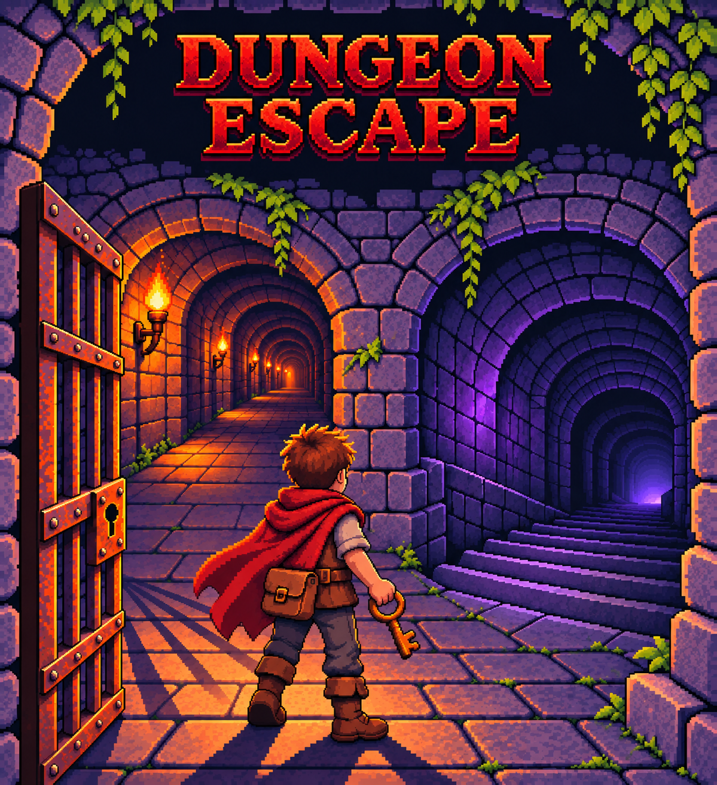
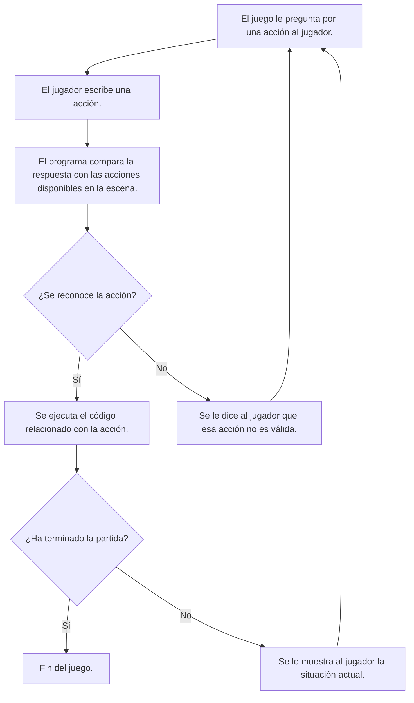

# Dungeon Escape (Pre-alpha)

## 1. Presentación del Videojuego

### Descripción General del Videojuego


Dungeon Escape es un videojuego del género de **aventura conversacional**. El jugador debe escribir en la terminal la acción que desea hacer, y en función de sus decisiones ocurren distintos eventos.

**Despiertas en una celda abandonada.** No recuerdas cómo llegaste ahí... Frente a ti hay una puerta de hierro cerrada y una pequeña llave oxidada en el suelo. **Necesitas escapar.** Y ahora, *¿qué quieres hacer?*

Debes elegir entre distintos caminos. Algunos te llevarán un poco más cerca de la salida. Eso sí, ten mucho cuidado, porque parece que alguien te está siguiendo... :scream:




Decidí desarrollar este videojuego porque me gusta el desarrollo de videojuegos. Tengo experiencia previa desarrollando juegos en Unity, pero decidí desarrollar Dungeon Escape únicamente en Java para complementar mi aprendizaje en la universidad. Mi objetivo con este proyecto es aprender Java básico y entender cómo funcionan e interactúan entre sí las estructuras de control. También estoy aprendiendo a desarrollar un programa con un enfoque más narrativo, que es propio de este género de videojuegos.

Mi objetivo es que el jugador tenga una buena experiencia y que tanto las mecánicas como la historia sean entretenidas. Espero seguir puliendo el juego, la historia y las etapas, agregando consecuencias, caminos, detalles y easter eggs para que el usuario pueda disfrutar completamente de la experiencia.

---

## 2. Índice de Contenidos

- [Dungeon Escape (Pre-alpha)](#dungeon-escape-pre-alpha)
  - [1. Presentación del Videojuego](#1-presentación-del-videojuego)
    - [Descripción General del Videojuego](#descripción-general-del-videojuego)
  - [2. Índice de Contenidos](#2-índice-de-contenidos)
  - [3. Características Principales](#3-características-principales)
  - [4. Instalación y Configuración](#4-instalación-y-configuración)
    - [Requisitos Previos](#requisitos-previos)
    - [Obtener el juego](#obtener-el-juego)
  - [5. Tecnologías Usadas](#5-tecnologías-usadas)
  - [6. Arquitectura o Funcionamiento](#6-arquitectura-o-funcionamiento)
  - [7. Ejemplos de Uso](#7-ejemplos-de-uso)
      - [No se reconoce la acción](#no-se-reconoce-la-acción)
      - [Se reconoce la acción](#se-reconoce-la-acción)
      - [Recursos Relacionados](#recursos-relacionados)
  - [8. Información Adicional](#8-información-adicional)
      - [Contacto](#contacto)

## 3. Características Principales

* [x] El jugador escribe acciones en la terminal para avanzar.
* [x] Si la acción no coincide con las opciones disponibles, se le pregunta de nuevo al jugador.
* [x] Las opciones importantes tienen diferentes consecuencias.
* [x] Hay varios caminos por elegir.
* \[x] Se puede retroceder de camino en ciertas situaciones.
* [ ] Mecánica de intento fallido + reinicio.
* [ ] Etapa 2 -- Llegada al jardín.
* [ ] Etapa 2 -- Bajando las escaleras.
* [ ] Mecánica de inventario.
* [ ] Probabilidad de encontrarse con alguien.

## 4. Instalación y Configuración

### Requisitos Previos

* **Java Development Kit (JDK):** Es necesario para compilar y ejecutar el programa. El videojuego ha sido probado con la versión `21.0.8 LTS`.
* **Editor de código (opcional):** Utilicé Visual Studio Code para compilar y ejecutar el programa, pero se puede hacer perfectamente desde una terminal.

### Obtener el juego

1. Descargar el videojuego desde este repositorio.
2. Situar la terminal donde está el archivo.
3. Compilar el programa.

   ```bash
   javac DungeonEscape.java
   ```
4. Ejecutar el programa.

   ```bash
   java DungeonEscape
   ```

## 5. Tecnologías Usadas

| Tecnología         |    Versión    | Descripción                                                 | Uso                                                                   |
| :------------------ | :------------: | :----------------------------------------------------------- | :-------------------------------------------------------------------- |
| Java JDK            | `21.0.8 LTS` | Entorno de Java                                              | Codificar en Java, compilar y ejecutar archivos `.java`             |
| Visual Studio Code  |  `1.145.2`  | Editor de código                                            | Desarrollar el videojuego y crear archivo `README.md`               |
| Git                 |   `2.55.0`   | Sistema de control de versiones local                        | Hacer commits y push al repositorio remoto del videojuego             |
| GitHub              |   No aplica   | Plataforma donde está el alojamiento remoto del repositorio | Guarda los archivos y el historial de versiones. Hacer pull requests. |
| Markdown All in One |   `3.6.3`   | Extensión de VSCode para edición de Markdown               | Creación y modificación archivo `README.md`                       |

## 6. Arquitectura o Funcionamiento

El jugador está en una situación. El programa le pregunta qué quiere hacer, y el jugador escribe en la terminal su respuesta. Esa respuesta es procesada por el código y es comparada con las acciones disponibles en la escena. Si el programa reconoce la acción, se ejecuta el código relacionado con esta acción. Si no reconoce la acción, el programa ejecuta un código donde se le dice al jugador que esa acción no es válida y le vuelve a preguntar por lo que quiere hacer.

Los efectos que puede tener una acción reconocida son:

* Obtener información acerca del entorno donde se encuentra el jugador.
* Obtener objetos que le permitan al jugador llevar a cabo determinadas acciones.
* Avanzar hacia la siguiente etapa o entorno.



## 7. Ejemplos de Uso

#### No se reconoce la acción

```text
=============================
DUNGEON ESCAPE
=============================

Despiertas en una celda abandonada. No recuerdas cómo llegaste ahí...
Frente a ti hay una puerta de hierro cerrada y una pequeña llave oxidada en el suelo.
Necesitas escapar.

¿Qué quieres hacer?
nada
Has elegido: nada

No sabes cómo hacer eso.

Frente a ti hay una puerta de hierro y una llave oxidada.
¿Qué quieres hacer?
recoger la llave
Has elegido: recoger la llave

Te acercas y recoges la llave.
Está oxidada.
Parece que podría ir en algún sitio...
¿Qué quieres hacer?
```

---

#### Se reconoce la acción

```text
¡HAS ESCAPADO DE LA CELDA!
No será tan fácil la próxima vez...

Avanzas y observas que frente a ti hay dos caminos.
A tu izquierda hay un pasillo, por el que entra una corriente de aire.
A tu derecha hay unas escaleras, que descienden hacia la oscuridad.
¿Hacia dónde quieres ir?
A la izquierda
Has elegido: A la izquierda

Te adentras por el pasillo.
Su brisa es cada vez más fuerte.
Hay pequeñas antorchas iluminando el camino.
Al final del pasillo ves una puerta abierta.
Sigues y entras en el jardín.
¿Qué haces?
```

#### Recursos Relacionados

* [Cómo compilar y ejecutar archivos Java](https://docs.oracle.com/javase/tutorial/getStarted/cupojava/unix.html)
* [Guía para jugar aventuras conversacionales](https://juegos.leame.com/guia)

## 8. Información Adicional

> El videojuego se encuentra en Pre-alpha, por lo que todavía no se puede completar.

<details>
<summary>Pequeña ayuda para el principio</summary>
Presta atención a los objetos que están en la habitación.
</details>

<!-- Hola. -->

#### Contacto

* [Perfil de Github](https://github.com/JoseA236) :sunglasses:
