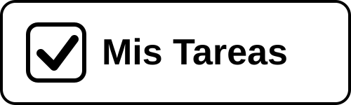
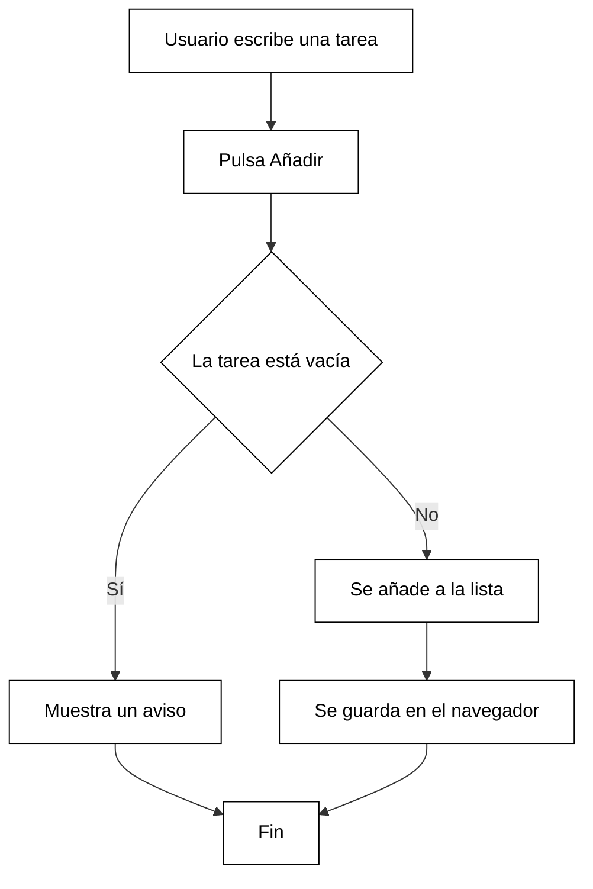

<a id="inicio"></a>

# Mis Tareas

<div align="center">




</div>

---

## Presentación del proyecto

**Mis Tareas** es una pequeña página web donde puedes *apuntar lo que tienes que hacer* y marcarlo cuando lo termines. :white_check_mark:

**Autor:** Jose Damian Cagigas

**Objetivo:** tener una lista de tareas sencilla, sin registros ni cosas complicadas.

**Problema que resuelve:** a veces se nos olvidan las tareas del día. Con esta aplicación las ves todas en un solo sitio y sabes cuáles te quedan por hacer.

---

## Índice de contenidos

- [Presentación del proyecto](#presentación-del-proyecto)
- [Características principales](#características-principales)
- [Instalación y configuración](#instalación-y-configuración)
- [Tecnologías utilizadas](#tecnologías-utilizadas)
- [Arquitectura y funcionamiento](#arquitectura-y-funcionamiento)
- [Ejemplos de uso](#ejemplos-de-uso)
- [Información adicional](#información-adicional)

---

## Características principales

1. **Añadir tareas**
   - Escribir el nombre de la tarea
   - Pulsar el botón "Añadir"
2. **Marcar tareas como hechas**
   - La tarea aparece tachada
3. **Borrar tareas**
   - Borrar una tarea concreta
   - Borrar todas las tareas hechas a la vez
4. **Contador de tareas pendientes**
   - Muestra cuántas tareas faltan por hacer
5. **Guardado automático**
   - Las tareas se guardan en el navegador

### Estado de desarrollo

- [x] Añadir tareas
- [x] Marcar tareas como hechas
- [x] Borrar tareas
- [ ] Contador de tareas pendientes
- [x] Guardado automático

---

## Instalación y configuración

Para usar el proyecto en tu ordenador sigue estos pasos:

1. Descarga el proyecto con `git clone`.
2. Entra en la carpeta `mis-tareas`.
3. Abre el archivo `index.html` con tu navegador.

```bash
git clone https://github.com/JoseDamianCagigas05/mis-tareas.git
cd mis-tareas
```

> No hace falta instalar nada más.

---

## Tecnologías utilizadas

| Tecnología | Versión | Descripción | Uso en el proyecto |
|:-----------|:-------:|:------------|-------------------:|
| **HTML** | `5` | Lenguaje para crear páginas web | Estructura de la página |
| **CSS** | `3` | Lenguaje para dar estilo | Colores y diseño |
| **JavaScript** | `ES6` | Lenguaje de programación web | Lógica de las tareas |
| *Git* | `2.x` | Control de versiones | Guardar y subir el código |

---

## Arquitectura y funcionamiento

La aplicación funciona **solo en el navegador**. No tiene servidor: las tareas se guardan en el propio navegador de quien la usa.



---

## Ejemplos de uso

### Ejemplo 1: añadir una tarea

```javascript
const tareas = [];

function anadirTarea(texto) {
  tareas.push({ texto: texto, hecha: false });
  console.log("Tarea añadida:", texto);
}

anadirTarea("Hacer la compra");
```

### Ejemplo 2: marcar una tarea como hecha

```javascript
function marcarHecha(posicion) {
  tareas[posicion].hecha = true;
  console.log("Tarea hecha:", tareas[posicion].texto);
}

marcarHecha(0);
```

Más información: [JavaScript en MDN](https://developer.mozilla.org/es/docs/Web/JavaScript) y [Guía de Markdown](https://www.markdownguide.org/).

---

## Información adicional

> **Nota:** este es un proyecto ficticio creado para practicar Markdown.

<details>
<summary>Ideas para el futuro</summary>

- Poner fecha a cada tarea
- Crear categorías (casa, trabajo, estudios)
- Hacer una versión para móvil

</details>

<!-- Este comentario no se ve en el documento: la versión 1.0 es solo una práctica de Markdown. -->

### Caracteres especiales escapados

\# Esto no es un título

\*Esto no está en cursiva\*

\[Esto no es un enlace\]

### Contacto

- Correo: [jose.damian@alumnos.uneatlantico.es](mailto:jose.damian@alumnos.uneatlantico.es)
- GitHub: [@JoseDamianCagigas05](https://github.com/JoseDamianCagigas05)

---

[Volver al inicio](#inicio)
