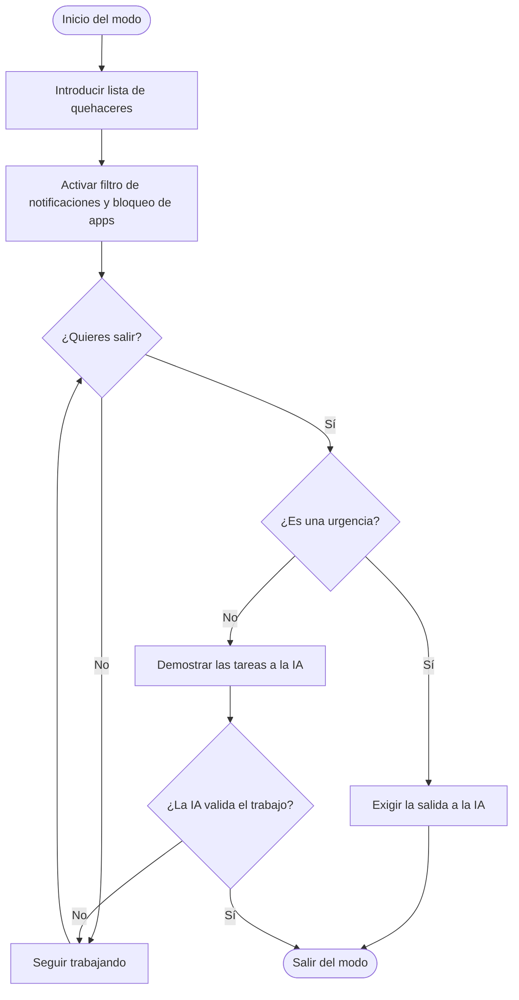

# :rocket: TaskDone AI:rocket:

 
TaskDone AI es un sistema inteligente de gestión de tareas diseñado para optimizar flujos de trabajo personales y de equipo mediante automatizaciones impulsadas por aprendizaje automático.
##  Indice
- [:rocket: TaskDone AI:rocket:](#rocket-taskdone-airocket)
  - [Indice](#indice)
  - [Objetivo principal](#objetivo-principal)
  - [Estudio](#estudio)
  - [Otras Funcionalidades](#otras-funcionalidades)
      - [La Camara](#la-camara)
      - [Análisis de Picos de Productividad](#análisis-de-picos-de-productividad)
      - [Economía de Descansos:](#economía-de-descansos)
  - [Como salir del modo:](#como-salir-del-modo)
          - [Ejemplo de lista:](#ejemplo-de-lista)
  - [Privacidad:](#privacidad)
    - [Estado de desarrollo](#estado-de-desarrollo)
  - [Resumen de funcionalidades](#resumen-de-funcionalidades)
  - [Funcionamiento](#funcionamiento)
    - [Contacto](#contacto)
## Objetivo principal
>>El objetivo de esta app se basa en resolver la dispersión de información y la falta de concentración, para esto, hemos estado analizando los principales problemas que lo generan, la  app los soluciona.
 

 
 
## Estudio
>>Nuestro estudio asegura que las mayores distracciones que ocurren en nuestro dia a dia son:
 
- ##### Las notificaciones:
  >>Las notificaciones no importantes nos hacen mirar el movil, luego, acabas en instagram escrolleando por una misera notificacion.
  Por esto, TaskDone filtra las notificaciones y solo te hace llegar las que no pueden esperar.
- ##### Las aplicaciones:
  >>Siempre que empiezas a trabajar te llega la tentacion de abrir apps para lo que se supone va a ser solo un minuto,
  TaskDonne elimina esto bloqueando apps, las apps que no quieres que se bloqueen podran ser configuradas con muchas mas opciones como si quieres descansos o que no se te bloqueen notificaciones.
## Otras Funcionalidades
 
#### La Camara
>>La IA incluye una camara que comprueva que estes siendo productivo, cuando no lo estas siendo inicia un contador y puedes configurar una alarma para que si estas cierto tiempo sin haver nada te avise.    
 
 
#### Análisis de Picos de Productividad
 
>>La IA analiza en qué franjas horarias rindes más y cuándo sufres más fatiga. Con estos datos, te sugiere automáticamente cuándo programar las tareas más pesadas y cuándo tomar descansos obligatorios.
 
#### Economía de Descansos:
 
>>Para hacer el enfoque más amigable, la app introduce un sistema de puntos que ganas al completar tareas difíciles. Estos puntos se pueden canjear por minutos extra de descanso flexible o para desbloquear momentos de ocio sin culpa.
 
## Como salir del modo:
>>Pensando sobre las funcionalidades de la app llegamos a la conclusion de que la app no seria util si puedieras salir del modo solo pulsando un boton, por tanto, antes de entrar en el modo tendras que introducir una lista de queaceres y podras salier cuando le demuestres a la IA que has acabado,no te precupes, en un caso de urgencia podras salir del modo exigiendoselo a la IA.
###### Ejemplo de lista:
- [ ] Resumen 
  Subir demostracion:
  
- [x] Estudiar (en este caso la IA te preguntara sobre el tema para poder marcarla)
 
## Privacidad:
>>La app funciona completamente en local y no envia ningun dato a el sevidor, ni siquiera los desarralladores podrán ver lo que mandas a la IA.
 
### Estado de desarrollo
 
- [x] Filtro de notificaciones
- [x] Bloqueo de aplicaciones
- [x] Salida controlada del modo
- [ ] Cámara de productividad
- [ ] Análisis de picos de productividad
- [ ] Economía de descansos

## Resumen de funcionalidades

| Funcionalidad | Qué hace | Estado |
| :--- | :--- | :---: |
| **Filtro de notificaciones** | Solo deja pasar las notificaciones que *no pueden esperar* | :white_check_mark: |
| **Bloqueo de aplicaciones** | Bloquea las apps distractoras y permite configurar excepciones | :white_check_mark: |
| **Salida controlada del modo** | Exige una lista de quehaceres y que la IA valide que has terminado | :white_check_mark: |
| **Cámara de productividad** | Comprueba que trabajas; si no, inicia un contador y una alarma | :construction: |
| **Picos de productividad** | Analiza tus franjas de mayor rendimiento y fatiga | :construction: |
| **Economía de descansos** | Puntos por tareas difíciles, canjeables por descanso u ocio | :construction: |

## Funcionamiento
 
Todo el procesamiento ocurre en el dispositivo del usuario. Al entrar en el modo se registra la lista de quehaceres, se activan el filtro de notificaciones y el bloqueo de apps, y la IA valida el trabajo realizado antes de permitir la salida. El siguiente diagrama muestra el proceso de salida del modo:
 

 

### Contacto
 
- Correo: [jose.martin@alumnos.uneatlantico.es](jose.marin@alumnos.uneatlantico.es)
