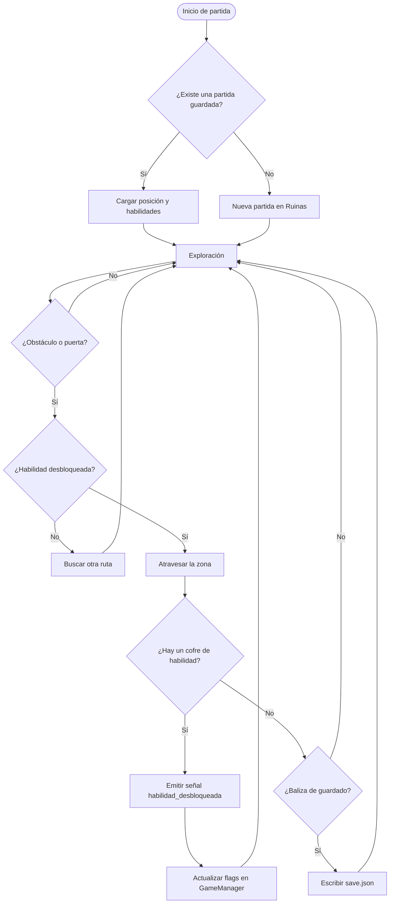

# Ecos de Ceniza 
<a id="presentacion-del-proyecto"></a>
<!--Imagen del juego aquí más adelante-->

## 1. Presentación del proyecto

### Descripción general

__Ecos de Ceniza__ es un __Metroidvania en 2D de plataformas__ desarrollado con __Godot 4__. Donde nuestra protagonsta despierta de entre ruinas de una ciudad hundida, y cuya misión será recuperar _antiguos artefactos_ repartidos por el mapa para reparar el _faro central_. 

El mundo será un único mapa interconectado, con las diversas zonas visibles, pero únicamente accesibles con cierta habilidad.

### Objetivos

Aprender a desarrollar un juego, experimentando con el flujo que tienen que seguir los jugadores y crear una progresión agradable sin llegar a ser acelerada durante todo el juego.

1. Cómo **estructurar un proyecto de juego** de forma modular y mantenible.
2. Cómo **controlar el comportamiento del jugador** mediante estados.
3. Cómo **bloquear y desbloquear zonas** según el progreso.
4. Cómo **persistir el progreso** de la partida en un archivo.

---

<a id="indice-de-contenidos"></a>

## 2. Índice de contenidos

- [1. Presentación del proyecto](#presentacion-del-proyecto)
- [2. Índice de contenidos](#indice-de-contenidos)
- [3. Características principales](#caracteristicas-principales)
- [4. Instalación y configuración](#instalacion-y-configuracion)
- [5. Tecnologías utilizadas](#tecnologias-utilizadas)
- [6. Arquitectura y funcionamiento](#arquitectura-y-funcionamiento)
- [7. Ejemplos de uso](#ejemplos-de-uso)

<!--Espacio para el resto de contenidos del índice-->

---

<a id="caracteristicas-principales"></a>

## 3. Características principales 

1. **Mapa interconectado** con cinco zonas:
   - Ruinas
   - Cloacas
   - Fábrica
   - Corales
   - Faro
2. **Sistema de habilidades** que abre nuevas rutas a las zonas:
   - Doble salto
   - Dash
   - correr para subir paredes
   - Ataque cargado
3. **Combate** Con 2 ataques (basico y fuerte), y desbloquea combos con las habilidades
4. **Minimapa** que se va revelando a medida que se explora para completar un mapa.
5. **Banda sonora ambiental** y efectos de sonido propios, buscando inmersión en el juego.

### Estado de desarrollo

- [x] Movimiento básico (correr y saltar)
- [x] Máquina de estados del jugador
- [x] Ataques (básico y fuerte)
- [x] Doble salto
- [x] Dash
- [x] Mapa de las zonas Ruinas y Cloacas
- [ ] Correr por las paredes
- [ ] Ataque cargado
- [ ] Minimapa
- [ ] Jefes finales
- [ ] Zonas Bosque Oxidado, Fábrica y Faro

---

<a id="instalacion-y-configuracion"></a>

## 4.- Instalación y configuración

**Ecos de Ceniza** será un juego **100% gratuito**. Podrá ser descargado desde **itch.io** o desde **GitHub**, y no se necesita instalar Godot para jugarlo: el juego se distribuye ya exportado y listo para ejecutar.

### Requisitos de sistema

| Componente       | Mínimo                                      |
| :--------------- | :------------------------------------------ |
| Sistema          | Windows 10/11 (64 bits) o Linux (64 bits)   |
| Memoria RAM      | 2 GB                                        |
| Gráficos         | Compatible con *OpenGL 3.3* o superior      |
| Espacio en disco | 200 MB libres                               |
| Navegador (web)  | Chrome, Firefox o Edge actualizados         |
| Extras           | Mando compatible con *XInput* (opcional)    |

### Descarga
 
Elige la plataforma de descarga que prefieras:
 
- **itch.io**: También permite jugar directamente en el navegador, sin instalar nada.
- **GitHub Releases**: Donde se encontrarán todas las versiones publicadas.

| Plataforma        | Archivo                      | Tamaño aprox. |
| :---------------- | :--------------------------- | ------------: |
| Windows (64 bits) | `ecos-de-ceniza-windows.zip` |        150 MB |
| Linux (64 bits)   | `ecos-de-ceniza-linux.zip`   |        140 MB |
| Navegador (HTML5) | *Se juega en itch.io*        |             — |

### Pasos de instalación 

#### Windows
 
1. Descarga el archivo `ecos-de-ceniza-windows.zip`.
2. Extrae el contenido en una carpeta, por ejemplo `C:\Juegos\EcosDeCeniza`.
3. Abre la carpeta y ejecuta `EcosDeCeniza.exe`.
4. También puedes extraer el archivo desde **PowerShell**:
 
```powershell
Expand-Archive -Path .\ecos-de-ceniza-windows.zip -DestinationPath .\EcosDeCeniza
 
.\EcosDeCeniza\EcosDeCeniza.exe
```
 
#### Linux
 
1. Descarga `ecos-de-ceniza-linux.zip` desde itch.io o GitHub.
2. Extrae el archivo y da permisos de ejecución con `chmod +x`.
3. Ejecuta `EcosDeCeniza.x86_64`.

```bash
curl -L -o ecos-de-ceniza-linux.zip \
  https://github.com/usuario/ecos-de-ceniza/releases/latest/download/ecos-de-ceniza-linux.zip
 
unzip ecos-de-ceniza-linux.zip -d ecos-de-ceniza
cd ecos-de-ceniza
chmod +x EcosDeCeniza.x86_64
./EcosDeCeniza.x86_64
```
 
#### Navegador
 
1. Entra en la página del juego en [itch.io](https://usuario.itch.io/ecos-de-ceniza).
2. Pulsa el botón **Run game** y espera a que cargue.
3. Puedes activar la pantalla completa con el botón del reproductor.

### Configuración
 
Dentro del juego, el menú **Opciones** permite ajustar el volumen de la música y los efectos, la pantalla completa y los controles. Los ajustes y la partida se guardan en la carpeta de datos del usuario:
 
| Sistema | Ruta de los datos del juego                                  |
| :------ | :----------------------------------------------------------- |
| Windows | `%APPDATA%\Godot\app_userdata\Ecos de Ceniza\`               |
| Linux   | `~/.local/share/godot/app_userdata/Ecos de Ceniza/`          |
 
### Controles
 
| Acción        | Teclado    | Control      |
| :------------ | :--------: | :----------: |
| Mover         | `A` / `D`  | Stick izq.   |
| Saltar        | `Espacio`  | `A`          |
| Dash          | `Shift`    | `RB`         |
| Atacar        | `J`        | `X`          |
| Pausa         | `Esc`      | `Start`      |
 
### Compilar desde el código fuente (opcional)
 
Solo es necesario si quieres modificar el juego. Necesitas **Godot 4.3** o superior y **Git**.
 
1. Clona el repositorio con `git clone`.
2. Abre Godot, pulsa **Importar** y selecciona el archivo `project.godot`.
3. Pulsa `F5` para ejecutar el proyecto.
4. Para generar tu propia versión, ve a `Proyecto > Exportar` y elige `Windows`, `Linux` o `Web`.

```bash
git clone https://github.com/usuario/ecos-de-ceniza.git
cd ecos-de-ceniza
 
godot --editor --path .
```
 
---

<a id="tecnologias-utilizadas"></a>

## 5. Tecnologías utilizadas

| Tecnología                      | Versión   | Descripción                                      | Uso en el proyecto                                              |
| :------------------------------ | :-------: | :----------------------------------------------- | :-------------------------------------------------------------- |
| **Godot Engine**                | `4.3`     | Motor de videojuegos *open source* 2D y 3D.      | Motor principal: escenas, físicas, entrada y exportación.       |
| **GDScript**                    | `4.3`     | Lenguaje de scripting propio de Godot.           | Lógica del jugador, enemigos, GameManager y guardado.           |
| **Aseprite**                    | `1.3`     | Editor de *pixel art* y animación.               | Creación de *sprites* y animaciones de personajes.              |
| **LMMS**                        | `1.2`     | Software de música y edición de audio.           | Composición de la banda sonora y edición de efectos.            |
| **Git** y **GitHub**            | `2.43`    | Control de versiones y alojamiento del código.   | Seguimiento de cambios y entrega del proyecto.                  |
| **Mermaid**                     | `10.x`    | Herramienta de diagramas basada en texto.        | Diagramas de arquitectura incluidos en este `README.md`.        |

---

<a id="arquitectura-y-funcionamiento"></a>

## 6. Arquitectura y funcionamiento

El juego se organiza en **escenas** reutilizables (`Player`, `Enemy`, `Level`, `UI`) y un **autoload** llamado `GameManager`, que guarda el estado global: habilidades desbloqueadas, salas visitadas y vida máxima.

- El **jugador** se controla con una máquina de estados: `Idle`, `Run`, `Jump`, `Fall`, `Dash`, `Wall`, `Attack` y `Hurt`.
- Los sistemas se comunican mediante **señales** (por ejemplo, `hability_achived`), lo que evita dependencias directas entre nodos.
- Cada **zona bloqueada** consulta un flag en `GameManager` para saber si el jugador puede pasar.

### Estructura de carpetas

```
ecos-de-ceniza/
├── project.godot
├── scenes/      # Player, Enemy, Level, UI
├── scripts/     # GDScript: estados, GameManager, guardado
├── assets/      # Sprites y tilesets
├── audio/       # Música y efectos
└── docs/        # Capturas y documentación
```

### Diagrama de flujo del desbloqueo de habilidades y guardado



---

<a id="ejemplos-de-uso"></a>

## 7. Ejemplos de uso

### Ejemplo 1: desbloquear el dash y llegar a una nueva zona

1. Explora las **Cloacas** hasta encontrar el dash.
2. Vuelve al **Bosque Oxidado**, donde un abismo por ejemplo bloquea el camino.
3. Haz un dash en pleno salto para cruzar.

El estado `Dash` del jugador se implementa así:

<!-- gdscript no se puestra con colores ;( -->

```
# scripts/player/state_dash.gd
extends State

const DASH_SPEED := 600.0
const DASH_TIME := 0.2

var timer := 0.0

func enter() -> void:
    timer = DASH_TIME
    player.velocity = Vector2(player.facing * DASH_SPEED, 0.0)

func physics_update(delta: float) -> void:
    timer -= delta
    player.move_and_slide()
    if timer <= 0.0:
        state_machine.change_state("Fall")
```

Y la puerta del abismo podría comprobar la habilidad en el `GameManager`:

```
# scripts/world/ability_gate.gd
extends Area2D

@export var required_ability: String = "dash"

func _on_body_entered(body: Node2D) -> void:
    if body.is_in_group("player") and GameManager.has_ability(required_ability):
        queue_free()  # La barrera desaparece
```

### Ejemplo 2: añadir un enemigo nuevo

1. Duplica la escena `scenes/enemies/enemy_base.tscn`.
2. Cambia el sprite y ajusta las estadísticas en el Inspector.
3. Asigna un script que herede del enemigo base:

```
# scripts/enemies/enemy_slime.gd
extends EnemyBase

func _ready() -> void:
    max_health = 3
    speed = 40.0
    damage = 1

func _on_player_detected() -> void:
    state_machine.change_state("Chase")
```

4. Coloca la escena en un nivel arrastrándola desde el panel *Sistema de archivos*.

**Recursos relacionados**

- [Documentación oficial de Godot](https://docs.godotengine.org/es/4.x/)
- [CharacterBody2D en la documentación de Godot](https://docs.godotengine.org/en/stable/classes/class_characterbody2d.html)
- [Guardar y cargar partidas (Godot)](https://docs.godotengine.org/es/4.x/tutorials/io/saving_games.html)
- [Guía de sintaxis de Mermaid](https://mermaid.js.org/intro/)

<!-- Realmente no encuentro manera de poner ejemplos prácticos para un videojuego, ya que sería un proyecto para entretenimiento, no funcionalidad, pero los elementos de mark down están, así que espero que igual le agrade profe :) -->

---

<!-- 
8.- Información adicional
9.- Elementos visuales y avanzados

Ya falta menos!!! :D

--> 