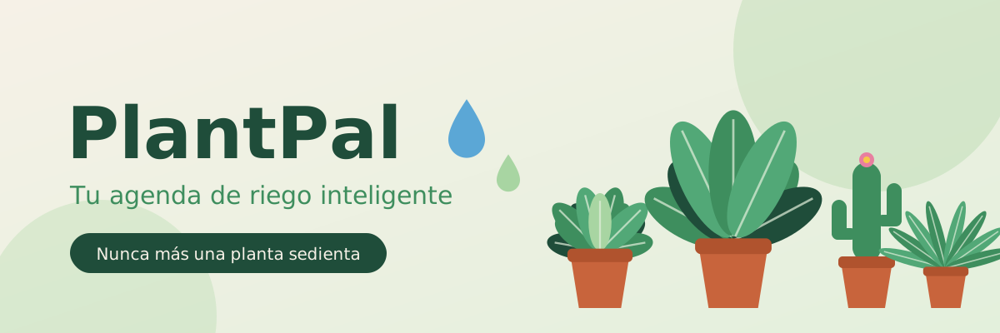
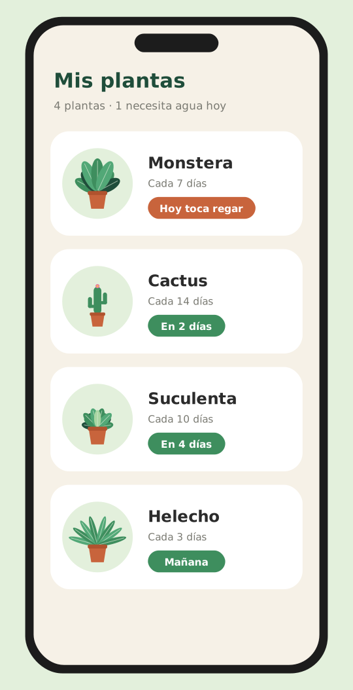
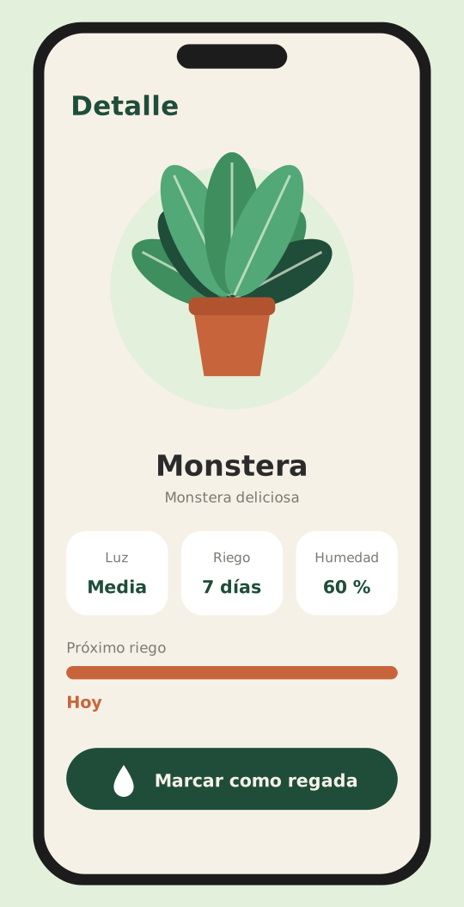
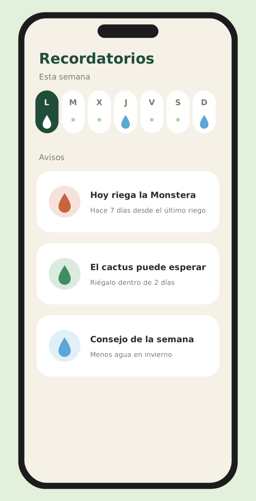
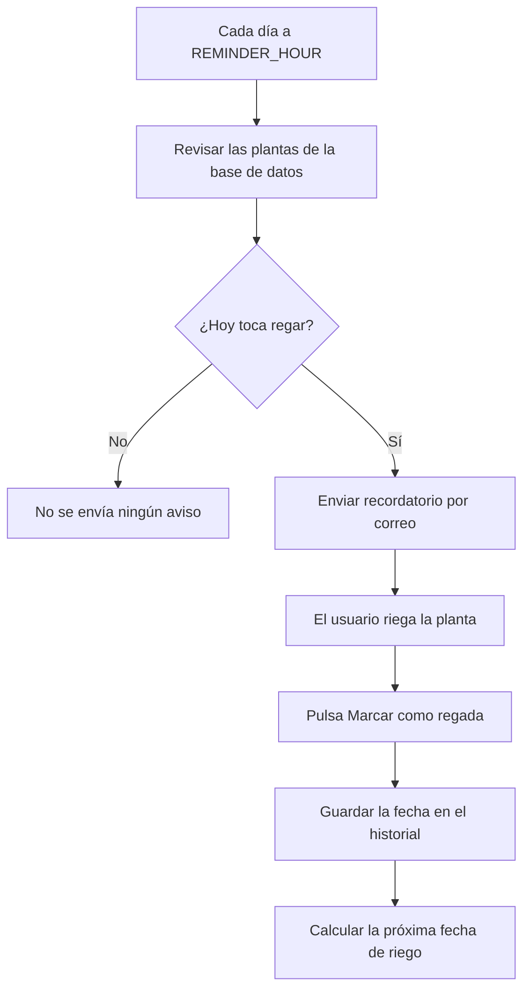

# PlantPal




:seedling: **PlantPal** es una aplicación web que te avisa de **cuándo toca regar
cada una de tus plantas**. Tú registras tus plantas una sola vez y la app se
encarga de calcular el calendario de riego y de enviarte *recordatorios*.

## Objetivo

Mucha gente compra plantas con ilusión y, semanas después, se le mueren por
**falta de agua o por exceso de riego**. El problema es que cada especie
necesita cuidados distintos y es muy fácil olvidarse.

**PlantPal** resuelve esto con una idea sencilla: *una agenda de riego
automática* que recuerda qué planta hay que regar y cuándo.

## Índice

1. [Así se ve](#así-se-ve)
2. [Características principales](#características-principales)
3. [Instalación y configuración](#instalación-y-configuración)
4. [Tecnologías utilizadas](#tecnologías-utilizadas)
5. [Arquitectura y funcionamiento](#arquitectura-y-funcionamiento)
6. [Ejemplos de uso](#ejemplos-de-uso)
7. [Información adicional](#información-adicional)
8. [Contacto](#contacto)

---

## Así se ve

| Mis plantas | Detalle de una planta | Recordatorios |
| :---: | :---: | :---: |
|  |  |  |

*Las imágenes son ilustraciones de ejemplo creadas para este proyecto ficticio.*

---

## Características principales

Estado de desarrollo de las funcionalidades de **PlantPal**:

- [x] Gestión de plantas
  - [x] Añadir una planta con su nombre y especie
  - [x] Editar o eliminar plantas
- [x] Calendario de riego automático
  - [x] Cálculo de la próxima fecha según los días de riego
  - [x] Vista semanal
- [x] Recordatorios diarios por correo electrónico
- [x] Historial de riegos de cada planta
- [x] Consejos de cuidado según la especie
- [ ] Modo vacaciones
- [ ] Identificar plantas con la cámara
  - [ ] Reconocimiento por foto
  - [ ] Sugerencia automática de cuidados
- [ ] Aplicación móvil

---

## Instalación y configuración

Sigue estos pasos para ejecutar **PlantPal** en tu ordenador:

1. Instala [Node.js](https://nodejs.org/) y comprueba que funciona con `node --version`.
2. Clona el repositorio y entra en la carpeta del proyecto:

   ```bash
   git clone https://github.com/tu-usuario/plantpal.git
   cd plantpal
   ```

3. Instala las dependencias con `npm install`.
4. Copia el archivo de ejemplo de variables de entorno y rellena `PORT` y `REMINDER_HOUR`:

   ```bash
   cp .env.example .env
   ```

5. Crea la base de datos con `npm run db:init`.
6. Arranca el servidor de desarrollo:

   ```bash
   npm run dev
   ```

7. Abre `http://localhost:3000` en tu navegador.

---

## Tecnologías utilizadas

| Tecnología | Versión | Descripción | Uso en el proyecto |
| :--- | :---: | :--- | :--- |
| **Node.js** | `20.x` | Entorno de ejecución de *JavaScript* en el servidor | Ejecuta el backend de la aplicación |
| **Express** | `4.19` | Framework web minimalista para Node.js | Define las rutas de la `API` REST |
| **SQLite** | `3.45` | Base de datos ligera que vive en un único archivo | Guarda las plantas y el historial de riegos |
| **node-cron** | `3.0` | Librería para programar tareas repetitivas | Lanza cada día la comprobación de riegos |
| **React** | `18.x` | Librería para construir interfaces de usuario | Genera el *frontend* y el calendario semanal |

---

## Arquitectura y funcionamiento

**PlantPal** tiene dos partes: un *frontend* en React que ve el usuario y una
API en Express que guarda los datos en SQLite. Además, una tarea programada
con `node-cron` se ejecuta cada día a la hora configurada en `REMINDER_HOUR`
y decide si hay que avisar al usuario.

El siguiente diagrama muestra ese proceso diario, desde la comprobación hasta
que el usuario riega la planta:



Estructura de carpetas del proyecto:

```text
plantpal/
├── client/          # Frontend en React
├── server/
│   ├── routes/      # Rutas de la API
│   ├── jobs/        # Tareas programadas (recordatorios)
│   └── db/          # Base de datos SQLite
├── .env.example     # Variables de entorno de ejemplo
└── README.md
```

---

## Ejemplos de uso

### Ejemplo 1: añadir una planta desde la terminal

Con el servidor en marcha, puedes registrar una planta enviando una petición
`POST` a la API con `curl`:

```bash
curl -X POST http://localhost:3000/api/plantas \
  -H "Content-Type: application/json" \
  -d '{"nombre": "Monstera", "especie": "Monstera deliciosa", "riegoCadaDias": 7}'
```

La API responde con la planta creada y su próxima fecha de riego:

```json
{
  "id": 1,
  "nombre": "Monstera",
  "especie": "Monstera deliciosa",
  "riegoCadaDias": 7,
  "proximoRiego": "2026-11-15"
}
```

### Ejemplo 2: consultar qué plantas hay que regar hoy

Desde el *frontend* se pueden obtener las plantas pendientes con la función `fetch`:

```javascript
async function plantasParaRegarHoy() {
  const respuesta = await fetch("http://localhost:3000/api/plantas?riegoHoy=true");
  const plantas = await respuesta.json();

  plantas.forEach((planta) => {
    console.log(`Hoy toca regar: ${planta.nombre}`);
  });
}

plantasParaRegarHoy();
```

**Recursos relacionados:**

- [Documentación de Express](https://expressjs.com/es/)
- [Documentación de SQLite](https://www.sqlite.org/docs.html)
- [Paquete node-cron en npm](https://www.npmjs.com/package/node-cron)
- [Fetch API en MDN](https://developer.mozilla.org/es/docs/Web/API/Fetch_API)

---

## Información adicional

### Consejo importante

> :droplet: **Recuerda:** más agua no significa más salud. El *exceso de riego*
> es una de las causas más comunes de que una planta se muera. Antes de regar,
> toca la tierra: si todavía está húmeda, espera un día más.

<!-- Este comentario no se ve en la vista final: el apartado de plantas compatibles se ampliará en cada versión. -->

### Plantas compatibles

<details>
<summary>Ver la lista de plantas compatibles y su frecuencia de riego</summary>

| Planta | Riego recomendado | Luz |
| :--- | :---: | :---: |
| Monstera | Cada `7` días | Media |
| Cactus | Cada `14` días | Alta |
| Suculenta | Cada `10` días | Alta |
| Helecho | Cada `3` días | Baja |

</details>

### Caracteres especiales

Para mostrar caracteres que Markdown interpretaría como formato, se escapan
con una barra invertida (`\`):

- \*Estos asteriscos no ponen el texto en cursiva\*
- \# Esta línea no es un encabezado
- \_Estos guiones bajos tampoco\_
- \[Esto no es un enlace\]\(ejemplo\)

---

## Contacto

- **Autor:** Nombre Apellido
- **Correo:** [nombre.apellido@example.com](mailto:nombre.apellido@example.com)
- **GitHub:** [github.com/tu-usuario](https://github.com/tu-usuario)
- **Incidencias:** [Abrir una incidencia](https://github.com/tu-usuario/plantpal/issues)
