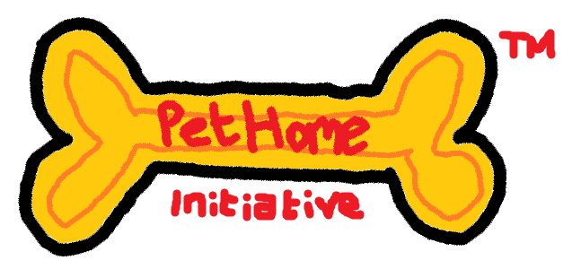

# PetHome Initiative

Esta iniciativa tiene como objetivo principal darle un hogar a cientos de mascotas que actualmente se encuentran sin hogar a través del internet con la ayuda de la comunidad.



## 1. Presentación del proyecto

**PetHome Initiative** es una plataforma colavorativa de web *full-stack* diseñada para servir de puente entre los protectores de animales y los posibles adoptantes.

El problema principal que aborda PetHome Initiative es tanto la falta de visibilidad como la saturación de los refugios y la desorganización de los procesos de adopción ya que muchas protectoras gestionan adopciones mediante varios canales distintos, nosotros proponemos varias soluciones a este problema, entre ellas:

- Un **catálogo unificado** de todas las mascotas disponibles para adopción, con información detallada y fotos de cada una.
- Un **sistema de gestión de adopciones** que permita a las protectoras organizar y hacer seguimiento de las solicitudes de adopción de manera eficiente.
- Una **campaña de marketing digital** para aumentar el interés y la visibilidad a nuestra plataforma y a las mascotas disponibles para adopción.

## 3. Características principales

A continuación, detallaremos las características principales de la plataforma y su proceso de desarrollo:

- [x] **Catálogo de mascotas**
    - Permite a los usuarios explorar y buscar mascotas disponibles para adopción, con filtros por especie, raza, edad, tamaño y ubicación.
    - Cada mascota tiene su propia página con información detallada, fotos y un formulario de contacto
- [x] **Sistema de pre-adopción digital**
    - Cuestionario de compatibilidad con los posibles adoptantes en los que se determina si la mascota es adecuada para su entorno y estilo de vida.
    - Adjuntación de documentos requiridos para poder completar el proceso de adopción.
- [ ] **Seguimiento de solicitudes de adopción a tiempo real**
    - Panel de control donde los refugios puedan dar de baja o de alta a los animales de forma sencilla implemantada en una base de datos unificada entre los refugios.
    - Notificaciones por correo electrónico a los adoptantes sobre el estado de su solicitud.
- [ ] **Campaña de marketing digital**
    - Contratar a un diseñador gráfico porque lo de nuestro logo es inexcusable. Está hecho en Microsoft Paint, ¿qué clase de compañía profesional hace su logo en Microsoft Paint?
    - Crear contenido visuak atractivo para redes sociales y anuncios en línea.

## 4. Instalación y configuración

Para poner en marcha la plataforma de **PetHome Initiative** y todos los cambios que hemos propuesto, se requiere realizar los siguientes pasos de instalación y configuración:

1. **Despliegue y configuración del entorno cloud**

    - Configurar el servidor principal de la plataforma en el entorno cloud de su elección (AWS, Azure, Google Cloud, etc.).
    - Inicializa las variables de entorno necesarias para la conexión a la base de datos y otros servicios externos.

    ```bash
    cp .env.example .env
    ```
    - Modificar el archivo `.env` con las credenciales y configuraciones específicas de su entorno.

2. **Alta y configuración de las protectoras asociadas**

    - Accede al panel de administración global mediante la ruta `/admin/setup`.
    - Registra las credenciales de los refugios piloto.

3. **Configuración de pasarelas y catálogos iniciales**

    - Conecta las pasarelas de pago externas (Revolut, PayPal, Stripe) para permitir donaciones y pagos de adopción.
    - Carga los catálogos de base de razas, tipos de animales, nombres, fotos, etc., para que los refugios puedan usarlos para registrar nuevas mascotas.
    ```bash
    npm run db:seed
    ```