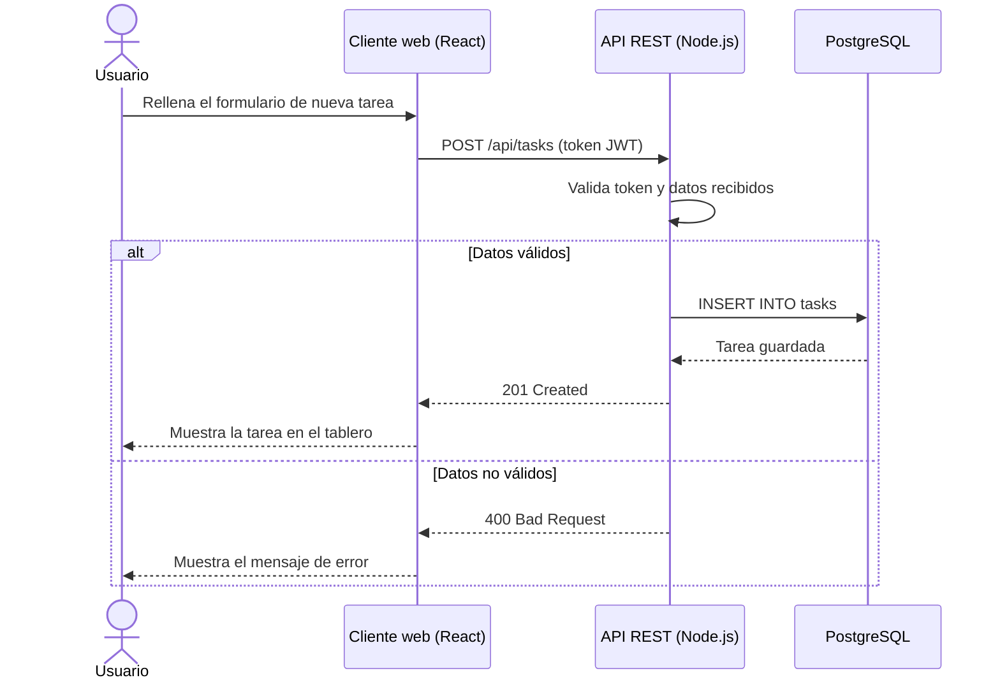

# Organizador automatico para la vida del primer año de universidad : Taskorg

**Creacion** Cuando uno piensa que le depara el destino muchos dirian que es mejor tenerlo organizado, Por eso mismo creemos que la utilizacion de un programa externo para colaborar en este objetivo es lo mas efectvio.

**Obejetivo principal:** El objetivo de esta guia es que el programa se encargue en tener organizado todo para poder llevar un año bueno y poder tener un equilibrio justo entre una vida academica prospera, un trabajo estable y una vida digna.

Proyecto **Ficticio** basado en mi persona.

---

## Indice de contenidos

-[Universidad](Universidad)
-[Trabajo](Trabajo)
-[Estudio](Estudio)
-[Entrenamiento](Entrenamiento)
-[Alimentacion](Alimentacion)
-[Vida-social](Vida-social)
-[Sueños](Sueños)
-[Objetivos](Objetivos)
---
## Caracteristicas principales 

1 **Gestion de tareas**
  -Tener la posibilidad de organizar de manera efectiva lo relacionado a las areas en mi vida
2. **Reorganacizacion de ideas y obetivos**
  -Saber el como cuando y porque de las cosas realizadas
3. **Dispocicion de tiempo**
  -cuanto tiempo puede ser invertido en relacion a la tarea.
4. **Prioridad de accion**
  -Saber y controlar las tareas necesarias de las opcionales 
### Desarrollo hasta el momento

-[x] Tener acceso al calendario
-[x] Creacion de un horario
-[x] Guias y dietas para la correcta Alimentacion y Sueños
-[ ] Conseguirte Vida social
-[ ] Conseguirte Trabajo 
-[ ] Ayudarte en el Gym

## Instalacion y aplicacion 

1. Trabajos universitarios

  ```bash
  Se debera vincular la aplicacion con panal para tener acceso a las pruebas y recordatorios
  ```
2 La comida

  ```bash

   En las horas definidas se mandaran alaertas acerca de la correcta
   alimentacion del usuario
    
  ```
3 El sueño 
  ```bash 
  En el horario definido se apagaran las pantallas para colaborar con el sueño
  ```
4 Deporte
  ```bash
  Si los trabajos estan cubiertos entonces se procedera a la notificacion de entrenamiento para el usuario
  ```
## Tecnologias del Proyecto
| Tecnología     | Versión | Descripción                               | Uso en el proyecto                      |
| :------------- | :-----: | :---------------------------------------- | --------------------------------------: |
| **Node.js**    | `20.x`  | Entorno de ejecución de JavaScript        | Servidor y lógica de la API             |
| **React**      | `18.x`  | Biblioteca para interfaces de usuario     | Interfaz web del *tablero Kanban*       |
| **PostgreSQL** | `16`    | Base de datos relacional                  | Almacén de usuarios y tareas            |
| **Express**    | `4.x`   | *Framework* minimalista para Node.js      | Definición de rutas `/api/*`            |
| **Docker**     | `25.x`  | Plataforma de contenedores                | Despliegue y entorno de desarrollo      |

---
TaskORG sigue una arquitectura cliente-servidor: el **cliente web** (React) se comunica con una **API REST** (Node.js y Express) que valida la autenticación mediante *JWT* y guarda la información en **PostgreSQL**.

El siguiente diagrama muestra el proceso real de creación de una tarea:


---

## Ejemplos de uso

### Ejemplo 1: crear una tarea mediante la API

```bash
curl -X POST http://localhost:3000/api/tasks \
  -H "Authorization: Bearer <TOKEN>" \
  -H "Content-Type: application/json" \
  -d '{"titulo": "Preparar presentación", "prioridad": "alta"}'
```

### Ejemplo 2: listar las tareas desde JavaScript

```javascript
const respuesta = await fetch("http://localhost:3000/api/tasks", {
  headers: { Authorization: `Bearer ${token}` },
});
const tareas = await respuesta.json();

tareas
  .filter((t) => t.prioridad === "alta")
  .forEach((t) => console.log(t.titulo));
```

### Recursos relacionados

- [Documentación de fetch en MDN](https://developer.mozilla.org/es/docs/Web/API/Fetch_API)
- [Guía de Express](https://expressjs.com/es/guide/routing.html)
- [Guía de Markdown de GitHub](https://docs.github.com/es/get-started/writing-on-github)

---

## Información adicional

### Notas importantes

> [!WARNING]
> Nunca subas el archivo `.env` al repositorio: contiene credenciales privadas. Añádelo siempre a `.gitignore`.

<details>
<summary>Ver los comandos útiles de desarrollo</summary>

| Comando          | Acción                           |
| ---------------- | -------------------------------- |
| `npm run dev`    | Inicia el servidor con recarga   |
| `npm test`       | Ejecuta las pruebas automáticas  |
| `npm run build`  | Genera la versión de producción  |

Se usa `<details>` porque esta información es útil, pero no imprescindible para una primera lectura.

</details>

<!--Practicamente escribi esto con todo lo que aprendi en BECA. -->

### Contacto

- 📧 Correo: [michaelcm2008@gmail.com](michaelcm2008@gmail.com)
- 🐙 GitHub: [github.com/Mike.og7/TaskORG](https://github.com/Mikeog7)
- 🌐 Web: Aun en desarrollo 

---


