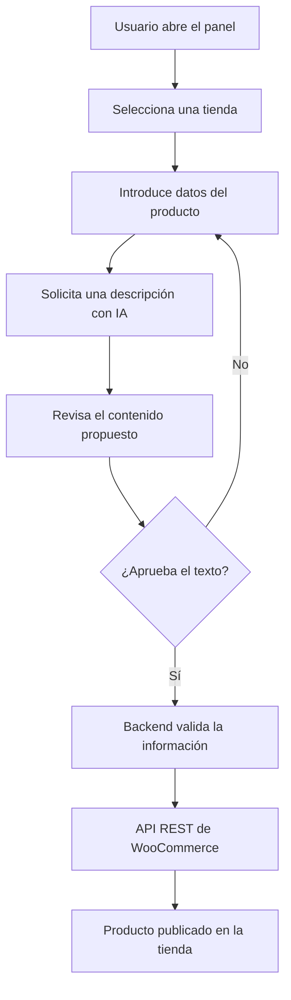

# PIVOT IA 🚀 | Plataforma para crear y gestionar tiendas online


## Presentación del proyecto

**PIVOT IA** es un *proyecto tecnológico ficticio de carácter académico* que propone una plataforma para crear, conectar y administrar tiendas online desde un único lugar. Su enfoque es combinar herramientas de comercio electrónico con funciones de **inteligencia artificial (IA)**.

**Problema:** un pequeño negocio puede necesitar varias herramientas independientes para preparar una tienda, cargar productos, escribir descripciones y comprobar pedidos. Ese proceso consume tiempo y requiere conocimientos técnicos.

**Objetivo:** simplificar las tareas habituales de una tienda digital mediante un panel intuitivo, integraciones con **WordPress y WooCommerce** y asistentes que *ayudan* a preparar contenido, siempre con revisión humana antes de publicarlo.

> **Alcance:** esta documentación describe una propuesta de software. Las pantallas, API y flujos explicados son ejemplos de diseño; **no se afirma que exista una plataforma funcional publicada**.

---

## Índice de contenidos

1. [Presentación del proyecto](#presentación-del-proyecto)
2. [Características principales](#características-principales)
3. [Instalación y configuración](#instalación-y-configuración)
4. [Tecnologías utilizadas](#tecnologías-utilizadas)
5. [Arquitectura y funcionamiento](#arquitectura-y-funcionamiento)
6. [Ejemplos de uso](#ejemplos-de-uso)
7. [Información adicional](#información-adicional)
8. [Contacto](#contacto)

## Características principales

Las siguientes son **funcionalidades previstas**, no prestaciones disponibles actualmente:

1. **Gestión de múltiples tiendas:** consultar varias tiendas desde un panel central.
   - Mostrar un resumen de pedidos.
   - Identificar productos pendientes de revisión.
2. **Catálogo de productos:** crear fichas con nombre, precio, SKU e imágenes.
3. **Asistente de redacción con IA:** proponer títulos y descripciones de productos.
4. **Plantillas de tienda:** partir de diseños reutilizables para acelerar la configuración.
5. **Automatización de tareas:** organizar avisos sobre pedidos y stock.
6. **Panel de métricas:** visualizar ventas y productos más consultados.

### Estado de desarrollo

- [x] Definir el problema, el objetivo y las funcionalidades.
- [x] Documentar el flujo principal y la arquitectura propuesta.
- [ ] Desarrollar el panel de administración.
- [ ] Integrar la API de WooCommerce.
- [ ] Implementar el asistente de IA con revisión humana.
- [ ] Realizar pruebas con usuarios y publicar una versión estable.

## Instalación y configuración

Como todavía es un **prototipo conceptual**, los siguientes pasos permiten preparar un **entorno inicial de Vue**, no instalar un producto terminado.

1. **Comprobar los requisitos:** disponer de `Git`, `Node.js` (versión 22 o superior compatible con Vite) y `npm`.
2. **Crear el proyecto base** desde una terminal:

   ```bash
   npm create vite@latest pivot-ia-demo -- --template vue
   cd pivot-ia-demo
   npm install
   ```

3. **Configurar la futura conexión con la API.** Crear un archivo `.env.local` en el directorio del proyecto:

   ```dotenv
   VITE_API_BASE_URL=http://localhost:8000/api
   VITE_APP_NAME=PIVOT_IA_DEMO
   ```

   La dirección es **ilustrativa**: el servidor de API todavía no está implementado.

4. **Iniciar el entorno de desarrollo:**

   ```bash
   npm run dev
   ```

5. **Abrir la URL local** que muestre Vite en la terminal. En esta etapa se verá la plantilla inicial de Vue; el panel de PIVOT IA requeriría desarrollo adicional.

Para preparar una integración futura, consultar la [guía oficial de Vue](https://vuejs.org/guide/introduction.html) y la [API REST de WooCommerce](https://developer.woocommerce.com/docs/apis/rest-api/).

## Tecnologías utilizadas

| Tecnología | Versión prevista | Descripción | Uso en el proyecto |
| :--- | :---: | :--- | ---: |
| **Vue.js** | `3.x` | Framework *frontend* | Panel de usuario |
| **Vite** | `7.x` | Herramienta de desarrollo web | Entorno de pruebas |
| **PHP** | `8.3` | Lenguaje para servicios web | Lógica del servidor |
| **WordPress** | `6.x` | Gestor de contenidos | Base de las tiendas |
| **WooCommerce** | `10.x` | Extensión de *e-commerce* | Productos y pedidos |
| **MySQL** | `8.x` | Base de datos relacional | Persistencia de datos |

*Las versiones son referencias de diseño y deberán comprobarse por compatibilidad antes de una implementación real.*

## Arquitectura y funcionamiento

La propuesta consta de tres partes: el **panel web** recibe acciones del usuario, un **servicio backend** valida y procesa las solicitudes, y la **integración con WooCommerce** administra los productos y pedidos. El asistente de IA propone textos; el usuario decide si se publican.

### Flujo: creación y publicación de un producto



Este diagrama representa un **flujo planificado**, no una integración ya desplegada.

## Ejemplos de uso

Las siguientes peticiones representan el **contrato de una API hipotética**. Los endpoints `localhost:8000` aún no funcionan y se presentan únicamente para explicar el uso previsto.

### Ejemplo 1. Crear una tienda

Un usuario registraría una tienda con su nombre y dirección pública:

```bash
curl -X POST http://localhost:8000/api/tiendas \
  -H "Content-Type: application/json" \
  -d '{"nombre":"Mi Tienda Demo","dominio":"tienda.ejemplo.test"}'
```

**Respuesta ilustrativa:**

```json
{
  "id": 1,
  "nombre": "Mi Tienda Demo",
  "estado": "pendiente_de_configuracion"
}
```

### Ejemplo 2. Generar un borrador de descripción

El propietario solicitaría una propuesta de texto para un producto, sin publicarla automáticamente:

```bash
curl -X POST http://localhost:8000/api/ia/descripciones \
  -H "Content-Type: application/json" \
  -d '{"producto":"Botella reutilizable","tono":"claro","idioma":"es"}'
```

**Respuesta ilustrativa:**

```json
{
  "borrador": "Botella reutilizable para acompañarte cada día.",
  "requiere_revision": true,
  "publicado": false
}
```

Como recursos complementarios están la [documentación de Vite](https://vite.dev/guide/) y la [guía de diagramas Mermaid](https://mermaid.js.org/syntax/flowchart.html).

## Información adicional

> ⚠️ **Recomendación de seguridad:** nunca almacenar contraseñas o claves de la API de WooCommerce en el código público. Utilizar variables de entorno y validar los permisos del usuario antes de ejecutar acciones.

<details>
<summary>Ver decisiones de diseño y posibles mejoras</summary>

El proyecto prioriza una experiencia sencilla para pequeños negocios. Como ampliaciones futuras se proponen el historial de cambios, un sistema de roles y pruebas automáticas. Las sugerencias de IA no deben publicarse sin aprobación del usuario.

</details>

<!-- Comentario para mantenimiento: sustituir los endpoints ficticios cuando exista un backend de prueba. -->

### Caracteres especiales en Markdown

Para mostrar símbolos sin activar el formato se utiliza la barra invertida (`\`). Por ejemplo: \*oferta\*, \#promoción y \[enlace\] aparecen como texto literal.

---

## Contacto

**Proyecto académico:** PIVOT IA — documentación de ejemplo para una actividad de evaluación continua.

- Correo de muestra: `contacto@pivot-ia.example` (dirección ilustrativa, no operativa).
- Referencias técnicas: [Vue.js](https://vuejs.org/) · [WooCommerce](https://woocommerce.com/) · [GitHub Docs](https://docs.github.com/es).

*Documento original creado con fines educativos. Las funcionalidades y los ejemplos de API son ficticios.*
