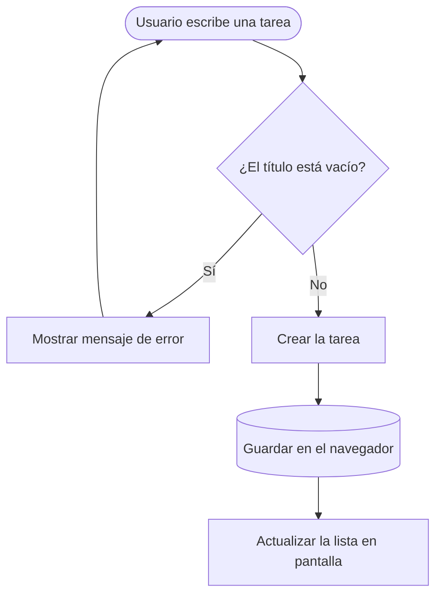

# ListaClara


:rocket: Organiza tu día sin esfuerzo.

Aplicación web para gestionar las tareas del día a día desde un único lugar.
Permite **añadir** tareas, **marcarlas como completadas**, *editarlas* o eliminarlas, y filtrarlas por estado (todas, pendientes o hechas). Todo funciona desde el navegador, sin registrarse.

**Objetivo:** resolver el problema de las tareas pendientes que se olvidan o se pierden entre notas sueltas, mensajes y papeles, ofreciendo una lista clara y siempre a mano.

---

## Índice

1. [Características principales](#características-principales)
2. [Instalación y configuración](#instalación-y-configuración)
3. [Tecnologías utilizadas](#tecnologías-utilizadas)
4. [Arquitectura y funcionamiento](#arquitectura-y-funcionamiento)
5. [Ejemplos de uso](#ejemplos-de-uso)
6. [Información adicional](#información-adicional)
7. [Contacto](#contacto)
8. [Notas de formato](#notas-de-formato)
---

## Características principales

ListaClara incluye las siguientes funcionalidades:

1. **Crear tareas**
   - Escribir un título y pulsar `Enter`
   - Opcional: añadir una fecha límite
2. **Completar tareas** con un solo clic
3. **Editar y eliminar** tareas existentes
4. **Filtrar** la lista por estado
   - Todas
   - Pendientes
   - Hechas
5. **Modo oscuro** para trabajar de noche
6. **Guardado automático** en el navegador

### Estado de desarrollo

- [x] Crear tareas
- [x] Completar tareas
- [x] Editar y eliminar tareas
- [ ] Filtros por estado
- [ ] Modo oscuro
- [ ] Guardado automático

---

## Instalación y configuración

Sigue estos pasos para ejecutar **ListaClara** en tu ordenador:

1. Instala [Node.js](https://nodejs.org) (versión 20 o superior) y comprueba que funciona con `node -v`.
2. Clona el repositorio del proyecto.
3. Entra en la carpeta e instala las dependencias con `npm install`.
4. Arranca la aplicación con `npm start`.
5. Abre `http://localhost:3000` en tu navegador.

```bash
git clone https://github.com/usuario/listaclara.git
cd listaclara
npm install
npm start
```

Si el puerto `3000` está ocupado, puedes cambiarlo con la variable `PORT`:

```bash
PORT=4000 npm start
```

---

## Tecnologías utilizadas

| Tecnología | Versión | Descripción | Uso en el proyecto |
| :--- | :---: | :--- | :--- |
| **HTML** | `5` | Lenguaje de marcado de páginas web | Estructura de la interfaz |
| **CSS** | `3` | Lenguaje de estilos | Diseño y *modo oscuro* |
| **JavaScript** | `ES2022` | Lenguaje de programación web | Lógica de las tareas y filtros |
| **Node.js** | `20` | Entorno de ejecución de JavaScript | Servidor local con `npm start` |

---

## Arquitectura y funcionamiento

**ListaClara** funciona íntegramente en el navegador. Cuando el usuario escribe una tarea, la aplicación comprueba que no esté vacía, la guarda y actualiza la lista en pantalla. Las tareas se almacenan en el navegador, por lo que siguen ahí al recargar la página.

El siguiente diagrama muestra el proceso de **añadir una tarea**:



---

## Ejemplos de uso

### Ejemplo 1: añadir una tarea

Escribe el título en el campo de texto y pulsa `Enter`. Internamente, la aplicación valida el título y guarda la tarea:

```javascript
function anadirTarea(titulo) {
  if (titulo.trim() === "") {
    mostrarError("El título no puede estar vacío");
    return;
  }

  const tarea = { id: Date.now(), titulo: titulo, hecha: false };
  tareas.push(tarea);
  localStorage.setItem("tareas", JSON.stringify(tareas));
  pintarLista();
}
```

### Ejemplo 2: ver solo las tareas pendientes

Pulsa el filtro **Pendientes** y la lista mostrará únicamente las tareas sin completar:

```javascript
const pendientes = tareas.filter((tarea) => !tarea.hecha);
pintarLista(pendientes);
```

### Recursos relacionados

- [Documentación de `localStorage` (MDN)](https://developer.mozilla.org/es/docs/Web/API/Window/localStorage)
- [Método `Array.filter` (MDN)](https://developer.mozilla.org/es/docs/Web/JavaScript/Reference/Global_Objects/Array/filter)
- [Documentación de Node.js](https://nodejs.org/docs/latest/api/)

---

## Información adicional

> **Nota importante:** las tareas se guardan en el navegador, no en un servidor. Si borras los datos del navegador o cambias de ordenador, perderás tu lista.

<details>
<summary>Ver próximas mejoras previstas</summary>

- Sincronización de tareas entre dispositivos
- Categorías y etiquetas de colores
- Recordatorios con notificaciones
- Exportar la lista a un archivo

</details>

<!-- Este comentario no se ve -->

---

## Contacto

- Correo: [contacto@listaclara.example](mailto:contacto@listaclara.example)
- Sitio web: [listaclara.example](https://listaclara.example)
- Repositorio del curso: [GitHub](https://github.com)

---

## Notas de formato

Para mostrar caracteres especiales de Markdown se escapan con una barra invertida: \*esto no queda en cursiva\*, \# esto no es un título y \_esto no se subraya\_