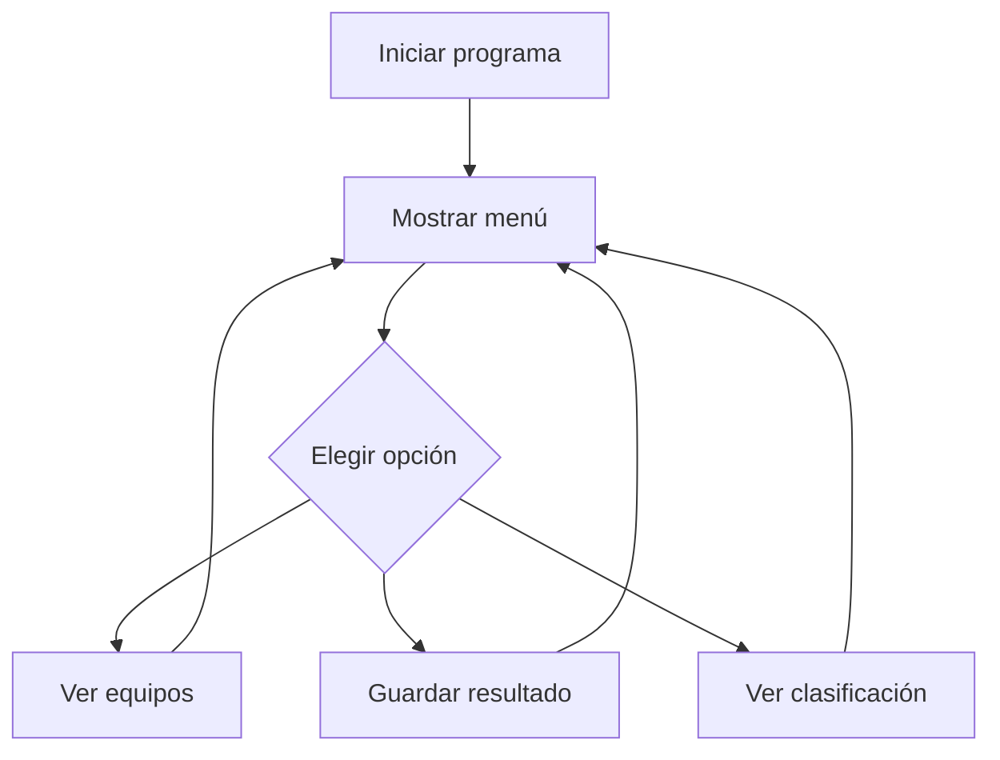

# ⚽ MiLiga

MiLiga es una idea de programa para llevar los resultados de una pequeña liga de fútbol.  
La idea es poder apuntar los partidos y ver cuántos puntos tiene cada equipo.

He elegido este proyecto porque me gusta el fútbol y quería hacer algo relacionado con él.


---

## Índice

- [Características](#características)
- [Instalación](#instalación)
- [Tecnologías](#tecnologías)
- [Cómo funciona](#cómo-funciona)
- [Ejemplos](#ejemplos)
- [Información extra](#información-extra)
- [Contacto](#contacto)

## Características

El programa tendría estas opciones:

- Añadir equipos a la liga.
- Guardar el resultado de un partido.
- Consultar los partidos jugados.
- Calcular los puntos de cada equipo.
- Ver una clasificación sencilla.

### Tareas del proyecto

- [x] Pensar la idea del programa.
- [x] Decidir sus funciones principales.
- [ ] Programar el menú.
- [ ] Guardar los resultados.
- [ ] Mostrar la clasificación.

## Instalación

Para ejecutar el programa hace falta tener instalado Java.

1. Descargar el proyecto.
2. Abrir una terminal en la carpeta donde está guardado.
3. Compilar el archivo.
4. Ejecutar el programa.

Comandos que se utilizarían:

```bash
javac MiLiga.java
java MiLiga
```

## Tecnologías

| Tecnología | Versión | Descripción | Uso |
|:--|:--:|:--|:--|
| Java | 21 | Lenguaje de programación | Crear el programa |
| JDK | 21 | Herramientas de Java | Compilar el código |
| Git | 2.x | Control de versiones | Guardar los cambios |
| Markdown | Básico | Formato para escribir documentos | Hacer este README |

## Cómo funciona

Al iniciar el programa aparecería un menú. El usuario elegiría qué quiere hacer y el programa mostraría la información.

Este sería un ejemplo del proceso:



## Ejemplos

### Ejemplo 1: mostrar el resultado de un partido

```java
String local = "Real Madrid";
String visitante = "Barcelona";

System.out.println(local + " 2 - 1 " + visitante);
```

El resultado que aparecería sería:

```text
Real Madrid 2 - 1 Barcelona
```

### Ejemplo 2: calcular los puntos

En una liga, una victoria vale 3 puntos y un empate vale 1 punto.

```java
int victorias = 3;
int empates = 2;

int puntos = victorias * 3 + empates;

System.out.println("Puntos: " + puntos);
```

El resultado sería:

```text
Puntos: 11
```

Puedes consultar más información en la [documentación de Java](https://docs.oracle.com/en/java/) o en la [guía de Markdown](https://www.markdownguide.org/).

## Información extra

> **Nota:** para que la clasificación salga bien, hay que introducir correctamente los resultados de los partidos.

<details>
<summary>Ideas para mejorar el programa</summary>

Más adelante se podrían añadir:

- Una lista de goleadores.
- Las tarjetas amarillas y rojas.
- Un calendario de partidos.

</details>

<!-- Este es un comentario. No se muestra en la página normal. -->

En Markdown, si quiero escribir un asterisco sin que haga cursiva, puedo poner una barra delante: \\*texto\\*.

## Contacto

Este proyecto es una actividad de clase.

- **Autor:** Pablo Llanos
- **Correo de ejemplo:** miliga@example.com
- **Repositorio:** [GitHub](https://github.com/)

---


