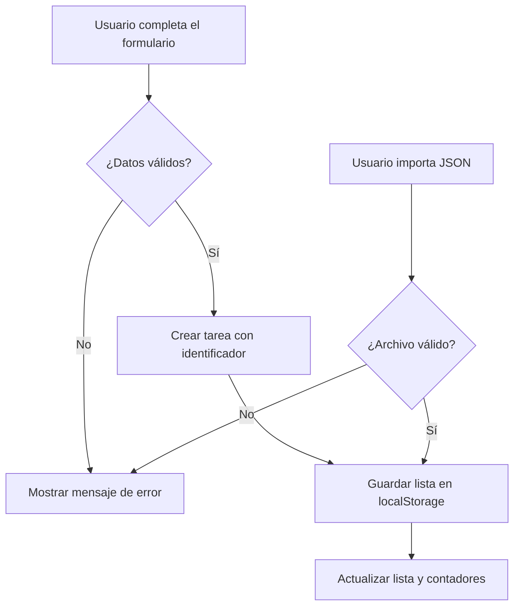

# 🧭 AulaFoco — planificador de estudio


**AulaFoco** es una pequeña aplicación web para organizar tareas de estudio sin crear una cuenta. Su objetivo es ayudar a transformar una lista dispersa de entregas y repasos en un plan visible: qué hay pendiente, qué vence pronto y qué se ha completado. Funciona *en el propio navegador* y guarda los datos en el dispositivo.

<!-- La captura de la vista renderizada se entrega junto a este README. -->

## Índice

1. [Características principales](#características-principales)
2. [Instalación y configuración](#instalación-y-configuración)
3. [Tecnologías utilizadas](#tecnologías-utilizadas)
4. [Arquitectura y funcionamiento](#arquitectura-y-funcionamiento)
5. [Ejemplos de uso](#ejemplos-de-uso)
6. [Información adicional](#información-adicional)
7. [Contacto](#contacto)

---

## Características principales

1. **Crear tareas** con asignatura, fecha límite y prioridad.
2. **Ver el estado de un vistazo** mediante contadores de tareas pendientes, completadas y próximas a vencer.
3. **Filtrar la lista** para mostrar todas las tareas, solo las pendientes o solo las completadas.
4. **Marcar tareas como terminadas** y recuperar una tarea si se marcó por error.
5. **Eliminar tareas** que ya no forman parte del plan.
6. **Exportar e importar una copia JSON**:
   - La exportación descarga un archivo que se puede guardar fuera del navegador.
   - La importación sustituye la lista actual por la del archivo seleccionado.

### Estado del desarrollo

- [x] Alta, finalización y eliminación de tareas.
- [x] Filtros y resumen de progreso.
- [x] Guardado local y copia de seguridad JSON.
- [ ] Avisos opcionales antes de una fecha límite.
- [ ] Sincronización entre dispositivos.

## Instalación y configuración

No requiere paquetes, cuenta ni servidor. Basta con un navegador moderno que admita JavaScript y `localStorage`.

1. Descarga el directorio `entregas/pablo.nieto/AEC-MD` del repositorio, o clona el repositorio completo:

   ```bash
   git clone https://github.com/miguelancabezon/26-27-igps.git
   cd 26-27-igps/entregas/pablo.nieto/AEC-MD
   ```

2. Abre `index.html` en el navegador. También puedes usar un servidor local si prefieres una dirección `http://`:

   ```bash
   # Opcional: desde la carpeta AEC-MD
   python -m http.server 8000
   ```

   En ese caso, visita `http://localhost:8000`. En Windows, el comando de Python puede ser `py -m http.server 8000`.

3. Añade una primera tarea. Los datos se guardan automáticamente en `localStorage`; no hay archivo de configuración ni credenciales.

> [!IMPORTANT]
> Los datos permanecen en el navegador y origen donde se crearon. Antes de borrar datos del navegador o cambiar de equipo, usa **Exportar JSON** para guardar una copia.

## Tecnologías utilizadas

| Tecnología | Versión | Descripción | Uso en el proyecto |
| :--- | :---: | :--- | :--- |
| **HTML** | `5` | Estructura semántica de la página | Formulario, filtros y lista de tareas |
| **CSS** | `3` | Estilos adaptables | Distribución, colores y estados visuales |
| **JavaScript** | `ES2022` | Lógica ejecutada en el navegador | Validación, eventos y actualización de la interfaz |
| **Web Storage API** | *Living Standard* | Almacenamiento local del navegador | Persistencia mediante `localStorage` |
| **JSON** | `RFC 8259` | Formato de intercambio de datos | Exportación e importación de copias |

## Arquitectura y funcionamiento

La aplicación está contenida en `index.html`. Al abrirla, JavaScript lee las tareas guardadas y dibuja la lista. Cada cambio válido actualiza el estado en memoria, vuelve a guardar la lista y refresca los contadores. La exportación genera un archivo JSON; la importación comprueba su estructura antes de sustituir los datos.



## Ejemplos de uso

### 1. Planificar una entrega

Abre `index.html`, escribe **Preparar presentación** como tarea, **IGPS** como asignatura, elige una fecha y prioridad **Alta**, y pulsa **Añadir tarea**. El navegador guarda un registro con esta forma:

```json
{
  "id": "ejemplo-001",
  "title": "Preparar presentación",
  "subject": "IGPS",
  "due": "2026-11-20",
  "priority": "alta",
  "done": false
}
```

Después, selecciona **Pendientes** para verla entre las tareas activas. Pulsa **Completar** cuando termines.

### 2. Guardar y restaurar una copia

Pulsa **Exportar JSON** para descargar `aulafoco-tareas.json`. Para recuperar el plan, pulsa **Importar JSON** y selecciona ese archivo. También puedes inspeccionar una copia desde la consola del navegador:

```javascript
const tareas = JSON.parse(localStorage.getItem('aulafoco.tasks.v1') ?? '[]');
console.table(tareas.map(({ title, subject, done }) => ({ title, subject, done })));
```

La consola solo muestra los datos: no modifica la lista. Para más información sobre las tecnologías, consulta [MDN: Web Storage API](https://developer.mozilla.org/es/docs/Web/API/Web_Storage_API), [MDN: JSON](https://developer.mozilla.org/es/docs/Web/JavaScript/Reference/Global_Objects/JSON) y la [documentación de Mermaid](https://mermaid.js.org/syntax/flowchart.html).

## Información adicional

<details>
<summary>Privacidad y formato de las copias</summary>

La aplicación no envía las tareas a un servidor. El archivo exportado contiene un objeto con la propiedad `tasks` y una lista de tareas. Al importar, se valida cada elemento antes de reemplazar la lista actual. Conserva una copia anterior si vas a probar una importación.

</details>

Para escribir símbolos de Markdown como texto literal se pueden escapar: \*asteriscos\*, \#almohadillas y \[corchetes\].

---

## Contacto

Proyecto de **Pablo Nieto**. Sugerencias y preguntas: [perfil de GitHub](https://github.com/Pablo3504) o [pablo.nieto@alumnos.uneatlantico.es](mailto:pablo.nieto@alumnos.uneatlantico.es).
