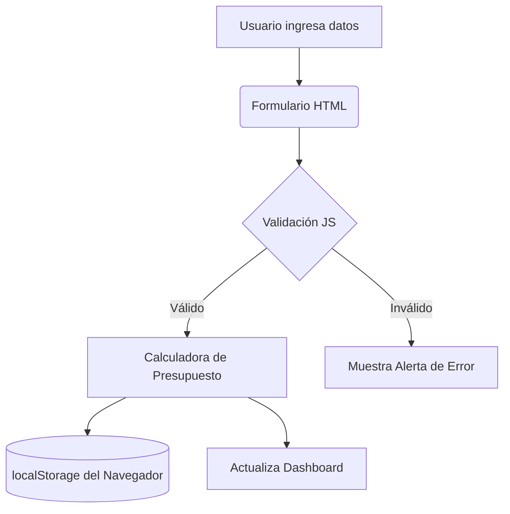

# :moneybag: UniBudget - Gestor de Presupuesto Estudiantil 


<!-- Comentario HTML oculto: Actividad de Evaluación Continua - Markdown -->

:rocket: **UniBudget** es una aplicacion web diseñada para ayudar a los estudiantes universitarios a gestionar sus ingresos y gastos para llegar al final del mes sin complicaciones

El objetivo principal es resolver la *falta de educacion financiera* que sufren muchos estudiantes universitarios. Ofreciendo un dashboard interactivo e intuitivo que no requiere tener conocimientos previos.

## Indice de contenido

1. [Presentacion del proyecto](#unibudget---gestor-de-presupuesto-estudiantil)
2. [Caracteristicas Principales](#caracteristicas-principales)
3. [Instalacion y Configuracion](#instalación-y-configuración)
4. [Tecnologias utilizadas](#tecnologías-utilizadas)
5. [Arquitectura y funcionamiento](#arquitectura-y-funcionamiento)
6. [Ejemplos de uso](#ejemplos-de-uso)
7. [Informacion extra](#informacion-extra)
8. [Contacto](#contacto)

---

## Caracteristicas Principales

UniBudget cuenta con diversas funcionalidades clave pensadas para la vida universitaria:

1. **Calculadora de presupuesto mensual**:
    - Ajuste automatico segun becas, trabajos a tiempo parcial o aportaciones familiares.
    - Desglose por categoria (*alquiler*, *comida*, *ocio*, *transporte*, *material academico*).
2. **División de gastos de piso**:
   - Reparto equitativo o proporcional de facturas entre roomies.
   - Recordatorios y asignacion de gastos.
3. **Almacenamiento local**:
   - Manejo de datos mediante `Local Storage` sin necesidad de la nube o bases de datos externas.
4. **Exportación e importación de reportes**:
   - Descarga de resúmenes mensuales en formato `.xlsx` y `.csv`.
5. **Alerta de presupuesto crítico**:
   - Avisos visuales cuando un gasto supera el limite diario configurado.

### Estado del desarrollo

- [x] Dashboard (HTML / CSS)
- [x] Calculo y almacenamiento local (JavaScript)
- [x] Exportación de datos
- [ ] Integración con modelos de inteligencia artificial
- [ ] Modo oscuro y claro automático según preferencia del sistema

## Instalación y configuración

1. Clona el repositorio desde GitHub a tu máquina local:
   ```bash
   git clone https://github.com/usuario/unibudget.git
   ```
2. Abre el archivo `index.html` en tu navegador web preferido:
    ```bash
    start index.html
    ```

> **Nota:** Si usas Visual Studio Code, te recomendamos la extensión `Live Server` para recargar los cambios en tiempo real durante la edición.

---

## Tecnologías utilizadas

| Tecnología | Versión | Descripción | Uso en el proyecto |
| :--- | :---: | :--- | :--- |
| **HTML** | `5.0` | Lenguaje de marcado de estructura web | Formularios de entrada |
| **CSS** | `3.0` | Hojas de estilo en cascada | Diseño |
| **JavaScript** | `ES6+` | Lenguaje de programación ejecutable en cliente | Calculo financiero |
| **Git** | `2.x` | Sistema de control de versiones | Gestión del código fuente y flujo de trabajo colaborativo |

---

## Arquitectura y funcionamiento

UniBudget opera mediante una arquitectura orientada al cliente. Toda la lógica financiera y la validación ocurren en el navegador del usuario.



## Ejemplos de uso

### 1. Inicialización de presupuesto en JavaScript

```javascript
// Configuración e inicialización del presupuesto
const limiteMensual = 500;
let gastosActuales = 120;

function calcularSaldo(limite, gastos) {
    return limite - gastos;
}

console.log(`Saldo disponible: $${calcularSaldo(limiteMensual, gastosActuales)}`);
```

### 2. Estructura del formulario en HTML

```html
<form id="form-gasto">
    <label for="monto">Monto (\*):</label>
    <input type="number" id="monto" name="monto" required>
    <button type="submit">Guardar</button>
</form>
```
Para mas detalles sobre las funcionalidades puedes consultar la [Documentacion oficial](https://www.google.com/url?sa=t&source=web&rct=j&opi=89978449&url=https://www.youtube.com/watch%3Fv%3DdQw4w9WgXcQ&ved=2ahUKEwixwIKvpe-XAxXp_gIHHQaCAKgQwqsBegQIHxAB&usg=AOvVaw0aHtehaphMhOCAkCydRLZU).

## Informacion extra

> [!WARNING]   
> **Advertencia sobre privacidad:** Esta aplicación almacena la información exclusivamente en la memoria local de tu navegador (`localStorage`). Si borras el historial o la caché del navegador, los datos registrados se perderán. Se recomienda realizar copias de seguridad periódicas.

<details>
<summary><b>Haz clic aquí para ver recomendaciones de uso y seguridad</b></summary>

- **Uso sin conexión:** La aplicación no requiere conexión a Internet para funcionar tras cargar la página.
- **Seguridad:** No introduzcas números de tarjeta, claves bancarias ni datos personales sensibles.
- **Sintaxis de código:** Si necesitas escribir símbolos de formato sin activar el marcado, utiliza el carácter de escape `\`, como por ejemplo `\#1` o `\*gastos\*`.
</details>

## Contacto

Si tienes sugerencias o has detectado algun error o quieres contribuir al proyecto. Ponte en contacto:

- **Web del desarrollador** [https://github.com/rodrigotar](https://github.com/rodrigotar)