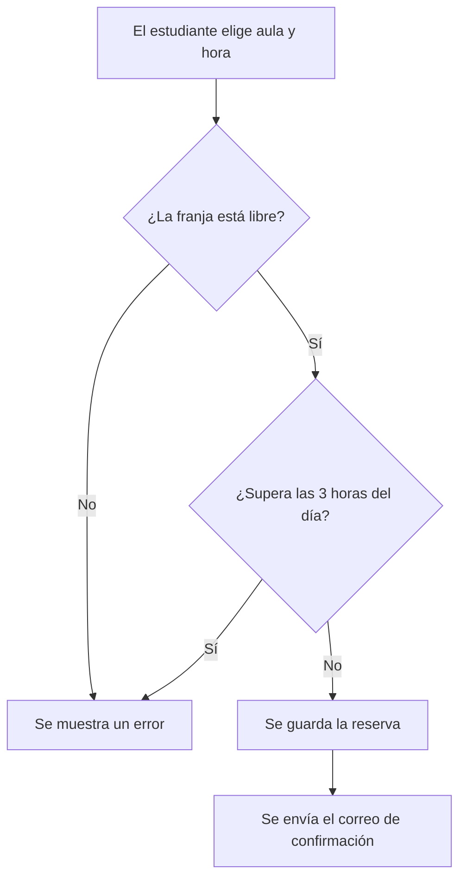

# AulaLibre


## Presentación

**AulaLibre** es una *aplicación web* para reservar salas de estudio en la biblioteca de la universidad. Entras desde el móvil o el ordenador, ves qué aulas quedan libres y eliges la hora que te viene bien.

### Objetivo

Que nadie tenga que ir a la biblioteca *a ver si hay suerte*. Con AulaLibre sabes antes de salir de casa si vas a tener sitio, y las salas se reparten con reglas claras, no según quién llegue antes.

### Problema que resuelve

En época de exámenes las salas de estudio se llenan a primera hora y pasa siempre lo mismo:

- llegas a la biblioteca y *no hay sitio*;
- hay quien **se queda una sala el día entero** y nadie se lo impide;
- el personal apunta las reservas en papel y no sabe cuánto se usa de verdad cada sala.

AulaLibre cambia el papel por reservas desde el móvil, con un límite de horas por persona. Y si alguien reserva y no aparece, a los 15 minutos la sala vuelve a estar libre.

---

## Índice de contenidos

- [Presentación](#presentación)
  - [Objetivo](#objetivo)
  - [Problema que resuelve](#problema-que-resuelve)
- [Características principales](#características-principales)
  - [Estado de desarrollo](#estado-de-desarrollo)
- [Instalación y configuración](#instalación-y-configuración)
  - [Requisitos previos](#requisitos-previos)
  - [Pasos de instalación](#pasos-de-instalación)
- [Tecnologías utilizadas](#tecnologías-utilizadas)
- [Arquitectura y funcionamiento](#arquitectura-y-funcionamiento)
- [Ejemplos de uso](#ejemplos-de-uso)
  - [Ejemplo 1: consultar aulas disponibles](#ejemplo-1-consultar-aulas-disponibles)
  - [Ejemplo 2: cancelar una reserva](#ejemplo-2-cancelar-una-reserva)
- [Información adicional](#información-adicional)
- [Contacto](#contacto)

---

## Características principales

1. **Consulta de disponibilidad en tiempo real**
   - Calendario por día y por semana.
   - Filtros por planta, capacidad y equipamiento (pizarra, proyector, enchufes).
2. **Reserva por franjas horarias**
   - Franjas de 1 hora; cada estudiante puede reservar hasta 3 horas al día.
   - Reservas individuales o de grupo, de hasta 6 personas.
3. **Check-in con código QR**
   - Cada aula tiene un QR en la puerta: lo escaneas al llegar y confirmas que estás.
   - Si en 15 minutos nadie lo ha escaneado, la reserva se anula y el aula vuelve a estar libre.
4. **Notificaciones por correo**
   - Te llega una confirmación al reservar y un recordatorio 30 minutos antes de empezar.
5. **Panel de administración**
   - Alta, baja y bloqueo de aulas (por mantenimiento o exámenes).
   - Estadísticas de ocupación por día y por franja horaria.
6. **Inicio de sesión con la cuenta universitaria**
   - Entras con tu correo de la universidad, sin crear otra cuenta.

### Estado de desarrollo

- [x] Consulta de disponibilidad
- [x] Reserva de franjas horarias
- [x] Notificaciones por correo
- [ ] Check-in con código QR
- [ ] Panel de administración
- [ ] Inicio de sesión con la cuenta universitaria

---

## Instalación y configuración

### Requisitos previos

- `Node.js` 20 o superior y `npm`.
- `PostgreSQL` 16 en ejecución local.
- `git` para clonar el repositorio.

### Pasos de instalación

1. Clona el repositorio y entra en la carpeta del proyecto:

   ```bash
   git clone https://github.com/sergiodelrio/aulalibre.git
   cd aulalibre
   ```

2. Instala las dependencias:

   ```bash
   npm install
   ```

3. Arranca el servidor con `npm run dev` y abre `http://localhost:3000` en el navegador.

---

## Tecnologías utilizadas

| Tecnología | Versión | Descripción | Uso en el proyecto |
|:-----------|:-------:|:------------|-------------------:|
| **React** | `18.3` | Biblioteca de interfaces de usuario | Frontend: calendario y formularios de reserva |
| **Node.js** | `20 LTS` | Entorno de ejecución de JavaScript | Ejecución del backend |
| **Express** | `4.21` | Framework web para Node.js | API REST de aulas y reservas |
| **PostgreSQL** | `16` | Base de datos relacional | Almacenamiento de aulas, usuarios y reservas |
| **Nodemailer** | `6.9` | Envío de correos desde Node.js | Confirmaciones y recordatorios |

---

## Arquitectura y funcionamiento

AulaLibre sigue una arquitectura **cliente-servidor**:

- El **frontend** (React) muestra el calendario y envía las peticiones a la API.
- El **backend** (Express) comprueba que la franja esté libre y que el estudiante no se pase de 3 horas al día.
- La **base de datos** (PostgreSQL) guarda las reservas. Cada minuto, el sistema revisa qué reservas llevan 15 minutos sin check-in y libera esas aulas.

Esto es lo que pasa cuando un estudiante crea una reserva:



---

## Ejemplos de uso

### Ejemplo 1: consultar aulas disponibles

Qué aulas quedan libres en la planta 2 el 10 de noviembre:

```bash
curl "http://localhost:3000/api/aulas/disponibles?fecha=2026-11-10&planta=2"
```

La API devuelve cada aula con sus franjas libres:

```json
[
  {
    "id": 12,
    "nombre": "Sala 2.04",
    "capacidad": 4,
    "equipamiento": ["pizarra", "enchufes"],
    "franjasLibres": ["09:00", "10:00", "16:00"]
  }
]
```

### Ejemplo 2: cancelar una reserva

Para cancelar la reserva número 45:

```bash
curl -X DELETE "http://localhost:3000/api/reservas/45"
```

Si todo va bien, la reserva desaparece y el aula vuelve a quedar libre.

Recursos relacionados:

- [Documentación oficial de Express](https://expressjs.com/es/)
- [Documentación de PostgreSQL](https://www.postgresql.org/docs/)
- [Sintaxis de diagramas de flujo en Mermaid](https://mermaid.js.org/syntax/flowchart.html)

---

## Información adicional

> :warning: **Si no escaneas el QR en los 15 minutos siguientes al inicio de tu franja, pierdes la reserva** y el aula queda libre para otra persona.

<details>
<summary>Normas de uso de las aulas</summary>

- Máximo **3 horas** de reserva por estudiante y día.
- Las reservas de grupo requieren un mínimo de 2 personas.
- Se puede cancelar una reserva hasta 10 minutos antes de su inicio.
- Tres ausencias sin cancelar en un mes bloquean las reservas durante 7 días.
- En el calendario, las franjas marcadas con \* están reservadas para periodos de exámenes.

</details>

<!-- Pendiente: añadir capturas de pantalla de la interfaz cuando esté terminado el diseño -->

---

## Contacto

:envelope: ¿Dudas o sugerencias? Escríbenos:

- Correo: [soporte@aulalibre.com](mailto:soporte@aulalibre.com)
- Repositorio: [github.com/sergiodelrio/aulalibre](https://github.com/sergiodelrio/aulalibre)
- Incidencias: [abrir un issue](https://github.com/sergiodelrio/aulalibre/issues)

---
