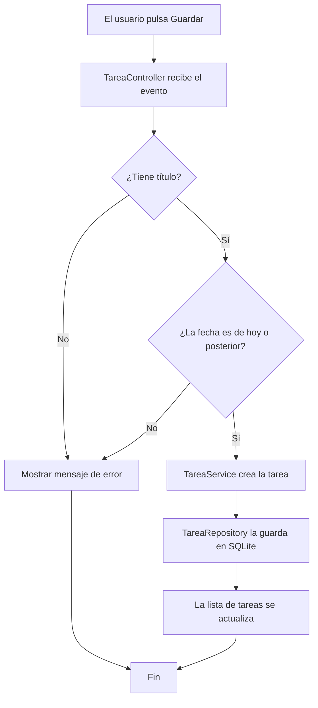

# AulaTask
<a id="inicio"></a>

<div align="center">


</div>

<!-- Badges de tecnologías y estado del proyecto -->


**AulaTask** es una aplicación de escritorio hecha en *Java* y *JavaFX* para apuntar las **entregas, exámenes y tareas** de cada asignatura y tenerlo todo en el mismo sitio. 📚

## Objetivo y problema que resuelve
<a id="objetivo"></a>

A muchos estudiantes nos pasa lo mismo: unas fechas están en el campus virtual, otras en el correo y otras apuntadas en una libreta. Al final te enteras tarde de una entrega o descubres que tienes tres para la misma semana.

Con **AulaTask** la idea es tener todas las tareas de clase juntas y que la propia aplicación te avise antes de que se acabe el plazo, para poder organizarte con tiempo.

---

## Índice de contenidos
<a id="indice"></a>

1. [Objetivo y problema que resuelve](#objetivo)
2. [Características principales](#caracteristicas)
   - [Estado del desarrollo](#estado)
3. [Instalación y configuración](#instalacion)
4. [Tecnologías utilizadas](#tecnologias)
5. [Arquitectura y funcionamiento](#arquitectura)
6. [Ejemplos de uso](#ejemplos)
7. [Información adicional](#informacion)
   - [Caracteres especiales](#caracteres)
   - [Contacto](#contacto)

---

## Características principales
<a id="caracteristicas"></a>

1. **Gestión de tareas**: puedes crear una tarea, editarla, marcarla como hecha o borrarla.
   - Cada tarea lleva *título*, *fecha límite* y *prioridad*.
   - La prioridad puede ser `BAJA`, `MEDIA` o `ALTA`.
2. **Tareas por asignatura**: cada tarea va dentro de su asignatura.
   - Cada asignatura tiene su propio color para reconocerla rápido.
3. **Recordatorios** :bell: que avisan **24 horas antes** de que termine el plazo.
4. **Calendario semanal** para ver de un vistazo qué semanas vienen más cargadas.
5. **Exportar a CSV** para poder abrir las tareas en Excel.

### Estado del desarrollo
<a id="estado"></a>

- [x] Gestión de tareas
- [x] Tareas por asignatura
- [ ] Recordatorios *(estoy en ello)*
- [ ] Calendario semanal
- [ ] Exportar a CSV

[Volver al índice](#indice)

---

## Instalación y configuración
<a id="instalacion"></a>

Para ejecutarlo hace falta tener instalado **JDK 21** y **Apache Maven**. Para saber si ya los tienes, puedes usar `java -version` y `mvn -version`.

1. Descargar el repositorio con `git clone`.
2. Entrar en la carpeta con `cd aulatask`.
3. Compilar con `mvn clean package`.
4. Abrir la aplicación con `mvn javafx:run`.
5. *(Opcional)* Si quieres que el aviso llegue antes o después, cambia `recordatorio.horas` en el archivo `config.properties`.

Los comandos, todos seguidos:

```sh
git clone https://github.com/usuario/aulatask.git
cd aulatask
mvn clean package
mvn javafx:run
```

> [!NOTE]
> El archivo `config.properties` está en la carpeta `src/main/resources/`.

[Volver al índice](#indice)

---

## Tecnologías utilizadas
<a id="tecnologias"></a>

| Tecnología | Versión | Descripción | Uso en el proyecto |
|:-----------|:-------:|:------------|-------------------:|
| **Java** |`21`| Lenguaje de programación orientado a objetos. | Toda la lógica de la aplicación. |
| **JavaFX** |`21`| Librería para hacer interfaces de escritorio. | Ventanas y formularios. |
| **Apache Maven** |`3.9`| Herramienta para compilar y gestionar librerías. | Compilar y arrancar con `mvn javafx:run`.|
| **SQLite** |`3.46`| Base de datos que se guarda en un solo archivo. | Guardar las tareas y las asignaturas. |
| *JUnit* |`5.10`| Librería para hacer pruebas. | Probar la clase `TareaService`. |

[Volver al índice](#indice)

---

## Arquitectura y funcionamiento
<a id="arquitectura"></a>

El código está separado en **capas**, y cada una se encarga de una cosa:

- **Vista**: las pantallas de JavaFX, lo que ve el usuario.
- **Controlador** (`TareaController`): recoge lo que hace el usuario, por ejemplo pulsar un botón.
- **Servicio** (`TareaService`): revisa que los datos de la tarea estén bien.
- **Repositorio** (`TareaRepository`): guarda y lee los datos de SQLite.

Así funciona lo que pasa al **crear una tarea nueva**:



[Volver al índice](#indice)

---

## Ejemplos de uso
<a id="ejemplos"></a>

### Ejemplo 1: crear una tarea desde código

```java
TareaService servicio = new TareaService(new TareaRepository("datos/aulatask.db"));

Tarea entrega = new Tarea("AEC Markdown", LocalDate.of(2026, 11, 15), Prioridad.ALTA, "IGPS");
servicio.crearTarea(entrega);

System.out.println("Tarea guardada con id " + entrega.getId());
```

### Ejemplo 2: mostrar las tareas pendientes

```java
List<Tarea> pendientes = servicio.listarPendientes();

for (Tarea t : pendientes) {
    System.out.println(t.getFechaLimite() + " - " + t.getTitulo());
}
```

### Documentación y recursos relacionados

- [Documentación oficial de Java 21][java]
- [Guía de inicio de JavaFX][javafx]
- [Documentación de Mermaid][mermaid]

[java]: https://docs.oracle.com/en/java/javase/21/ "Java SE 21"
[javafx]: https://openjfx.io/openjfx-docs/ "OpenJFX"
[mermaid]: https://mermaid.js.org/intro/ "Mermaid"

[Volver al índice](#indice)

---

## Información adicional
<a id="informacion"></a>

> **:warning: Importante:** todas las tareas se guardan en un archivo del ordenador, `aulatask.db`.
> Si vas a cambiar de ordenador, **haz antes una copia de ese archivo**, porque si no perderás las tareas.

<details>
<summary>🔍 Ver cómo es la base de datos</summary>

Solo hay dos tablas: `asignaturas` y `tareas`.

```sql
CREATE TABLE asignaturas (
    id     INTEGER PRIMARY KEY AUTOINCREMENT,
    nombre TEXT NOT NULL
);

CREATE TABLE tareas (
    id            INTEGER PRIMARY KEY AUTOINCREMENT,
    titulo        TEXT NOT NULL,
    fecha_limite  TEXT NOT NULL,
    prioridad     TEXT,
    asignatura_id INTEGER REFERENCES asignaturas(id)
);
```

</details>

### Caracteres especiales
<a id="caracteres"></a>

En AulaTask las asignaturas se marcan con almohadilla y el estado va entre corchetes. Como Markdown los tomaría por un encabezado y un enlace, hay que escaparlos con la barra invertida:

\#IGPS \[PENDIENTE\] Entregar la AEC de Markdown

### Contacto
<a id="contacto"></a>

Si tienes alguna duda o idea para mejorar la aplicación, puedes escribirme :email:

- **Autor:** Víctor Arenas
- **Correo (ejemplo):** `soporte@aulatask.example`
- **GitHub:** <https://github.com/victorarenas-uneat>

[Volver al inicio](#inicio)
