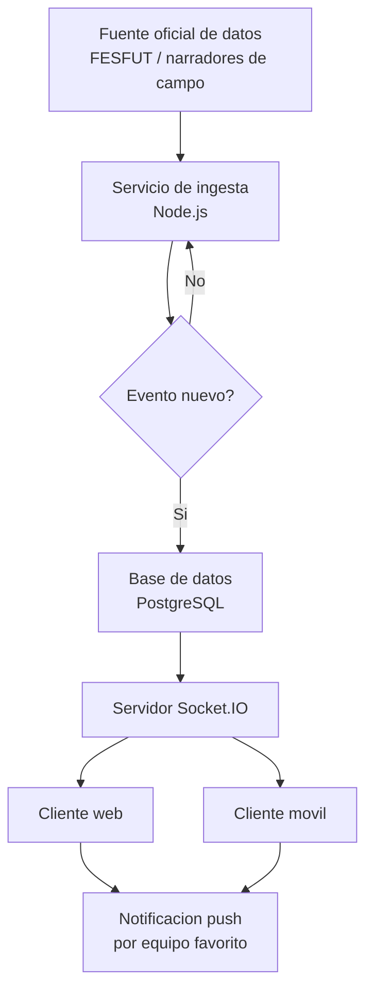
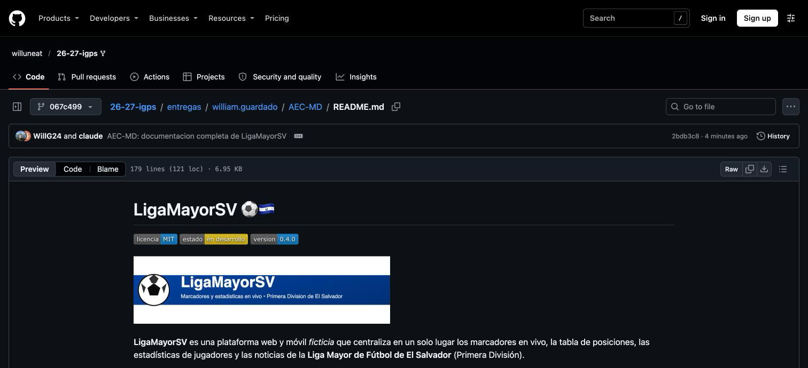
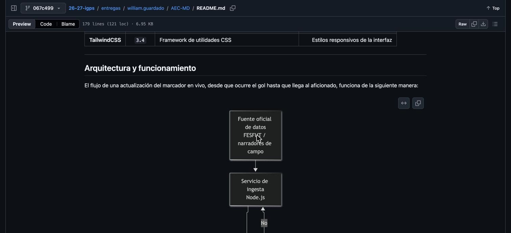

<!-- Entrega AEC-MD - William Guardado. Proyecto ficticio con fines academicos: documentacion tecnica construida para practicar Markdown avanzado. -->

# LigaMayorSV ⚽🇸🇻


**LigaMayorSV** es una plataforma web y móvil *ficticia* que centraliza en un solo lugar los marcadores en vivo, la tabla de posiciones, las estadísticas de jugadores y las noticias de la **Liga Mayor de Fútbol de El Salvador** (Primera División).

Hoy en día esta información está repartida entre redes sociales, páginas de prensa deportiva y transmisiones de radio, lo que obliga al aficionado a revisar múltiples fuentes para seguir un solo partido. El objetivo principal de `LigaMayorSV` es resolver ese problema ofreciendo una única fuente de verdad, actualizada en tiempo real, con notificaciones personalizadas por equipo favorito.

> Este es un proyecto **académico** creado para la actividad de evaluación continua de Markdown. No representa un producto comercial real ni está afiliado a la FESFUT.

---

## Tabla de contenidos

1. [Funcionalidades principales](#funcionalidades-principales)
2. [Instalación y configuración](#instalación-y-configuración)
3. [Tecnologías utilizadas](#tecnologías-utilizadas)
4. [Arquitectura y funcionamiento](#arquitectura-y-funcionamiento)
5. [Ejemplos de uso](#ejemplos-de-uso)
6. [Información adicional](#información-adicional)
7. [Contacto](#contacto)

---

## Funcionalidades principales

1. **Marcador en vivo**: actualización del resultado en tiempo real durante los 90 minutos de juego.
   - Eventos de gol, tarjetas y sustituciones.
   - Reconexión automática si se pierde la señal.
2. **Tabla de clasificación** generada automáticamente tras cada jornada.
3. **Perfiles de equipos y jugadores**, incluyendo historial de goles y tarjetas.
4. **Calendario de partidos** con resultados históricos por temporada.
5. **Notificaciones push** personalizadas por equipo favorito.
6. *(Opcional)* **Modo oscuro** y ajustes de accesibilidad.

### Estado del desarrollo

- [x] Marcador en vivo
- [x] Tabla de clasificación automática
- [x] Calendario de partidos
- [ ] Perfiles de jugadores con estadísticas avanzadas
- [ ] Notificaciones push por equipo
- [ ] Modo oscuro / accesibilidad

---

## Instalación y configuración

Sigue estos pasos para ejecutar el proyecto en un entorno local:

1. Clona el repositorio:

   ```bash
   git clone https://github.com/ligamayorsv/ligamayorsv-app.git
   cd ligamayorsv-app
   ```

2. Instala las dependencias del proyecto:

   ```bash
   npm install
   ```

3. Crea un archivo `.env` en la raíz del proyecto y define las variables de entorno necesarias, como `API_KEY` y `DATABASE_URL`.

4. Inicia el servidor en modo desarrollo:

   ```bash
   npm run dev
   ```

5. Abre `http://localhost:3000` en el navegador para ver la aplicación en funcionamiento.

> [!NOTE]
> El comando `npm run build` genera la versión optimizada para producción.

---

## Tecnologías utilizadas

| Technology      | Version  | Description                                           |                      Project Usage |
| :-------------- | :------: | :---------------------------------------------------- | ---------------------------------: |
| **React**       |  `18.3`  | Librería de interfaz de usuario basada en componentes |    Construcción del *frontend* web |
| **Node.js**     | `20 LTS` | Entorno de ejecución de JavaScript del lado servidor  |       API REST y lógica de negocio |
| **PostgreSQL**  |   `16`   | Sistema de base de datos relacional                   |  Almacenamiento de equipos y datos |
| **Socket.IO**   |  `4.7`   | Librería de comunicación en *tiempo real*             |         Envío del marcador en vivo |
| **TailwindCSS** |  `3.4`   | Framework de utilidades CSS                           | Estilos responsivos de la interfaz |

---

## Arquitectura y funcionamiento

El flujo de una actualización del marcador en vivo, desde que ocurre el gol hasta que llega al aficionado, funciona de la siguiente manera:



En resumen: un servicio de ingesta consulta la fuente oficial de datos, guarda cada evento nuevo en la base de datos y lo distribuye por *websockets* a todos los clientes conectados, que a su vez disparan una notificación push si el usuario sigue a ese equipo.

---

## Ejemplos de uso

### Ejemplo 1: Consultar la tabla de posiciones vía API

```javascript
fetch("https://api.ligamayorsv.dev/v1/standings/2026")
  .then((response) => response.json())
  .then((standings) => console.log(standings))
  .catch((error) => console.error("Error al obtener la tabla:", error));
```

### Ejemplo 2: Suscribirse a las notificaciones de un equipo

```bash
curl -X POST https://api.ligamayorsv.dev/v1/subscriptions \
  -H "Content-Type: application/json" \
  -d '{"team": "Alianza FC", "device_id": "abc123"}'
```

Para más detalles sobre los *endpoints* disponibles consulta la [documentación de Express](https://expressjs.com/) y la [documentación de Socket.IO](https://socket.io/docs/), frameworks utilizados en el backend.

---

## Información adicional

> **Recomendación:** durante los partidos de alta demanda (clásicos o finales), se recomienda activar el *modo de bajo consumo de datos* para evitar saturar la conexión del usuario.

<details>
<summary>📋 Preguntas frecuentes (click para expandir)</summary>

**¿La aplicación funciona sin conexión a internet?**
No. `LigaMayorSV` depende de una conexión activa para recibir los eventos en tiempo real.

**¿Se pueden seguir varios equipos a la vez?**
Sí, no hay límite en la cantidad de equipos favoritos que un usuario puede seleccionar.

**¿Qué pasa si la fuente oficial de datos falla?**
El sistema reintenta la conexión automáticamente y muestra el último resultado conocido mientras tanto.

</details>

### Caracteres especiales escapados

Para mostrar literalmente símbolos que Markdown interpretaría como sintaxis, se escapan con `\`:

- Un asterisco literal: \*no es una lista\*
- Un guion bajo literal: \_no es cursiva\_
- Una almohadilla literal: \# no es un encabezado
- Una barra invertida literal: \\n no es un salto de línea

---

## Contacto

¿Preguntas o sugerencias sobre este proyecto académico?

- GitHub: [@willuneat](https://github.com/willuneat)
- Correo de ejemplo: `contacto@ligamayorsv.dev`

---

## Capturas de pantalla

Vista previa renderizada de este documento en GitHub:





---

*Documentación creada por William Guardado como parte de la actividad de evaluación continua de Markdown.*
