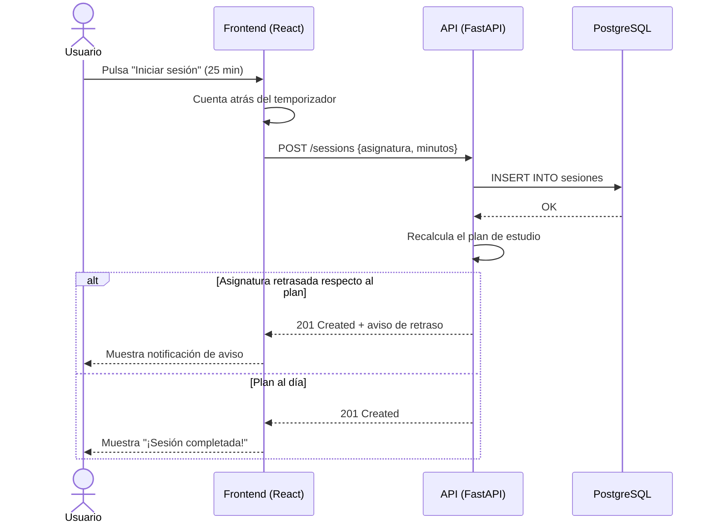

# FocusForge


<p align="center">
  
</p>

**FocusForge** es una aplicación web para *planificar, medir y mejorar* las sesiones de estudio de estudiantes universitarios. Combina la técnica **Pomodoro** con un calendario de exámenes y un panel de estadísticas para que el alumno sepa en todo momento *qué* tiene que estudiar, *cuánto* tiempo le ha dedicado y *cómo* va respecto a sus objetivos. :books:

### Objetivo principal

El objetivo de FocusForge es **reducir la improvisación en época de exámenes**. Muchos estudiantes reparten su tiempo de forma desigual: dedican horas a la asignatura que les gusta y dejan para el último día la que más les cuesta.

FocusForge resuelve este problema:

- Generando un **plan de estudio automático** a partir de las fechas de examen y la dificultad de cada asignatura.
- Registrando el tiempo *real* dedicado a cada materia.
- Avisando cuando una asignatura se queda ~~olvidada~~ por detrás del plan.

---

## Índice de contenidos

- [Características principales](#características-principales)
  - [Estado del desarrollo](#estado-del-desarrollo)
- [Instalación y configuración](#instalación-y-configuración)
  - [Requisitos previos](#requisitos-previos)
  - [Pasos de instalación](#pasos-de-instalación)
  - [Variables de entorno](#variables-de-entorno)
- [Tecnologías utilizadas](#tecnologías-utilizadas)
- [Arquitectura y funcionamiento](#arquitectura-y-funcionamiento)
- [Ejemplos de uso](#ejemplos-de-uso)
- [Información adicional](#información-adicional)
  - [Contacto](#contacto)

---

## Características principales

1. **Temporizador Pomodoro configurable** :tomato:
   - Duración de sesión y de descanso personalizable.
   - Descanso largo automático cada cuatro sesiones.
2. **Calendario de exámenes**
   - Alta de asignaturas con fecha de examen y nivel de dificultad (1-5).
   - Vista mensual y semanal.
3. **Plan de estudio automático**
   - Reparte las horas disponibles según la cercanía del examen y la dificultad.
   - Se recalcula cada vez que se completa o se salta una sesión.
4. **Panel de estadísticas**
   - Horas por asignatura y por semana.
   - Racha de días consecutivos estudiando :fire:
5. **Notificaciones inteligentes**
   - Aviso cuando una asignatura acumula más de dos días de retraso respecto al plan.
   - Recordatorio diario configurable.
6. **Exportación de datos**
   - Descarga del historial en `CSV` o `JSON`.

### Estado del desarrollo

- [x] Temporizador Pomodoro
- [x] Calendario de exámenes
- [x] Panel de estadísticas básico
- [ ] Plan de estudio automático *(en pruebas)*
- [ ] Notificaciones push
- [ ] Exportación a `CSV` / `JSON`

---

## Instalación y configuración

### Requisitos previos

Antes de empezar, asegúrate de tener instalado:

- `git` 2.40 o superior
- `Docker` y `Docker Compose`
- `Python` 3.12 *(solo si vas a ejecutar el backend sin Docker)*
- `Node.js` 20 LTS *(solo para desarrollar el frontend)*

### Pasos de instalación

1. Clona el repositorio:

   ```bash
   git clone https://github.com/ejemplo/focusforge.git
   cd focusforge
   ```

2. Copia el archivo de configuración de ejemplo y edítalo:

   ```bash
   cp .env.example .env
   ```

3. Levanta todos los servicios con Docker Compose:

   ```bash
   docker compose up -d --build
   ```

4. Aplica las migraciones de la base de datos:

   ```bash
   docker compose exec api alembic upgrade head
   ```

5. Abre `http://localhost:5173` en el navegador. La API queda disponible en `http://localhost:8000/docs`.

### Variables de entorno

El archivo `.env` contiene las variables necesarias. Las más importantes son `DATABASE_URL`, `SECRET_KEY` y `POMODORO_DEFAULT_MINUTES`:

```ini
DATABASE_URL=postgresql://focus:focus@db:5432/focusforge
SECRET_KEY=cambia-esto-por-una-clave-segura
POMODORO_DEFAULT_MINUTES=25
SHORT_BREAK_MINUTES=5
LONG_BREAK_MINUTES=15
```

---

## Tecnologías utilizadas

| Tecnología       | Versión  | Descripción                                   | Uso en el proyecto                                  |
| :--------------- | :------: | :-------------------------------------------- | --------------------------------------------------: |
| **Python**       | `3.12`   | Lenguaje de programación de propósito general | Lenguaje del *backend*                               |
| **FastAPI**      | `0.115`  | Framework web asíncrono para crear APIs REST  | Expone los *endpoints* de la API                     |
| **PostgreSQL**   | `16`     | Sistema gestor de bases de datos relacional   | Almacena usuarios, asignaturas y sesiones            |
| **React**        | `18.3`   | Librería de JavaScript para interfaces        | Interfaz web (*frontend*)                            |
| **Docker**       | `27`     | Plataforma de contenedores                    | Despliegue con `docker compose`                      |

---

## Arquitectura y funcionamiento

FocusForge sigue una arquitectura **cliente-servidor** de tres capas:

1. El **frontend** en React muestra el temporizador, el calendario y las estadísticas.
2. La **API** en FastAPI recibe las peticiones, aplica la lógica de negocio y recalcula el plan.
3. La **base de datos** PostgreSQL guarda de forma persistente toda la información.

El siguiente diagrama de secuencia muestra qué ocurre cuando el usuario **termina una sesión Pomodoro**:



---

## Ejemplos de uso

### Ejemplo 1: registrar una sesión desde la línea de comandos

Se puede registrar una sesión directamente contra la API con `curl`:

```bash
curl -X POST http://localhost:8000/sessions \
  -H "Authorization: Bearer $TOKEN" \
  -H "Content-Type: application/json" \
  -d '{"subject_id": 3, "minutes": 25}'
```

Respuesta de la API:

```json
{
  "id": 128,
  "subject": "Matemática Numérica",
  "minutes": 25,
  "behind_schedule": false
}
```

### Ejemplo 2: consultar estadísticas con Python

Este *script* obtiene las horas dedicadas a cada asignatura en la última semana:

```python
import requests

API_URL = "http://localhost:8000"
TOKEN = "tu-token-aqui"

respuesta = requests.get(
    f"{API_URL}/stats/weekly",
    headers={"Authorization": f"Bearer {TOKEN}"},
)

for asignatura in respuesta.json():
    horas = asignatura["minutes"] / 60
    print(f"{asignatura['name']}: {horas:.1f} h")
```

### Documentación y recursos externos

- [Documentación oficial de FastAPI](https://fastapi.tiangolo.com/)
- [Guía de React](https://react.dev/learn)
- [La técnica Pomodoro, explicada por su autor](https://www.pomodorotechnique.com/)
- [Sintaxis de diagramas Mermaid](https://mermaid.js.org/intro/)

---

## Información adicional

> [!WARNING]
> **Importante:** FocusForge guarda las sesiones en la base de datos local del contenedor. Si ejecutas `docker compose down -v` **se borrarán todos los datos**. Haz una exportación antes de eliminar los volúmenes.

> *"No se trata de estudiar más horas, sino de estudiar mejor las que tienes."*
> — Lema del proyecto

<!-- TODO: añadir capturas del panel de estadísticas cuando el diseño final esté listo -->

<details>
<summary><strong>¿Cómo calcula FocusForge el plan de estudio?</strong></summary>

<br>

Cada asignatura recibe una **puntuación de prioridad**:

```text
prioridad = dificultad × (1 / días_hasta_el_examen)
```

Las horas libres de la semana se reparten de forma proporcional a esa puntuación. Por ejemplo, una asignatura de dificultad 5 con examen en 4 días tendrá más horas asignadas que otra de dificultad 2 con examen en 10 días.

</details>

<details>
<summary><strong>Preguntas frecuentes</strong></summary>

<br>

- **¿Funciona sin conexión?** El temporizador sí; las estadísticas se sincronizan al recuperar la conexión.
- **¿Es gratuito?** Sí, se distribuye con licencia MIT.

</details>

### Contacto

- :email: Correo: [soporte@focusforge.example.com](mailto:soporte@focusforge.example.com)
- :octocat: GitHub: [github.com/ejemplo/focusforge](https://github.com/ejemplo/focusforge)
- :bug: Incidencias: [abrir un *issue*](https://github.com/ejemplo/focusforge/issues)

---

### Nota sobre caracteres especiales

Para mostrar símbolos que Markdown interpretaría como formato, se escapan con la barra invertida `\`:

- \*Este texto no aparece en cursiva\*
- \# Esto no es un encabezado
- \+ Esto no crea una lista y el archivo se llama mi\_plan\_de\_estudio.csv
- Un enlace sin formato: \[FocusForge\]\(https://ejemplo.com\)

---

<p align="center">Hecho con :heart: por estudiantes, para estudiantes.</p>
